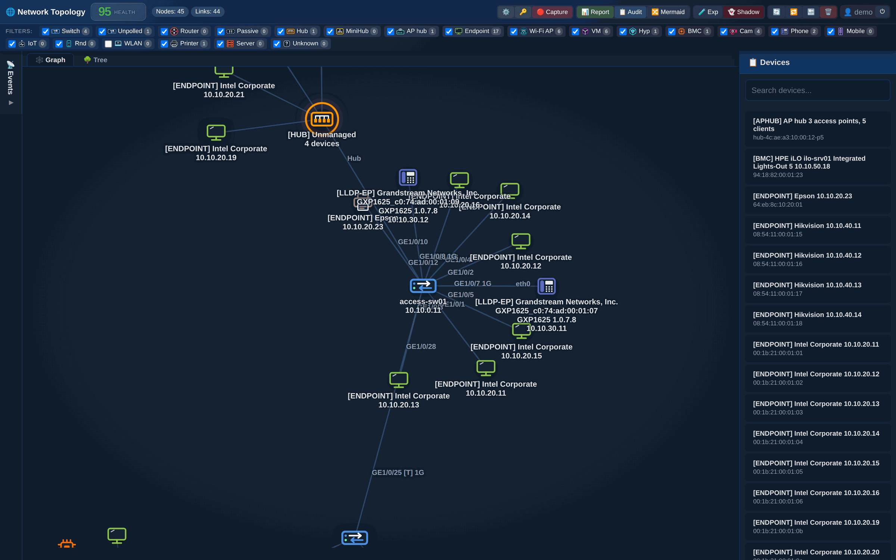
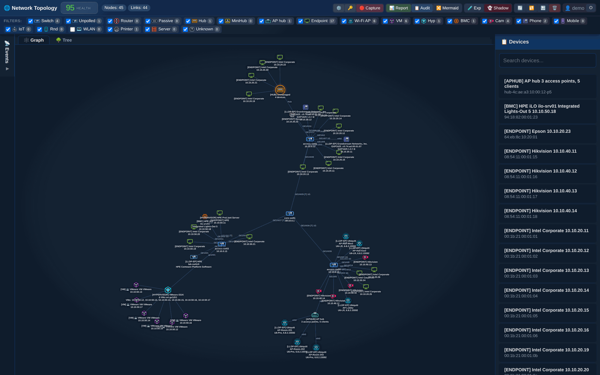
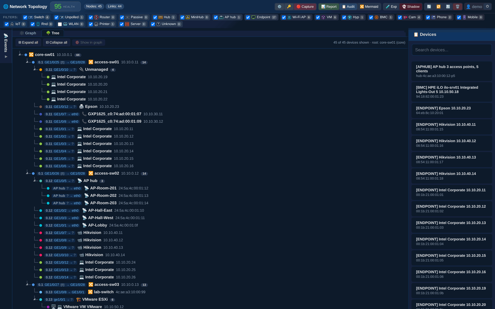
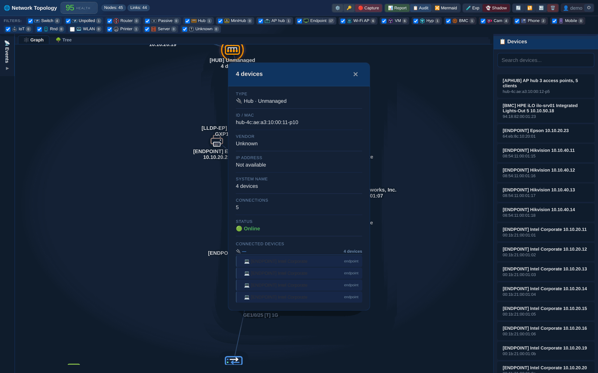
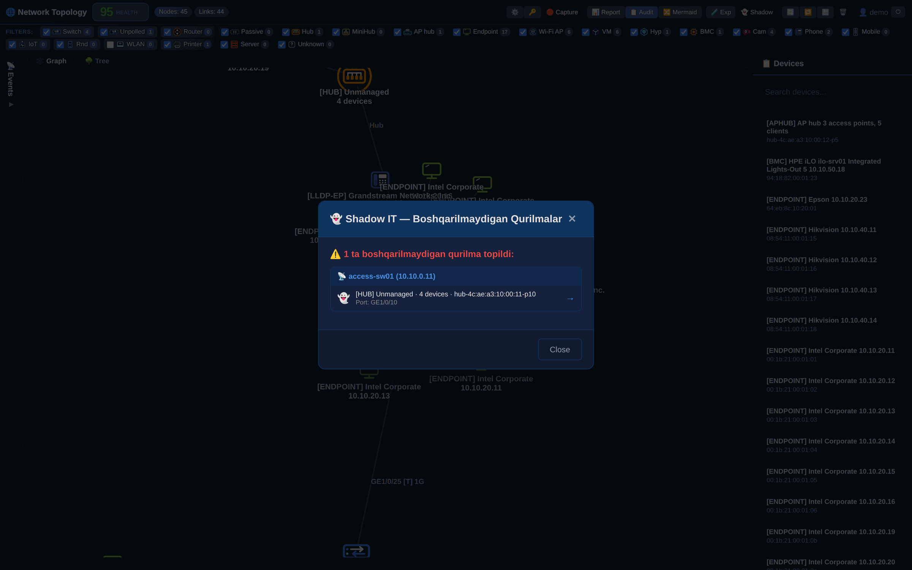
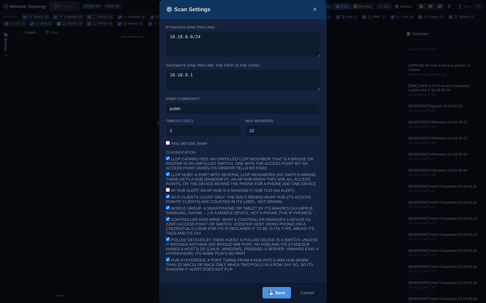

# LLDP Network Scanner

A self-hosted network mapper for switched LANs. It polls your switches over
SNMP, draws the whole network as one live graph (switches, routers, phones,
access points, cameras, servers, hypervisors and their VMs), tells what each
device is, and flags what should not be there: unmanaged switches hidden
behind a port (Shadow IT), loops, deep paths, ports that flap.

One Go binary with a built-in web UI. No agents on the devices: SNMP
read access to the switches is all it needs.



## Features

- **Topology from the switches' own tables.** LLDP neighbors, the bridge FDB,
  ARP, interfaces, VLANs and STP of every switch are merged into one graph;
  links LLDP does not show are inferred from where each switch learns the
  others' MACs.
- **Device classification.** Every node gets a group: switch, router,
  unpolled switch, access point, IP phone, mobile, camera, printer, IoT,
  server, BMC (iLO, iDRAC, XCC), hypervisor, VM, Wi-Fi client, endpoint. The
  decision is made in one place (`classifyNode`) from the MAC vendor (OUI),
  LLDP capabilities, sysName/sysDescr, controller inventories and your own
  device types.
- **Shadow IT detection.** A switch port that learns several MACs and has no
  managed switch behind it is an unmanaged hub. It is drawn as a hub node,
  raised as an alert and listed in reports. Access points behind a PoE switch
  (AP hub), VM ports and ESXi hosts are told apart so they do not raise false
  alarms.
- **Hypervisors and VMs.** VMware VM MACs on a port are grouped under their
  ESXi host. Hosts are confirmed over HTTP or from vCenter.
- **Two views.** An interactive force graph with filters, search and a
  per-device info panel, and a Tree view rooted at the core switch.
- **Port history.** Per-port traffic, errors and status changes are stored in
  InfluxDB 2 and shown on a history page for each device.
- **Health score and alerts.** A periodic analysis scores the network and
  sends critical findings to a Telegram bot.
- **Reports.** Network audit reports in Markdown, DOCX and SVG/PNG, Mermaid
  export, and saved captures of the topology over time.
- **Device modules.** UniFi Network controllers, VMware vCenter/ESXi, Kerio
  Operator PBX and Grandstream/Yealink phones. Their logins are kept in an
  encrypted Credentials vault.
- **Settings you can turn off.** Each classification rule that changed
  earlier behaviour is a checkbox in Settings → Classification.
- **Web login.** Users are bcrypt-hashed and sessions are signed.

## Screenshots

All screenshots show a synthetic demo network (addresses `10.10.x.x`), not a
real site.

| | |
|---|---|
|  **Whole network**: core, three access switches, phones, cameras, access points, an ESXi host with its VMs |  **Tree view**: every device under the core, by switch port |
|  **Info panel**: an unmanaged hub found behind port GE1/0/10 and the devices on it |  **Shadow IT list**: unmanaged hubs per switch |
|  **Settings**: scan ranges, gateways, SNMP, classification choices | |

## How it works

```
switches (SNMP) ─┐
gateways (ARP) ──┤                                   ┌─> web UI (graph, tree, history)
controllers ─────┼─> graph build ─> classification ──┼─> analyzer ─> Telegram, InfluxDB
ESXi probes ─────┘                                   └─> reports (MD, DOCX, SVG)
```

1. **Discovery.** IP ranges are scanned for SNMP agents. An agent with a
   BRIDGE-MIB port or an LLDP local chassis id is polled as a switch.
2. **Polling.** Every switch is walked with `snmpbulkwalk`: LLDP, FDB, ARP,
   interfaces, VLANs and STP. It is polled again every 5 minutes, and its
   traffic counters every 10 seconds.
3. **Graph build.** Switch nodes come first, then LLDP neighbors. Each FDB
   port is then decided by one rule (`fdbPorts`), followed by cross-switch
   links, gateways, managed access points and hypervisors. IP addresses come
   from the gateways' and switches' ARP tables.
4. **Classification.** Each node is classified when the graph data is
   served, with the current settings.
5. **Analysis.** Every minute the analyzer computes the health score and
   detects anomalies. Critical findings go to Telegram.

[`structure.md`](structure.md) is the full map of the code. It covers what
runs and when, the data flow, where each rule lives, the classification
order and how to extend it. It also has a generated index of every function
and type with its callers.

## Requirements

- Linux.
- Go 1.25 or newer (to build).
- `snmpbulkwalk` from net-snmp (`apt install snmp`) and `ping`.
- SNMP v2c read access to the switches and, for IP addresses, to the
  gateways (routers/firewalls whose ARP tables cover the LAN).
- Optional:
  - InfluxDB 2 on `localhost:8086` for port history; see
    `docker-compose.yml`.
  - Python 3 with `pypandoc` and `python-docx` for DOCX reports.
  - `pyTelegramBotAPI` and Flask for the Telegram bot.

## Build and run

```bash
go build -o lldp_scanner .

# configuration (see below)
echo '192.168.10.0/24' > swich_ips      # where the switches are
echo '192.168.10.1'    > gateway_ip     # the core router(s), first = core

# a web user (asks for the password)
./lldp_scanner --user-add admin

# first run: discovers the switches, then keeps polling
./lldp_scanner
```

Open `http://<host>:8088` and sign in.

Modes (`--mode`):

| Mode | What it does |
|---|---|
| `normal` (default) | Scans the ranges, or loads the last saved network, then keeps polling and analysing. |
| `monitor24h` | Monitoring for `--duration` (`24h`, `1h`, `30m`). Writes results to `--output`. |
| `experiment` | One full scan with all metrics saved, then exits. |
| `benchmark` | Sequential scans with 1, 10, 25, 50 and 100 workers. |

Other flags: `--workers`, `--networks` (ranges, comma-separated), `--community`.
Web users: `--user-add NAME`, `--user-del NAME`, `--user-list`.
`--vault-password` sets the password of the Credentials vault.

## Configuration

These files live in the working directory and are not tracked by git. Some
of them may hold passwords.

| File | Purpose |
|---|---|
| `swich_ips` | IP ranges to scan for switches, one CIDR per line (also editable in Settings). |
| `gateway_ip` | Gateway IPs, one per line or space/comma-separated; `#` starts a comment. The first one is the core. Their ARP tables give IP addresses. |
| `ignored_issues.json` | Findings you chose to ignore. |
| `secrets/` | Web users, session key, Credentials vault (device logins). |
| `network_data.json` | Last polls and settings, so a restart shows the map at once. |
| `mac_ip_cache.json` | MAC → IP cache. |
| `esxi_confirmed.json` | Confirmed ESXi host NICs. |
| `modules_inventory.json` | Last inventories of the controllers. |

The SNMP community, timeout, worker count and the classification choices
are set in the UI (⚙ Settings) and saved to `network_data.json`.

### Telegram alerts

`bot/analyserbot.py` listens on `127.0.0.1:5005` and forwards the analyzer's
alerts to Telegram. Set `TELEGRAM_BOT_TOKEN`, or put the token in
`bot/.bot_token`, then run `bot/run_bot.sh`. A systemd unit is included.

### Device modules

Open the 🔑 Credentials window, set a vault password, and add the logins of
your UniFi controller, vCenter, Kerio Operator or phones. The inventory
modules run every 5 minutes. They add managed access points, Wi-Fi client
counts, ESXi hosts and phone details to the graph.

## Tests

```bash
go test ./...
```

The suite takes about two minutes. It needs no network: `harness_test.go`
replaces every network and file side effect with fakes. To prove that, run
it in an empty network namespace:

```bash
unshare -rn sh -c 'ip link set lo up && go test ./...'
```

Golden files under `testdata/golden/` pin the graph, analyzer, report and
UI outputs. `go test -run NAME -update` rewrites them. Two regions are
generated from the code and checked by tests:

- the group tables in the UI and DOCX scripts (`TestGroupTables`);
- the function index in `structure.md` (`TestStructureIndex`).

## Project layout

| Path | What |
|---|---|
| `*.go` | The scanner (package `main`): polling, graph build, classification, analyzer, web server, reports. |
| `modules/` | Device modules (`unificontroller`, `vcenter`, `esxi`, `vsphere`, `keriooperator`, `voip`) and shared helpers (`kit`). |
| `static/` | The web UI: `index.html`, `app.js` (graph), `tree.js` (tree), `history.html` (port history). |
| `bot/` | Telegram bot. |
| `instrumens/` | Markdown → DOCX converters for reports. |
| `testdata/` | Fixtures and golden files. |
| `structure.md` | Code map and function index. |

Parts of the UI text and of the console output are in Uzbek.
