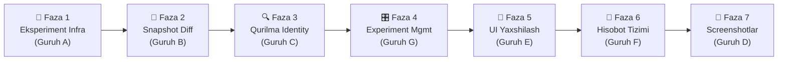

# UPGRADE REJASI — UMUMIY KO'RINISH

> **Maqsad:** `lldp_go` dasturiga qo'shiladigan barcha o'zgartirishlarni tartibli, fazma-faz amalga oshirish.
> **Fayl joylashuvi:** `code/lldp_go/`
> **Dependency tartibida** bajariladi (har bir faza oldingisiga tayanadi).

---

## Fazalar Xaritasi

---

## Fazalar Jadvali

| # | Faza | Guruh | Nima qilinadi | O'zgartiriladigan fayllar | Taxminiy vaqt |
|---|------|-------|---------------|--------------------------|---------------|
| 1 | [Eksperiment Infra](phase_1_experiment_infra.md) | **A** | Benchmark, export, timing, vendor stats | `example_usage.go`, `snmp_scanner.go`, `analyzer.go` | 1–2 kun |
| 2 | [Snapshot Diff](phase_2_snapshot_diff.md) | **B** | Diff engine, InfluxDB events, summaries | **[NEW]** `snapshot_diff.go`, `influx_client.go`, `analyzer.go`, `example_usage.go` | 1 kun |
| 3 | [Qurilma Identity](phase_3_device_identity.md) | **C** | DNS lookup, isRandomMAC, Wi-Fi kategori | `example_usage.go`/`snmp_scanner.go`, `dj_graph.go`, `static/app.js` | 0.5 kun |
| 4 | [Experiment Mgmt](phase_4_experiment_mgmt.md) | **G** | CLI flags, rejimlar, web panel | `example_usage.go`, `web_server.go`, `static/index.html` | 1 kun |
| 5 | [UI Yaxshilash](phase_5_ui_improvements.md) | **E** | Health widget, glow, legend, status bar | `static/index.html`, `static/style.css`, `static/app.js`, `web_server.go` | 1–2 kun |
| 6 | [Hisobot Tizimi](phase_6_report_system.md) | **F** | Topologiya rasmi, DOCX audit, API | **[NEW]** `report_topology.go`, `web_server.go`, `analyzer.go` | 1–2 kun |
| 7 | [Screenshotlar](phase_7_screenshots.md) | **D** | Interfeys, Telegram, DOCX, InfluxDB screenshots | — (kod o'zgartirish yo'q) | 0.5 kun |

**Jami taxminiy vaqt:** 6–9 kun

---

## Ishlash Qoidalari

1. **Ketma-ketlik muhim** — Faza 2 ni boshlamasdan Faza 1 tugashi kerak
2. **Har bir faza mustaqil test qilinadi** — `go build` muvaffaqiyatli bo'lishi shart
3. **Natijalar `results/` papkasida** — barcha JSON eksportlar shu yerda
4. **Asl `upgrade.md` saqlanadi** — arxiv sifatida

---

## Asl Guruhlardan Fazalarga Mapping

| Asl Guruh | Faza | Izoh |
|-----------|------|------|
| A (Eksperiment Infra) | Faza 1 | To'liq |
| B (Snapshot Diff) | Faza 2 | To'liq |
| C (Qurilma Identity) | Faza 3 | To'liq |
| G (Eksperiment Mgmt) | Faza 4 | G dan oldin C kerak (CLI monitor24h Snapshot ni ishlatadi) |
| E (UI Yaxshilash) | Faza 5 | E dan oldin C (hostname) va B (diff panel) kerak |
| F (Hisobot Tizimi) | Faza 6 | F barcha oldingi fazalarga bog'liq |
| D (Screenshotlar) | Faza 7 | Barcha kod o'zgartirishlardan keyin |

> **Izoh:** Asl `upgrade.md` dagi tartib A → B → C → G → E → F edi. Biz aynan shu tartibni saqladik, faqat D ni oxiriga qo'ydik.
