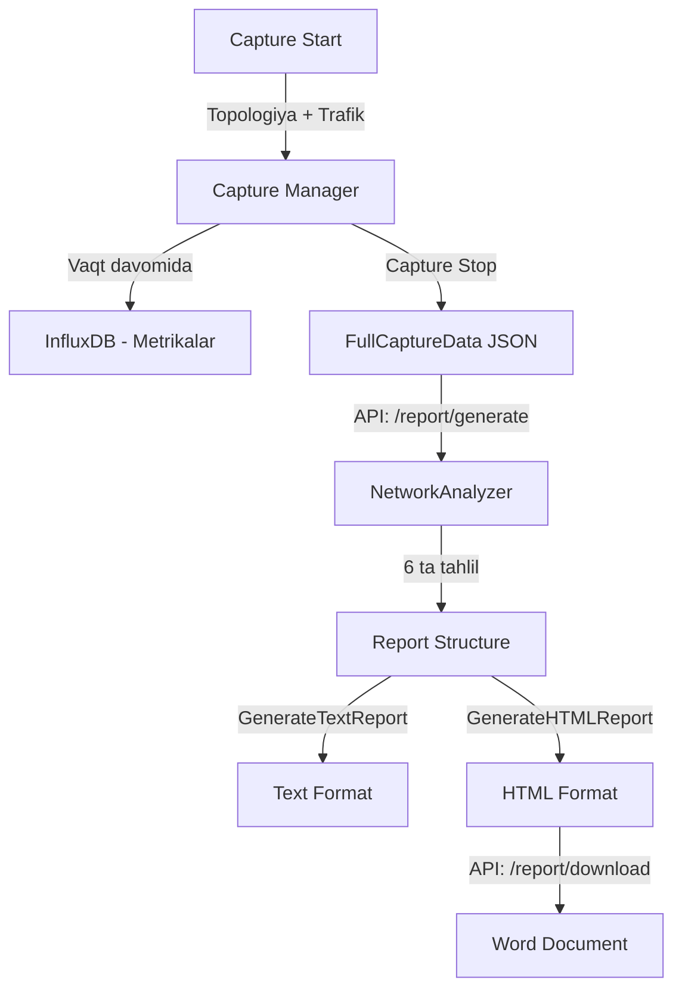

# Hisobot Yaratish Funksiyasi - Texnik Hujjat

## Kirish

Loyihadagi hisobot yaratish tizimi tarmoq holatini to'liq tahlil qilib, foydalanuvchiga batafsil hisobot taqdim etish uchun mo'ljallangan. Tizim tarmoq ma'lumotlarini yig'adi, tahlil qiladi va turli formatlarda (JSON, TEXT, HTML, Word) hisobot yaratadi.

---

## Arxitektura va Oqim

### Umumiy Ishlash Tartibi



### Asosiy Komponentlar

1. **CaptureManager** - Ma'lumotlarni yig'ish va saqlash
2. **NetworkAnalyzer** - Tahlil qilish
3. **Report Generator** - Hisobot yaratish
4. **Web API** - Foydalanuvchi interfeysi

---

## 1. Ma'lumotlar Tuzilmasi

### FullCaptureData - To'liq Ma'lumotlar Paketi

```go
type FullCaptureData struct {
    Session     CaptureSession    `json:"session"`      // Sessiya metama'lumotlari
    Topology    GraphData         `json:"topology"`     // Tarmoq topologiyasi
    Metrics     []TrafficMetrics  `json:"metrics"`      // Trafik ko'rsatkichlari
    Events      []StatusEvent     `json:"events"`       // Status o'zgarishlari
    DevicesData []DeviceData      `json:"devices_data"` // Qurilma ma'lumotlari
}
```

**Har bir maydon:**

#### CaptureSession
```go
type CaptureSession struct {
    ID        string    `json:"id"`         // UUID - noyob identifikator
    Name      string    `json:"name"`       // Foydalanuvchi beradigan nom
    StartTime time.Time `json:"start_time"` // Boshlanish vaqti
    EndTime   time.Time `json:"end_time"`   // Tugash vaqti
    Config    string    `json:"config"`     // Konfiguratsiya
    Status    string    `json:"status"`     // "running", "completed", "failed"
}
```

#### TrafficMetrics - Trafik Ma'lumotlari
```go
type TrafficMetrics struct {
    Timestamp   time.Time `json:"timestamp"`    // Vaqt belgisi
    DeviceIP    string    `json:"device_ip"`    // Qurilma IP
    Interface   string    `json:"interface"`    // Interface nomi (e.g., "Gi0/1")
    InBps       uint64    `json:"in_bps"`       // Kiruvchi trafik (bit/sekund)
    OutBps      uint64    `json:"out_bps"`      // Chiquvchi trafik (bit/sekund)
    InDiscards  uint64    `json:"in_discards"`  // Tushirilgan paketlar (kiruvchi)
    OutDiscards uint64    `json:"out_discards"` // Tushirilgan paketlar (chiquvchi)
    InErrors    uint64    `json:"in_errors"`    // Xatolar (kiruvchi)
    OutErrors   uint64    `json:"out_errors"`   // Xatolar (chiquvchi)
    OperStatus  int       `json:"oper_status"`  // 1=Up, 2=Down
}
```

#### StatusEvent - Hodisalar
```go
type StatusEvent struct {
    Timestamp   time.Time `json:"timestamp"`   // Qachon sodir bo'lgan
    DeviceIP    string    `json:"device_ip"`   // Qaysi qurilmada
    Interface   string    `json:"interface"`   // Qaysi interface
    OldStatus   int       `json:"old_status"`  // Oldingi status
    NewStatus   int       `json:"new_status"`  // Yangi status
    Description string    `json:"description"` // Tavsif
}
```

### Report - Hisobot Strukturasi

```go
type Report struct {
    SessionID   string                   `json:"session_id"`   // Qaysi sessiyaga tegishli
    GeneratedAt time.Time                `json:"generated_at"` // Yaratilgan vaqt
    Summary     map[string]int           `json:"summary"`      // Xulosa statistikasi
    Suggestions []OptimizationSuggestion `json:"suggestions"`  // Tavsiyalar ro'yxati
    Nodes       []GraphNode              `json:"nodes"`        // Tarmoq node'lari
    HealthScore int                      `json:"health_score"` // Sog'liq balli (0-100)
}
```

### OptimizationSuggestion - Tavsiya

```go
type OptimizationSuggestion struct {
    IssueID     string `json:"issue_id"`     // Unikal muammo ID (cooldown va ignore uchun)
    Type        string `json:"type"`        // Muammo turi
    Severity    string `json:"severity"`    // Jiddiylik darajasi
    Device      string `json:"device"`      // Qaysi qurilma
    Description string `json:"description"` // Batafsil tavsif
    Value       string `json:"value"`       // Metrika qiymati
}
```

**Tavsiya turlari:**
- `path` - Yo'l optimallashtiruvi
- `congestion` - Tiqilinch muammosi
- `stability` - Barqarorlik muammosi
- `shadow_it` - Noqonuniy qurilmalar
- `stp` - STP konfiguratsiya muammosi
- `physical` - Fizik muammolar (kabel, SFP)
- `loopback` - Port loop aniqlandi (LLDP self-neighbor yoki MAC self-reference)

**Jiddiylik darajalari:**
- `high` - Yuqori (🔴 qizil)
- `medium` - O'rtacha (🟠 sariq)
- `low` - Past (ℹ️ ko'k)

---

## 2. Tahlil Algoritmlari

### NetworkAnalyzer.Analyze() - Asosiy Tahlil

Bu funksiya 6 ta turli tahlilni bajaradi:

```go
func (na *NetworkAnalyzer) Analyze() Report {
    // 1. Path Analysis - Yo'l tahlili
    pathSuggestions := na.analyzePaths()
    
    // 2. Congestion Analysis - Tiqilinch tahlili
    congestionSuggestions := na.analyzeCongestion()
    
    // 3. Stability Analysis - Barqarorlik tahlili
    stabilitySuggestions := na.analyzeStability()
    
    // 4. Shadow IT Detection - Noqonuniy qurilmalar
    shadowITSuggestions := na.analyzeShadowIT()
    
    // 5. STP Analysis - STP tahlili
    stpSuggestions := na.analyzeSTP()
    
    // 6. Loopback Detection - Loop aniqlash
    loopbackSuggestions := na.analyzeLoopback()
    
    // Health Score hisoblash
    report.HealthScore = na.CalculateHealthScore(&report)
    
    // Telegram notification (per-issue, 1h cooldown)
    na.notifyTelegramIfCritical(&report)
    
    return report
}
```

### Avtomatik Trigger - startPeriodicAnalysis()

`Analyze()` funksiyasi faqat capture sessiyada emas, har **60 sekundda** ham avtomatik chaqiriladi:

```go
func startPeriodicAnalysis() {
    ticker := time.NewTicker(60 * time.Second)
    for range ticker.C {
        // collectedData + globalGraph dan FullCaptureData yaratib
        analyzer := NewAnalyzer(fullData)
        analyzer.Analyze() // -> notifyTelegramIfCritical() chaqiriladi
    }
}
```

Bu orqali dastur ishlayotgan vaqtda **yangi muammolar paydo bo'lsa darhol Telegramga xabar** ketadi.

### 2.1 Path Analysis - Yo'l Tahlili

**Maqsad:** Core switchdan boshqa qurilmalargacha bo'lgan yo'lni tekshirish

**Algoritm:**
1. Graf tuzilmasini qayta qurish
2. Core switch topish (odatda 172.20.1.254)
3. BFS algoritmi bilan chuqurliklarni hisoblash
4. 3+ hop masofadagi qurilmalarni aniqlash

**Kod:**
```go
func (na *NetworkAnalyzer) analyzePaths() []OptimizationSuggestion {
    // Graf qurish
    graph := NewDJGraph()
    for _, node := range na.Data.Topology.Nodes {
        graph.AddNode(node.ID)
    }
    for _, link := range na.Data.Topology.Links {
        graph.AddEdge(link.Source, link.Target, link.Label)
    }
    
    // Core'dan uzoq qurilmalarni topish
    longPaths := graph.GetLongPaths(coreID, 3) // 3 hop chegarasi
    
    // Har biri uchun tavsiya yaratish
    for _, nodeID := range longPaths {
        suggestions = append(suggestions, OptimizationSuggestion{
            Type:        "path",
            Severity:    "medium",
            Device:      nodeID,
            Description: "Device is too far from Core. Consider moving to Distribution layer.",
            Value:       "4+ hops",
        })
    }
}
```

### 2.2 Congestion Analysis - Tiqilinch Tahlili

**Maqsad:** Interface yuklanishini va paket yo'qotishlarini aniqlash

**Algoritmlar:**

#### A. Bandwidth Utilization (Tarmoqdan foydalanish)
```go
const capacity1G = 1000.0 * 1000 * 1000  // 1 Gbps (bit/s)
const threshold = capacity1G * 0.8       // 800 Mbps (80%)

for _, metric := range na.Data.Metrics {
    totalBps := metric.InBps + metric.OutBps
    
    if float64(totalBps) > threshold {
        // CRITICAL: 80% dan ko'p yuklanish
        suggestions = append(suggestions, OptimizationSuggestion{
            Type:        "congestion",
            Severity:    "high",
            Description: "Traffic exceeds 800Mbps. Upgrade link or balance traffic.",
            Value:       fmt.Sprintf("%.2f Mbps", totalBps/1000000),
        })
    }
}
```

#### B. Packet Loss Detection (Paket yo'qotish)
```go
if metric.InDiscards > 0 || metric.OutDiscards > 0 {
    discards := metric.InDiscards + metric.OutDiscards
    suggestions = append(suggestions, OptimizationSuggestion{
        Type:        "congestion",
        Severity:    "medium",
        Description: "Packet Loss detected. Network is congested.",
        Value:       fmt.Sprintf("%d drops", discards),
    })
}
```

#### C. Physical Errors (Fizik xatolar)
```go
if metric.InErrors > 0 || metric.OutErrors > 0 {
    errors := metric.InErrors + metric.OutErrors
    suggestions = append(suggestions, OptimizationSuggestion{
        Type:        "physical",
        Severity:    "high",
        Description: "CRC/Frame errors detected. Check cable/SFP immediately.",
        Value:       fmt.Sprintf("%d errors", errors),
    })
}
```

### 2.3 Stability Analysis - Barqarorlik Tahlili

**Maqsad:** Interface statusining tez-tez o'zgarishini (flapping) aniqlash

**Algoritm:**
```go
func (na *NetworkAnalyzer) analyzeStability() []OptimizationSuggestion {
    // Interface statusining necha marta o'zgarganini sanash
    flapping := make(map[string]int)
    
    for _, event := range na.Data.Events {
        key := fmt.Sprintf("%s|%s", event.DeviceIP, event.Interface)
        // Faqat Down hodisalarini sanash
        if event.NewStatus == 2 {  // 2 = Down
            flapping[key]++
        }
    }
    
    // Har bir beqaror interface uchun tavsiya
    for key, count := range flapping {
        suggestions = append(suggestions, OptimizationSuggestion{
            Type:        "stability",
            Severity:    "high",
            Description: fmt.Sprintf("Interface went DOWN %d times.", count),
            Value:       fmt.Sprintf("%d outages", count),
        })
    }
}
```

### 2.4 Shadow IT Detection - Noqonuniy Qurilmalar

**Maqsad:** Unmanaged (boshqarilmaydigan) switchlarni topish

**Port-MAC Ratio Algoritmi:**
```go
func (na *NetworkAnalyzer) analyzeShadowIT() []OptimizationSuggestion {
    // 1. Port-MAC mapping yaratish
    portMACs := make(map[string]map[int][]string)
    
    for _, device := range na.Data.DevicesData {
        for _, macEntry := range device.MACTable {
            portMACs[device.IP][macEntry.PortNumber] = append(
                portMACs[device.IP][macEntry.PortNumber],
                macEntry.MACAddress,
            )
        }
    }
    
    // 2. Har bir portni tekshirish
    for deviceIP, ports := range portMACs {
        for portNum, macs := range ports {
            // Agar 2+ MAC address bor va trunk emas bo'lsa
            if len(macs) > 1 && !isTrunk(deviceIP, portNum) {
                suggestions = append(suggestions, OptimizationSuggestion{
                    Type:        "shadow_it",
                    Severity:    "high",
                    Description: fmt.Sprintf(
                        "Port %d has %d MAC addresses. Likely UNMANAGED SWITCH.",
                        portNum, len(macs),
                    ),
                    Value: fmt.Sprintf("%d MACs on single port", len(macs)),
                })
            }
        }
    }
}
```

**Mantiq:**
- Agar bitta portda 2+ MAC address ko'rinsa
- Va bu port trunk emas bo'lsa (VLAN aggregation)
- Demak, bu portga unmanaged switch ulangan

### 2.5 STP Analysis - Spanning Tree Protocol

**Maqsad:** STP Root Bridge to'g'ri konfiguratsiya qilinganligini tekshirish

**Algoritm:**
```go
func (na *NetworkAnalyzer) analyzeSTP() []OptimizationSuggestion {
    // 1. Barcha qurilmalardan Root Bridge'ni topish
    rootBridgeIDs := make(map[string][]string)
    
    for _, device := range na.Data.DevicesData {
        if device.STPInfo.Enabled && device.STPInfo.RootBridgeID != "" {
            rootBridgeIDs[device.STPInfo.RootBridgeID] = append(
                rootBridgeIDs[device.STPInfo.RootBridgeID],
                device.IP,
            )
        }
    }
    
    // 2. Root Bridge Core'da ekanligini tekshirish
    for rootMAC, devices := range rootBridgeIDs {
        isCore := checkIfDeviceIsCore(rootMAC)
        
        if !isCore {
            suggestions = append(suggestions, OptimizationSuggestion{
                Type:        "stp",
                Severity:    "high",
                Description: "STP Root Bridge is NOT on Core switch! " +
                           "Set priority on Core to make it Root.",
                Value: fmt.Sprintf("Seen by %d devices", len(devices)),
            })
        }
    }
}
```

**Muammo:** Agar Root Bridge Core'da bo'lmasa, barcha trafik noto'g'ri yo'llardan o'tadi.

### 2.6 Loopback Detection - Loop Aniqlash

**Maqsad:** Port loopback'larni aniqlash (kabelning o'sha switchga qaytib ulanishi)

**2 ta usul:**

#### A. LLDP Self-Neighbor
```go
// Switch o'z ChassisID sini qo'shni sifatida ko'rsa = loop
for _, neighbor := range device.Neighbors {
    if strings.ToLower(neighbor.RemChassisId) == chassisMAC {
        // LOOPBACK aniqlandi!
    }
}
```

#### B. MAC Self-Reference
```go
// Switch o'z MAC manzilini access portda ko'rsa = loop
for _, macEntry := range device.MACTable {
    if strings.ToLower(macEntry.MACAddress) == chassisMAC && !isTrunk {
        // LOOPBACK aniqlandi!
    }
}
```

**Jarima:** Har bir loopback uchun **-20 ball** (eng jiddiy muammo!)

### 2.6 Health Score Calculation - Sog'liq Balli

**Formula:**
```go
func (na *NetworkAnalyzer) CalculateHealthScore(report *Report) int {
    score := 100  // Boshlang'ich ball
    
    // Har bir muammo uchun ball ayirish
    for _, sugg := range report.Suggestions {
        switch sugg.Type {
        case "shadow_it":
            score -= 10  // Har bir unmanaged switch: -10
        case "congestion":
            if sugg.Severity == "high" {
                score -= 5  // Kritik tiqilinch: -5
            } else {
                score -= 2  // O'rtacha tiqilinch: -2
            }
        case "physical":
            score -= 2  // CRC/xatolar: -2
        case "stp":
            score -= 15 // STP muammosi: -15
        case "path":
            score -= 2  // Uzun yo'l: -2
        case "stability":
            score -= 3  // Flapping: -3
        case "loopback":
            score -= 20 // Loop aniqlandi: -20 (eng jiddiy!)
        }
    }
    
    if score < 0 {
        score = 0
    }
    
    return score
}
```

**Ball talqini:**
```go
func GetHealthLabel(score int) string {
    if score >= 90 {
        return "Excellent"  // Ajoyib
    } else if score >= 70 {
        return "Good"       // Yaxshi
    } else if score >= 50 {
        return "Fair"       // O'rtacha
    } else if score >= 30 {
        return "Poor"       // Yomon
    }
    return "Critical"       // Kritik
}
```

---

## 3. Hisobot Generatsiyasi

### 3.1 Text Report - Matnli Hisobot

```go
func (r *Report) GenerateTextReport() string {
    var sb strings.Builder
    
    // Header
    sb.WriteString("NETWORK ANALYSIS REPORT\n")
    sb.WriteString(fmt.Sprintf("Session: %s\n", r.SessionID))
    sb.WriteString(fmt.Sprintf("Generated: %s\n", r.GeneratedAt.Format(time.RFC1123)))
    
    // Summary
    sb.WriteString("SUMMARY:\n")
    sb.WriteString(fmt.Sprintf("- Path Issues: %d\n", r.Summary["path_issues"]))
    sb.WriteString(fmt.Sprintf("- Congestion Issues: %d\n", r.Summary["congestion_issues"]))
    sb.WriteString(fmt.Sprintf("- Stability Issues: %d\n", r.Summary["stability_issues"]))
    
    // Recommendations
    for i, sugg := range r.Suggestions {
        icon := "ℹ️"
        if sugg.Severity == "high" {
            icon = "🔴"
        } else if sugg.Severity == "medium" {
            icon = "🟠"
        }
        
        sb.WriteString(fmt.Sprintf("%d. %s [%s] %s\n", 
            i+1, icon, sugg.Type, sugg.Device))
        sb.WriteString(fmt.Sprintf("   Problem: %s\n", sugg.Description))
        sb.WriteString(fmt.Sprintf("   Metric: %s\n\n", sugg.Value))
    }
    
    return sb.String()
}
```

**Natija:**
```
NETWORK ANALYSIS REPORT
Session: fa7c94b3-ee26-4fe5-8aee-d4159364602e
Generated: Fri, 14 Feb 2026 10:00:00 UTC
--------------------------------------------------

SUMMARY:
- Path Optimization Issues: 2
- Congestion/Traffic Issues: 5
- Stability/Outage Issues: 1

DETAILED RECOMMENDATIONS:

1. 🔴 [CONGESTION] 172.20.254.10
   Problem: CRITICAL: Traffic on Gi0/24 exceeds 800Mbps
   Metric: 875.32 Mbps

2. 🔴 [SHADOW_IT] 172.20.254.15
   Problem: Port 12 has 5 MAC addresses. Likely UNMANAGED SWITCH
   Metric: 5 MACs on single port
```

### 3.2 HTML Report - HTML Hisobot

**Xususiyatlar:**
- Professional dizayn (Microsoft Word uchun)
- Rangli jadvallar
- Health Score visualizatsiya
- UTF-8 BOM qo'llab-quvvatlash

```go
func (r *Report) GenerateHTMLReport() string {
    var sb strings.Builder
    
    // HTML Header with Office namespace
    sb.WriteString(`
<html xmlns:o='urn:schemas-microsoft-com:office:office' 
      xmlns:w='urn:schemas-microsoft-com:office:word'>
<head>
    <meta charset="utf-8">
    <title>Network Analysis Report</title>
    <style>
        body { font-family: 'Calibri', 'Arial', sans-serif; }
        h1 { color: #2E74B5; border-bottom: 2px solid #2E74B5; }
        table { width: 100%; border-collapse: collapse; }
        th { background-color: #2E74B5; color: white; }
        .severity-high { color: #D32F2F; font-weight: bold; }
        .severity-medium { color: #EF6C00; font-weight: bold; }
    </style>
</head>
<body>
`)
    
    // Health Score Box
    healthColor := "#4CAF50"  // Green
    if r.HealthScore < 50 {
        healthColor = "#D32F2F"  // Red
    }
    sb.WriteString(fmt.Sprintf(`
<div style='background-color: %s; color: white; padding: 20px;'>
    <h2>Network Health Score: %d / 100</h2>
    <p>%s</p>
</div>
`, healthColor, r.HealthScore, GetHealthLabel(r.HealthScore)))
    
    // Summary Table
    sb.WriteString(`<table>
<tr><td>Path Issues</td><td>` + fmt.Sprintf("%d", r.Summary["path_issues"]) + `</td></tr>
<tr><td>Congestion Issues</td><td>` + fmt.Sprintf("%d", r.Summary["congestion_issues"]) + `</td></tr>
<tr><td>Shadow IT</td><td>` + fmt.Sprintf("%d", r.Summary["shadow_it_issues"]) + `</td></tr>
</table>`)
    
    // Recommendations Table
    sb.WriteString(`<table>
<thead>
    <tr>
        <th>Severity</th>
        <th>Type</th>
        <th>Device</th>
        <th>Issue</th>
        <th>Metric</th>
    </tr>
</thead>
<tbody>`)
    
    for _, sugg := range r.Suggestions {
        severityClass := ""
        if sugg.Severity == "high" {
            severityClass = "severity-high"
        }
        
        sb.WriteString(fmt.Sprintf(`
<tr>
    <td class='%s'>%s</td>
    <td>%s</td>
    <td>%s</td>
    <td>%s</td>
    <td>%s</td>
</tr>`, severityClass, sugg.Severity, sugg.Type, 
            sugg.Device, sugg.Description, sugg.Value))
    }
    
    sb.WriteString("</tbody></table></body></html>")
    return sb.String()
}
```

---

## 4. Web API Endpoints

### 4.1 POST /api/report/generate?id=SESSION_ID

**Maqsad:** Capture sessiyasi uchun hisobot yaratish

**Request:**
```http
POST /api/report/generate?id=fa7c94b3-ee26-4fe5-8aee-d4159364602e
Content-Type: application/json
```

**Response:**
```json
{
  "report": {
    "session_id": "fa7c94b3-ee26-4fe5-8aee-d4159364602e",
    "generated_at": "2026-02-14T10:00:00Z",
    "health_score": 73,
    "summary": {
      "path_issues": 2,
      "congestion_issues": 5,
      "stability_issues": 1,
      "shadow_it_issues": 1,
      "stp_issues": 0,
      "loopback_issues": 0
    },
    "suggestions": [
      {
        "type": "congestion",
        "severity": "high",
        "device": "172.20.254.10",
        "description": "CRITICAL: Traffic on Gi0/24 exceeds 800Mbps",
        "value": "875.32 Mbps"
      }
    ]
  },
  "text_summary": "NETWORK ANALYSIS REPORT\n..."
}
```

**Kod:**
```go
func reportGenerateHandler(w http.ResponseWriter, r *http.Request) {
    sessionID := r.URL.Query().Get("id")
    
    // 1. Fayldan yuklash
    filename := fmt.Sprintf("captures/%s_full_data.json", sessionID)
    file, err := os.Open(filename)
    if err != nil {
        http.Error(w, "Session not found", http.StatusNotFound)
        return
    }
    defer file.Close()
    
    // 2. JSON decode qilish
    var fullData FullCaptureData
    json.NewDecoder(file).Decode(&fullData)
    
    // 3. Analyzer yaratish va tahlil qilish
    analyzer := NewAnalyzer(fullData)
    report := analyzer.Analyze()
    
    // 4. Text report generatsiya
    textReport := report.GenerateTextReport()
    
    // 5. Response yuborish
    json.NewEncoder(w).Encode(map[string]interface{}{
        "report":       report,
        "text_summary": textReport,
    })
}
```

### 4.2 GET /api/report/download?id=SESSION_ID

**Maqsad:** Hisobotni Word (.doc) formatida yuklab olish

**Request:**
```http
GET /api/report/download?id=fa7c94b3-ee26-4fe5-8aee-d4159364602e
```

**Response Headers:**
```
Content-Type: application/msword
Content-Disposition: attachment; filename="Network_Report_fa7c94b3.doc"
```

**Kod:**
```go
func reportDownloadHandler(w http.ResponseWriter, r *http.Request) {
    sessionID := r.URL.Query().Get("id")
    
    // 1. Ma'lumotlarni yuklash
    filename := fmt.Sprintf("captures/%s_full_data.json", sessionID)
    file, err := os.Open(filename)
    defer file.Close()
    
    var fullData FullCaptureData
    json.NewDecoder(file).Decode(&fullData)
    
    // 2. HTML hisobot yaratish
    analyzer := NewAnalyzer(fullData)
    report := analyzer.Analyze()
    htmlContent := report.GenerateHTMLReport()
    
    // 3. Word fayl sifatida yuborish
    w.Header().Set("Content-Type", "application/msword")
    w.Header().Set("Content-Disposition", 
        fmt.Sprintf("attachment; filename=\"Network_Report_%s.doc\"", sessionID))
    
    // UTF-8 BOM yozish (Word uchun)
    w.Write([]byte("\xEF\xBB\xBF"))
    w.Write([]byte(htmlContent))
}
```

**Muhim:** UTF-8 BOM (`\xEF\xBB\xBF`) Word-ning kirill harflarni to'g'ri ko'rsatishi uchun zarur.

### 4.3 POST /api/issue/action

**Maqsad:** Shadow IT yoki Loopback muammosini ignore yoki verify qilish

**Request:**
```json
{
    "action": "ignore",
    "issue_id": "shadow_172_20_254_10_12"
}
```

**Actions:**
- `ignore` — Muammoni `ignored_issues.json` ga qo'shib, boshqa xabar yuborilmaydi
- `verify` — Muammoni ignore listdan olib, cooldown tozalab, rescan boshlaydi

**Response:**
```json
{"status": "ok", "message": "Issue ignored"}
```

---

## 5. To'liq Ishlatish Misoli

### Frontend'dan Foydalanish (JavaScript)

```javascript
// 1. Capture boshlash
async function startCapture() {
    const response = await fetch('/api/capture/start?name=Morning Scan', {
        method: 'POST'
    });
    const data = await response.json();
    console.log('Session ID:', data.session_id);
    return data.session_id;
}

// 2. Vaqt kutish...

// 3. Capture to'xtatish
async function stopCapture() {
    const response = await fetch('/api/capture/stop', {
        method: 'POST'
    });
    const data = await response.json();
    return data.session_id;
}

// 4. Hisobot yaratish
async function generateReport(sessionId) {
    const response = await fetch(`/api/report/generate?id=${sessionId}`, {
        method: 'POST'
    });
    const report = await response.json();
    console.log('Health Score:', report.report.health_score);
    console.log('Issues:', report.report.suggestions);
    return report;
}

// 5. Word hisobotni yuklab olish
function downloadReport(sessionId) {
    window.location.href = `/api/report/download?id=${sessionId}`;
}

// To'liq workflow
async function fullWorkflow() {
    // Capture boshlash
    const sessionId = await startCapture();
    
    // 30 daqiqa kutish
    await new Promise(resolve => setTimeout(resolve, 30 * 60 * 1000));
    
    // To'xtatish
    await stopCapture();
    
    // Hisobot yaratish
    const report = await generateReport(sessionId);
    
    // Ko'rsatish
    displayReport(report);
    
    // Yuklab olish
    downloadReport(sessionId);
}
```

---

## 6. Fayl Tuzilmasi

```
lldp_go/
├── analyzer.go               # Tahlil algoritmlari
│   ├── NetworkAnalyzer       # Asosiy analyzer struktura
│   ├── analyzePaths()        # Yo'l tahlili
│   ├── analyzeCongestion()   # Tiqilinch tahlili
│   ├── analyzeStability()    # Barqarorlik tahlili
│   ├── analyzeShadowIT()     # Shadow IT aniqlash
│   ├── analyzeSTP()          # STP tahlili
│   ├── CalculateHealthScore()# Sog'liq balli
│   ├── GenerateTextReport()  # Text format
│   └── GenerateHTMLReport()  # HTML/Word format
│
├── capture.go                # Capture boshqaruvi
│   ├── CaptureManager        # Sessiya boshqaruvchisi
│   ├── StartCapture()        # Boshlash
│   ├── StopCapture()         # To'xtatish
│   └── fetchSessionData()    # InfluxDB'dan olish
│
├── web_server.go             # API endpoints
│   ├── reportGenerateHandler()  # POST /api/report/generate
│   └── reportDownloadHandler()  # GET /api/report/download
│
└── captures/                 # Saqlangan sessionlar
    └── <uuid>_full_data.json
```

---

## 7. Xulosa va Tavsiyalar

### Tizimning Kuchli Tomonlari

✅ **To'liq tahlil** - 6 ta turli tahlil algoritmi (Path, Congestion, Stability, Shadow IT, STP, Loopback)
✅ **Health Score** - Obyektiv baholash tizimi
✅ **Ko'p formatda eksport** - JSON, Text, HTML, Word
✅ **Real-time ma'lumotlar** - InfluxDB integratsiyasi
✅ **Professional dizayn** - Word-ga mos HTML
✅ **RESTful API** - Oson integratsiya
✅ **Telegram Bot** - Real-time alertlar (per-issue, 1h cooldown, Ignore/Fixed tugmalar)
✅ **VM/Hypervisor aniqlash** - OS fingerprinting (TTL + LLDP + MAC)
✅ **Loopback aniqlash** - LLDP self-neighbor va MAC self-reference

### Kelajakdagi Yaxshilanishlar

🔧 **PDF eksport** - To'g'ridan-to'g'ri PDF yaratish
🔧 **Email yuborish** - Avtomatik hisobot jo'natish
🔧 **Tarixiy taqqoslash** - Oldingi hisobotlar bilan solishtirish
🔧 **Custom threshold'lar** - Foydalanuvchi sozlamalari
🔧 **Grafik visualizatsiya** - Chart.js integratsiyasi
🔧 **Trend analysis** - Vaqt o'tishi bo'yicha tahlil
🔧 **Alertlar** - Avtomatik ogohlantirishlar

---

**Yaratilgan:** 2026-02-14  
**Versiya:** 1.0  
**Muallif:** Technical Documentation Team
