# TARMOQ AUDIT HISOBOTI

Sana: 2026-03-25 06:13

Tizim: LLDP Network Scanner v2.0

## 1. Umumiy Ma'lumot

| Parametr | Qiymat |
|---|---|
| Skanerlash vaqti | 2026-03-25 06:13 |
| Topilgan qurilmalar (SNMP) | 67 |
| Noyob MAC manzillar | 67257 |

## 2. Tarmoq Sog'ligi

**70/100** — Good

| Anomaliya turi | Soni |
|---|---|

## 3. Topologiya Sxemasi

```mermaid
graph TD
  D_1_2172_20_230_48["D 1-2
172.20.230.48"]
  HPE172_20_254_10["HPE
172.20.254.10"]
  HPE172_20_230_82["HPE
172.20.230.82"]
  C_424a172_20_230_4["C 424/a
172.20.230.4"]
  HP172_20_254_247["HP
172.20.254.247"]
  MEDIA_MARKAZ172_20_230_37["MEDIA MARKAZ
172.20.230.37"]
  HPE172_20_230_14["HPE
172.20.230.14"]
  HPE172_20_230_5["HPE
172.20.230.5"]
  HUAWEI172_20_254_249["HUAWEI
172.20.254.249"]
  HPE172_20_230_41["HPE
172.20.230.41"]
  HPE172_20_253_11["HPE
172.20.253.11"]
  HPE172_20_230_39["HPE
172.20.230.39"]
  F_9172_20_240_12["F-9
172.20.240.12"]
  HPE172_20_230_43["HPE
172.20.230.43"]
  Jamic172_20_254_226["Jamic
172.20.254.226"]
  HPE172_20_230_9["HPE
172.20.230.9"]
  D_1172_20_230_3["D - 1
172.20.230.3"]
  F_2172_20_240_14["F-2
172.20.240.14"]
  HP172_20_254_204["HP
172.20.254.204"]
  HPE172_20_230_36["HPE
172.20.230.36"]
  HP172_20_254_223["HP
172.20.254.223"]
  HPE172_20_230_241["HPE
172.20.230.241"]
  A_220172_20_230_49["A 220
172.20.230.49"]
  HPE172_20_230_81["HPE
172.20.230.81"]
  HPE172_20_230_240["HPE
172.20.230.240"]
  A_3_Etaj172_20_230_46["A 3 Etaj
172.20.230.46"]
  TTJ_34172_20_230_23["TTJ-3&4
172.20.230.23"]
  A_332172_20_230_8["A-332
172.20.230.8"]
  A_Mobil172_20_230_50["A Mobil
172.20.230.50"]
  B_3182172_20_230_11["B-318/2
172.20.230.11"]
  HPE172_20_230_2["HPE
172.20.230.2"]
  HPE172_20_230_35["HPE
172.20.230.35"]
  HPE172_20_254_199["HPE
172.20.254.199"]
  A_RRT_Kalidor172_20_230_42["A RRT Kalidor
172.20.230.42"]
  B_423172_20_230_15["B-423
172.20.230.15"]
  HPE172_20_254_202["HPE
172.20.254.202"]
  B_3183172_20_230_1["B-318/3
172.20.230.1"]
  HPE172_20_230_7["HPE
172.20.230.7"]
  B_3181172_20_230_13["B-318/1
172.20.230.13"]
  HPE172_20_253_10["HPE
172.20.253.10"]
  HPE172_20_230_6["HPE
172.20.230.6"]
  HPE172_20_230_35-->HPE172_20_230_36
  HPE172_20_230_35-->HPE172_20_230_41
  A_220172_20_230_49-->HPE172_20_230_7
  HPE172_20_230_41-->HPE172_20_230_82
  HPE172_20_230_2-->HPE172_20_254_202
  HPE172_20_230_43-->HPE172_20_230_5
  HPE172_20_230_6-->HPE172_20_230_5
  A_RRT_Kalidor172_20_230_42-->HPE172_20_230_7
  HPE172_20_254_202-->HPE172_20_253_11
  HPE172_20_254_202-->HPE172_20_254_10
  HPE172_20_254_202-->HPE172_20_254_199
  HUAWEI172_20_254_249-->Jamic172_20_254_226
  HUAWEI172_20_254_249-->TTJ_34172_20_230_23
  HPE172_20_230_81-->A_332172_20_230_8
  B_3181172_20_230_13-->B_423172_20_230_15
  B_3181172_20_230_13-->B_3182172_20_230_11
  B_3181172_20_230_13-->HPE172_20_230_14
  B_3181172_20_230_13-->B_3183172_20_230_1
  B_3181172_20_230_13-->HPE172_20_230_39
  C_424a172_20_230_4-->HPE172_20_230_41
  C_424a172_20_230_4-->HPE172_20_253_11
  HPE172_20_253_10-->D_1172_20_230_3
  HPE172_20_253_10-->HPE172_20_230_7
  HPE172_20_253_10-->A_3_Etaj172_20_230_46
  HPE172_20_253_10-->A_332172_20_230_8
  HPE172_20_253_10-->HPE172_20_230_5
  HPE172_20_253_10-->HPE172_20_253_11
  HPE172_20_253_10-->B_3181172_20_230_13
  D_1172_20_230_3-->D_1_2172_20_230_48
  A_332172_20_230_8-->A_Mobil172_20_230_50
  A_332172_20_230_8-->HPE172_20_230_9
  HPE172_20_253_11-->HP172_20_254_204

```

## 4. Qurilmalar Ro'yxati

| IP | Hostname | Vendor | Portlar | MAC lar |
|---|---|---|---|---|
| 172.20.240.7 | F-7(2) | SNR | 29 | 175 |
| 172.20.230.26 | SNR-S2985G-48T | SNR | 53 | 248 |
| 172.20.253.11 | HPE | SNR | 57 | 0 |
| 172.20.230.23 | TTJ-3&4 | SNR | 55 | 800 |
| 172.20.230.36 | HPE | SNR | 55 | 2030 |
| 172.20.240.5 | F-5 | SNR | 53 | 0 |
| 172.20.254.204 | HP |  | 30 | 1535 |
| 172.20.230.41 | HPE | SNR | 56 | 2054 |
| 172.20.230.9 | HPE | SNR | 56 | 2135 |
| 172.20.230.15 | B-423 | SNR | 55 | 2732 |
| 172.20.254.247 | HP |  | 30 | 0 |
| 172.20.254.10 | HPE | SNR | 55 | 2035 |
| 172.20.230.82 | HPE | SNR | 56 | 2154 |
| 172.20.230.31 | E205-48 | SNR | 53 | 0 |
| 172.20.240.6 | F-7(1) | SNR | 29 | 675 |
| 172.20.230.39 | HPE | SNR | 55 | 2137 |
| 172.20.240.2 | F-4(2)_28P | SNR | 29 | 178 |
| 172.20.230.51 | A_padval_SNR | SNR | 29 | 691 |
| 172.20.230.6 | HPE | SNR | 56 | 2196 |
| 172.20.230.50 | A Mobil | SNR | 56 | 2078 |
| 172.20.240.14 | F-2 | SNR | 56 | 767 |
| 172.20.230.32 | E205-24 | SNR | 29 | 251 |
| 172.20.254.249 | HUAWEI |  | 33 | 1521 |
| 172.20.230.24 | E109-2 | SNR | 29 | 714 |
| 172.20.230.5 | HPE | SNR | 56 | 2091 |
| 172.20.240.8 | F-6(1) | SNR | 29 | 667 |
| 172.20.230.240 | HPE | SNR | 57 | 113 |
| 172.20.230.83 | SNR-S2985G-24TC | SNR | 29 | 681 |
| 172.20.230.2 | HPE | SNR | 57 | 2100 |
| 172.20.240.4 | F-8 | SNR | 53 | 0 |
| 172.20.230.35 | HPE | SNR | 55 | 2101 |
| 172.20.240.12 | F-9 | SNR | 56 | 796 |
| 172.20.230.25 | SNR-S2985G-24TC | SNR | 29 | 249 |
| 172.20.253.10 | HPE | SNR | 57 | 0 |
| 172.20.230.37 | MEDIA MARKAZ | SNR | 55 | 2095 |
| 172.20.230.43 | HPE | SNR | 58 | 2066 |
| 172.20.230.241 | HPE | SNR | 57 | 0 |
| 172.20.230.254 | SNR-S2995G-24FX | SNR | 29 | 0 |
| 172.20.254.226 | Jamic | Huawei | 0 | 0 |
| 172.20.230.46 | A 3 Etaj | SNR | 55 | 0 |
| 172.20.230.27 | E102 | SNR | 29 | 1050 |
| 172.20.230.29 | E202-24 | SNR | 29 | 1049 |
| 172.20.230.22 | E109 | SNR | 53 | 0 |
| 172.20.230.13 | B-318/1 | SNR | 57 | 0 |
| 172.20.240.9 | F-6(2) | SNR | 29 | 171 |
| 172.20.230.42 | A RRT Kalidor | SNR | 56 | 2095 |
| 172.20.230.3 | D - 1 | SNR | 56 | 2131 |
| 172.20.230.48 | D 1-2 | SNR | 55 | 2083 |
| 172.20.230.81 | HPE | SNR | 56 | 2001 |
| 172.20.230.49 | A 220 | SNR | 56 | 2637 |
| 172.20.230.33 | E-209 | SNR | 29 | 0 |
| 172.20.240.13 | F-1 | SNR | 29 | 736 |
| 172.20.240.3 | F-4-glavniy | SNR | 29 | 0 |
| 172.20.254.202 | HPE | SNR | 66 | 0 |
| 172.20.230.1 | B-318/3 | SNR | 55 | 2062 |
| 172.20.230.14 | HPE | SNR | 55 | 2080 |
| 172.20.230.8 | A-332 | SNR | 56 | 2141 |
| 172.20.240.10 | F-3(1) | SNR | 29 | 0 |
| 172.20.230.28 | SNR-S2985G-48T | SNR | 53 | 250 |
| 172.20.230.11 | B-318/2 | SNR | 55 | 1993 |
| 172.20.230.4 | C 424/a | SNR | 56 | 2156 |
| 172.20.240.1 | F-4_48P | SNR | 53 | 0 |
| 172.20.254.199 | HPE | SNR | 55 | 2130 |
| 172.20.240.11 | F-3(2) | SNR | 29 | 172 |
| 172.20.230.7 | HPE | SNR | 58 | 0 |
| 172.20.254.223 | HP |  | 30 | 0 |
| 172.20.230.34 | E-209.2 | SNR | 53 | 255 |

## 5. Anomaliyalar

| Turi | Qurilma | Tavsif |
|---|---|---|

## 6. Tavsiyalar

- Anomaliyalar topilmadi — tarmoq sog'lom holatda
