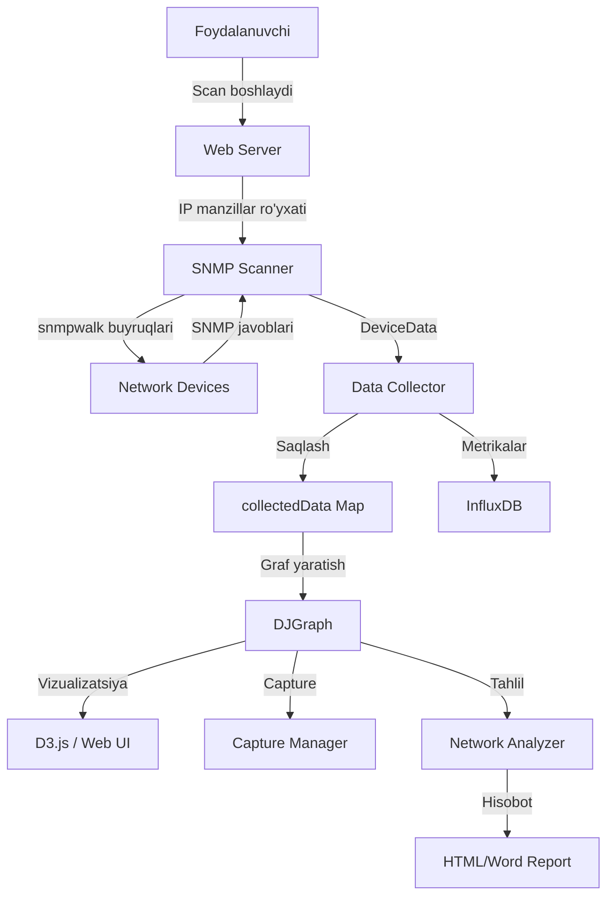
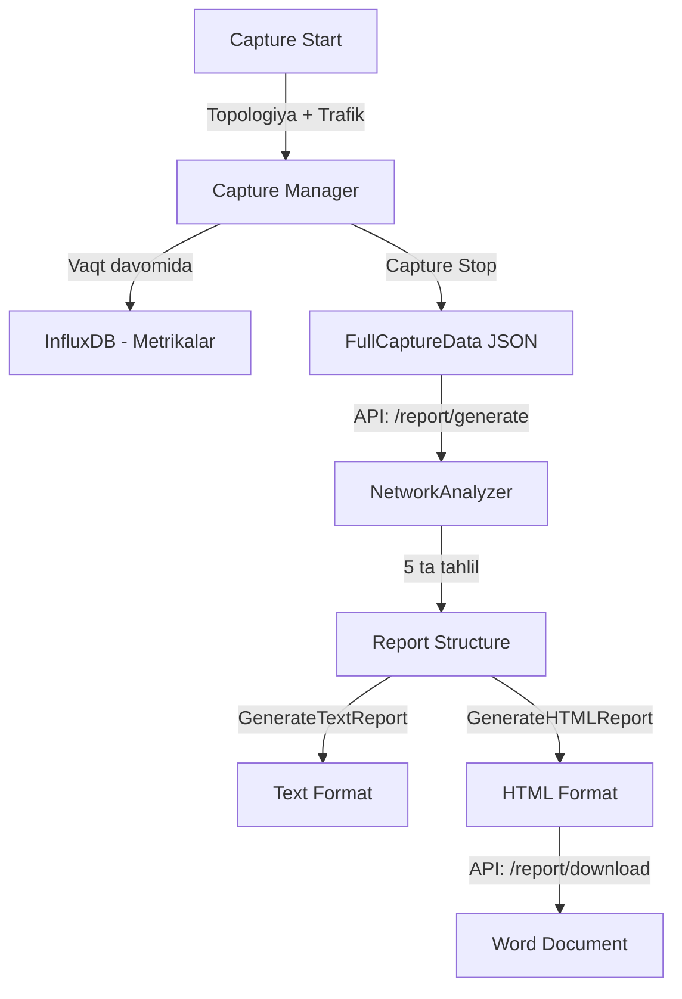

# LLDP Tarmoq Skaneri - Loyiha Hisoboti

## Kirish

Ushbu loyiha **LLDP (Link Layer Discovery Protocol)** protokoli asosida tarmoq topologiyasini avtomatik aniqlash, tahlil qilish va vizualizatsiya qilish uchun yaratilgan dasturiy ta'minot. Loyiha Go (Golang) dasturlash tilida yozilgan va zamonaviy tarmoq qurilmalarini SNMP orqali so'rov qilib, tarmoq strukturasini real vaqtda kuzatish imkonini beradi.

---

## Loyihaning Asosiy Maqsadlari

1. **Tarmoq Topologiyasini Avtomatik Aniqlash**: LLDP va SNMP protokollari yordamida tarmoqdagi barcha aktiv qurilmalarni topish va ularning o'zaro bog'lanishlarini aniqlash
2. **Vizualizatsiya**: Topilgan tarmoq topologiyasini grafik ko'rinishda taqdim etish (D3.js kutubxonasi yordamida)
3. **Tahlil va Monitoring**: Tarmoq salomatligini baholash, tiqilinchlar, xatolar va optimallashtirishlar uchun tavsiyalar berish
4. **Hisobot Yaratish**: Tarmoq holatini batafsil tavsiflovchi hisobotlarni HTML va Word formatlarida generatsiya qilish
5. **Influxdb bilan Integratsiya**: Tarmoq metrikalarini vaqt o'tishi bilan saqlash va tahlil qilish

---

## Arxitektura va Tizim Komponentlari

### 1. **Asosiy Modullar**

#### 📌 `example_usage.go` - Asosiy bajarilish moduli (1551 qator)
Bu faylda dasturning asosiy mantiqiy oqimi mavjud:

- **SNMP Scanning**: Tarmoqdagi qurilmalarni avtomatik skanerlash
- **Data Collection**: Har bir qurilmadan quyidagi ma'lumotlarni yig'ish:
  - System Name (qurilma nomi)
  - Chassis ID (qurilmaning yagona identifikatori)
  - Interface ma'lumotlari (portlar, tezlik, status)
  - LLDP qo'shnilar (neighbor devices)
  - MAC address jadvali
  - ARP jadvali
  - VLAN konfiguratsiyasi
  - STP (Spanning Tree Protocol) ma'lumotlari
- **Gateway ARP Collection**: `collectGatewayARP()` — gateway router'dan global MAC→IP lookup yaratish
- **VM/Hypervisor Detection**: MAC prefiksi orqali VMware, Proxmox, Hyper-V, Xen, VirtualBox aniqlash
- **OS Fingerprinting**: LLDP hostname + TTL ping + MAC vendor orqali OS aniqlash
- **MAC Vendor OUI Database**: 80+ ishlab chiqaruvchi prefiksi (SNR, Ubiquiti, Dahua, Cisco, VMware, Intel, Apple va boshqalar)
- **Garbage Filtering**: `isSpecialMAC()` va `isInvalidID()` orqali noto'g'ri ma'lumotlarni filtrlash

**Background Goroutine'lar:**
- `startPeriodicAnalysis()` — Har 60 sekundda tarmoqni tahlil qiladi va Telegram alert yuboradi
- `startTrafficPolling()` — Har 10 sekundda trafik counter'larni poll qiladi va real-time tezlikni hisoblaydi
- `handleRescanRequests()` — UI/Telegram'dan rescan tugmasi bosilganda tarmoqni qayta skanerlaydi

**Muhim funksiyalar:**
- `main()` - dasturning asosiy kirish nuqtasi
- `buildGraphEdges()` - qurilmalar orasidagi bog'lanishlarni yaratish (VM/Hub aniqlash bilan)
- `normalizeID()` - Chassis ID'larni formatlash va standartlashtirish
- `getMACVendor()` - MAC addressdan ishlab chiqaruvchini aniqlash (80+ OUI)
- `saveResults()` - natijalarni JSON formatida saqlash
- `collectGatewayARP()` - Gateway'dan global MAC→IP lookup yaratish
- `startPeriodicAnalysis()` - Har daqiqada avtomatik tahlil qilish
- `startTrafficPolling()` - Real-time trafik tezligini hisoblash
- `isHypervisorMAC()` / `isHypervisorPort()` - VM serverlarni aniqlash
- `detectOSFromMAC()` / `detectOSByTTL()` - OS fingerprinting
- `isSpecialMAC()` / `isInvalidID()` - Garbage filtrlash

#### 📌 `analyzer.go` - Tarmoq Tahlilchisi (770 qator)
Bu modul tarmoqning umumiy holatini baholash va optimallashtirishlar uchun tavsiyalar beradi:

**Tahlil turlari:**
1. **Path Analysis** - Uzun yo'llarni (hop count > 3) aniqlash
2. **Congestion Analysis** - Interface yuklanishini va tiqilinchlarni tekshirish
3. **Stability Analysis** - Interface statusining tez-tez o'zgarishini aniqlash
4. **Shadow IT Detection** - Nomaqbul switchlarni Port-MAC ratio algoritmi orqali topish (hypervisor portlarni filtrlash bilan)
5. **STP Analysis** - Spanning Tree Protocol konfiguratsiyasini tekshirish
6. **Loopback Detection** - LLDP self-neighbor va MAC self-reference orqali looplarni topish
7. **Telegram Notification** - Har bir Shadow IT va Loopback muammosi uchun Telegram xabar (1 soatda 1 marta cooldown)

**Health Score Calculation** - Tarmoqning umumiy "sog'ligi"ni 0-100 ballik sistemada baholash:
- 90-100: Excellent (Ajoyib)
- 70-89: Good (Yaxshi)
- 50-69: Fair (O'rtacha)
- 30-49: Poor (Yomon)
- 0-29: Critical (Kritik)

#### 📌 `web_server.go` - Web Interface (535 qator)
HTTP server orqali foydalanuvchi interfeysi va API endpoint'larni taqdim etadi:

**API Endpoints:**
- `GET /api/graph` - Tarmoq grafini D3.js formati olish
- `GET /api/hosts` - Qurilmalar ro'yxati
- `DELETE /api/hosts` - Ma'lumotlarni tozalash
- `GET/POST /api/settings` - Sozlamalarni boshqarish
- `POST /api/rescan` - Qayta skanerlashni boshlash
- `GET /api/status` - Dastur holati (hosts soni, SNMP success/fail)
- `GET /api/history?id=IP&hours=24` - InfluxDB'dan trafik tarixi
- `POST /api/capture/start` - Capture sessiyasini boshlash
- `POST /api/capture/stop` - Capture sessiyasini to'xtatish
- `GET /api/captures` - Barcha capture'larni ko'rish
- `POST /api/report/generate` - Hisobot yaratish
- `GET /api/report/download` - Hisobotni Word formatida yuklab olish
- `POST /api/issue/action` - Shadow IT/Loopback issue'ni ignore yoki verify qilish

#### 📌 `dj_graph.go` - Graf Ma'lumotlar Tuzilmasi (602 qator)
Network topologiyasini graf sifatida boshqarish:

**Asosiy strukturalar:**
- `DJGraph` - Tarmoq grafining asosiy ma'lumotlar tuzilmasi
- `GraphNode` - Node (qurilma) ma'lumotlari D3.js uchun
- `GraphLink` - Link (bog'lanish) ma'lumotlari

**Device Group System** (`determineDeviceGroup()`):
- `router` - Routerlar (Mikrotik, gateway IP)
- `switch` - Managed switchlar (SNR, HPE, Cisco)
- `server` - Serverlar (Linux, Windows)
- `hub` - Unmanaged switchlar (D-Link, TP-Link)
- `vm` - VM Hypervisor portlari (VMware, Proxmox, Hyper-V)
- `endpoint` - LLDP endpoint qurilmalar
- `camera` - IP kameralar (Dahua, Hikvision)

**Funksionallik:**
- Graf yaratish va tahrirlash
- Koordinatalarni optimallashtirish
- Chuqurliklarni hisoblash (BFS algoritmi)
- Zabbix formatiga eksport qilish
- D3.js uchun JSON formatida chiqarish

#### 📌 `snmp_object.go` - SNMP Ma'lumot Yig'ish (1049 qator)
SNMP protokoli orqali qurilmalardan ma'lumot to'plash:

**To'planadigan ma'lumotlar (7 ta parallel collector):**
- Chassis ID (LLDP-MIB)
- Interface statistikasi (IF-MIB) — tezlik, xatolar, trafik counter'lar (32-bit va 64-bit)
- LLDP qo'shnilar (LLDP-MIB) + Management IP'lar
- MAC address jadvali (BRIDGE-MIB)
- ARP jadvali (ipNetToMediaTable)
- Port VLAN konfiguratsiyasi (Q-BRIDGE-MIB)
- STP ma'lumotlari (BRIDGE-MIB STP)

**Asosiy metodlar:**
- `CollectData()` - Qurilmadan barcha ma'lumotlarni yig'ish
- `runSNMPWalk()` - snmpwalk buyrug'ini bajarish
- `collectInterfaces()` - Interface'larni to'plash
- `collectLLDPNeighbors()` - LLDP qo'shnilarni to'plash
- `collectMACTable()` - MAC jadvalini olish
- `collectPortVLANs()` - VLAN konfiguratsiyasini olish
- `collectSTPInfo()` - STP ma'lumotlarini olish

#### 📌 `capture.go` - Capture Sessiya Boshqaruvi (198 qator)
Network holatini vaqt davomida yozib olish:

**Strukturalar:**
- `CaptureSession` - Sessiya metama'lumotlari
- `FullCaptureData` - To'liq capture ma'lumotlari
- `TrafficMetrics` - Trafik ko'rsatkichlari
- `StatusEvent` - Status o'zgarishlari hodisalari

**Funksional:**
- Capture sessiyasini boshlash va to'xtatish
- Topologiya va trafik ma'lumotlarini saqlash
- InfluxDB'dan metrikalarni olish
- Capture'lar ro'yxatini boshqarish

#### 📌 `influx_client.go` - InfluxDB Integratsiyasi
Vaqt seriyali ma'lumotlarni InfluxDB'ga yozish va o'qish:

- Trafik metrikalarini yozish
- Status o'zgarishlarini qayd qilish
- Ma'lumotlarni vaqt oralig'i bo'yicha so'rov qilish

---

## Texnologiyalar va Kutubxonalar

### Backend
- **Go 1.23+** - Asosiy dasturlash tili
- **gosnmp** - SNMP protokoli bilan ishlash
- **InfluxDB client** - Vaqt seriyali ma'lumotlar bazasi
- **UUID** - Unique identifikatorlar yaratish

### Frontend
- **D3.js** - Grafik vizualizatsiya
- **Neo4jd3.js** - Graf vizualizatsiya kutubxonasi
- **Bootstrap** - UI framework
- **Font Awesome** - Ikonkalar

### Tashqi Vositalar
- **snmpwalk** - SNMP so'rovlar uchun tizim buyrug'i
- **Docker** - Konteynerlashtirish (InfluxDB uchun)

---

## Ma'lumotlar Oqimi (Data Flow)



---

## Asosiy Algoritmlar

### 1. **Chassis ID Normalizatsiyasi**
LLDP protokolida har bir qurilmaning Chassis ID'si turli formatlarda kelishi mumkin (MAC address, IP address, text). Dastur bu ID'larni standartlashtirib, yagona formatga keltiradi:

```go
func normalizeID(id string, subtype int) string {
    switch subtype {
    case 4: // MAC address
        return hexStringToMAC(id)
    case 5: // Network address (IP)
        return cleanIPAddress(id)
    case 7: // Local (text)
        return strings.TrimSpace(id)
    }
}
```

### 2. **Graf Qurish (Graph Building)**
Har bir qurilmadan olingan LLDP neighbor ma'lumotlari asosida tarmoq grafini qurish:

1. Har bir qurilmani node sifatida qo'shish
2. LLDP neighbor'lar asosida edge'lar yaratish
3. Port nomlarini normalizatsiya qilish
4. VLAN va trafik ma'lumotlarini label'larga qo'shish
5. Duplikat edge'larni filtrlash

### 3. **Shadow IT Detection (Algoritm)**
Noma'lum switchlarni topish uchun **Port-MAC Ratio** algoritmi qo'llaniladi:

```
Agar bitta portda 3+ MAC address ko'rinsa va 
LLDP neighbor ma'lumoti ko'rinmasa → 
Bu portga unmanaged switch ulangan
```

### 4. **Health Score Hisoblash**
Tarmoq sog'ligini hisoblash formulasi:

```
baseScore = 100
baseScore -= (CRITICAL_COUNT × 10)
baseScore -= (HIGH_COUNT × 5)
baseScore -= (MEDIUM_COUNT × 2)
baseScore -= (LOW_COUNT × 1)
healthScore = max(0, min(100, baseScore))
```

### 5. **BFS (Breadth-First Search) - Chuqurlik Hisoblash**
Root qurilmadan boshqa qurilmalargacha bo'lgan minimal hop count'ni topish:

```go
func (g *DJGraph) CalculateDepths(rootID string) map[string]int {
    depths := make(map[string]int)
    queue := []string{rootID}
    depths[rootID] = 0
    
    for len(queue) > 0 {
        current := queue[0]
        queue = queue[1:]
        
        for neighbor := range g.Edges[current] {
            if _, visited := depths[neighbor]; !visited {
                depths[neighbor] = depths[current] + 1
                queue = append(queue, neighbor)
            }
        }
    }
    return depths
}
```

---

## Ishlatilishi (Usage Flow)

### 1. **Dastlabki Konfiguratsiya**
```bash
# IP manzillar ro'yxatini tayyorlash
# swich_ips faylida:
172.20.1.254
172.20.254.10
172.20.254.11
...
```

### 2. **Dasturni Ishga Tushirish**
```bash
# Build
go build -o lldp_scanner

# Run
./lldp_scanner -ip swich_ips -web :8080 -community public
```

### 3. **Web Interfeysdan Foydalanish**
- Brauzerda `http://localhost:8080` ochish
- Real-time tarmoq grafini ko'rish
- Rescan tugmasini bosib yangi skanerlash
- Capture sessiyasini boshlash
- Hisobot yaratish

### 4. **Capture Sessiyasi**
```
1. Start Capture → Sessiya boshlash
2. Vaqt davomida trafik va status o'zgarishlarini kuzatish
3. Stop Capture → Ma'lumotlarni saqlash
4. Generate Report → Hisobot yaratish
5. Download Report → Word formatida yuklab olish
```

---

## Xususiyatlar va Imkoniyatlar

### ✅ Qo'llab-quvvatlanadigan Qurilmalar
- SNR switchlar
- Ubiquiti qurilmalari
- Dahua kameralar
- TP-Link qurilmalari
- Cisco qurilmalari
- Mikrotik routerlar
- Umumiy SNMP-qo'llab-quvvatlovchi qurilmalar

### ✅ To'planadigan Ma'lumotlar
- Qurilma modeli va versiyasi
- Interface statistikasi (trafik, xatolar, discards)
- LLDP topologiya ma'lumotlari
- MAC address jadvali
- ARP jadvali
- VLAN konfiguratsiyasi
- STP holati
- Port statuslari (up/down)

### ✅ Tahlil Va Monitoring
- Uzun path'larni aniqlash  
- Interface tiqilinchlarini topish
- Status o'zgarishlarini qayd qilish
- Shadow IT qurilmalarni aniqlash (hypervisor filtrlash bilan)
- VM/Hypervisor serverlarni aniqlash va OS fingerprinting (LLDP + TTL + MAC)
- Loopback (loop) aniqlash (LLDP self-neighbor + MAC self-reference)
- STP noto'g'ri konfiguratsiyasini topish
- Network health score berish
- Telegram orqali real-time ogohlantirishlar (per-issue, 1h cooldown)
- Muammolarni Ignore/Fixed qilish (interaktiv tugmalar)

### ✅ Eksport Formatlari
- JSON (scan_results.json)
- Zabbix Hosts (zabbix_hosts.json)
- Zabbix Map (zabbix_map.json)
- HTML hisobot
- Word hisobot (.doc)

---

## Fayllar va Ma'lumotlar Tuzilmasi

```
lldp_go/
├── example_usage.go      # Main dastur
├── analyzer.go           # Tahlil moduli
├── web_server.go         # Web server
├── dj_graph.go           # Graf tuzilmasi
├── snmp_object.go        # SNMP data collection
├── capture.go            # Capture management
├── influx_client.go      # InfluxDB integration
├── settings.go           # Sozlamalar
├── docker-compose.yml    # Docker konfiguratsiya
│
├── www/                  # Web frontend
│   ├── index.html
│   ├── network_enhanced.html
│   ├── js/
│   ├── css/
│   └── img/
│
├── captures/             # Saqlangan capture'lar
│   └── <uuid>_full_data.json
│
├── scan_results.json     # SNMP scan natijalari
├── zabbix_hosts.json     # Zabbix eksport
├── zabbix_map.json       # Zabbix map eksport
├── graphs_data.txt       # Graf ma'lumotlari
└── scanner_*.log         # Turli loglar
```

---

## Qiyinchiliklar va Yechimlar

### 🔴 Muammo 1: Chassis ID Formati
**Problem**: Turli qurilmalar Chassis ID'ni turli formatlarda beradi (MAC, IP, text)  
**Yechim**: `normalizeID()` funksiyasi yordamida barcha ID'larni standartlashtirish

### 🔴 Muammo 2: Duplikat Edge'lar
**Problem**: Ikki qurilma bir-birini neighbor sifatida ko'rsatsa, ikki marta edge yaratiladi  
**Yechim**: Edge qo'shishda `source < target` tartibni ta'minlash

### 🔴 Muammo 3: Ghost Nodes
**Problem**: O'chirilgan yoki mavjud bo'lmagan qurilmalar hali ham grafda ko'rinadi  
**Yechim**: TTL (Time To Live) mexanizmi va muntazam yangilanishlar

### 🔴 Muammo 4: MAC Vendor Detection
**Problem**: MAC addressdan ishlab chiqaruvchini aniqlash  
**Yechim**: OUI (Organizationally Unique Identifier) ma'lumotlar bazasini qo'llanish

### 🔴 Muammo 5: Unmanaged Switch Detection
**Problem**: LLDP qo'llab-quvvatlamaydigan switchlarni topish qiyin  
**Yechim**: Port-MAC ratio algoritmi - agar bitta portda ko'p MAC ko'rinsa, u yerda unmanaged switch bor

---

## Kelajakdagi Rivojlanish Yo'nalishlari

### 📊 Monitoring va Analytics
- [x] Real-time alertlar (Telegram Bot bilan)
- [x] Shadow IT aniqlash va Telegram notification
- [x] VM/Hypervisor aniqlash va OS fingerprinting
- [x] Loopback (loop) aniqlash
- [x] Per-issue notification cooldown (1 soatda 1 marta)
- [x] Interaktiv tugmalar (Ignore/Fixed) bilan issue boshqarish
- [ ] Anomaliya aniqlash (Machine Learning)
- [ ] Bandwidth forecasting
- [ ] SLA monitoring

---

## Xulosa

Ushbu LLDP tarmoq skaneri loyihasi zamonaviy tarmoq infratuzilmasini avtomatik aniqlash, monitoring qilish va tahlil qilish uchun kuchli vosita hisoblanadi. 

**Asosiy afzalliklari:**
- ✅ Avtomatik topologiya kashfiyoti
- ✅ Real-time monitoring
- ✅ Batafsil tahlil va optimallashtirishlar
- ✅ Qulay web interfeys
- ✅ Ko'p formatda eksport
- ✅ InfluxDB bilan vaqt seriyali ma'lumotlar
- ✅ Zabbix integratsiyasi
- ✅ Telegram Bot integratsiyasi (real-time alertlar)
- ✅ VM/Hypervisor aniqlash va OS fingerprinting
- ✅ Loopback aniqlash
- ✅ Per-issue notification cooldown

**Qo'llanish sohalari:**
- Enterprise tarmoq monitoring
- NOC (Network Operations Center) operatsiyalari
- Tarmoq auditi va tekshiruv
- Capacity planning
- Troubleshooting va diagnostika
- Tarmoq xavfsizligi auditlari

Loyiha ochiq kodli bo'lib, Go dasturlash tilining samaradorligi va ko'p platformali qo'llab-quvvatlash imkoniyatlaridan foydalanadi. Kelajakda yangi xususiyatlar va integratsiyalar qo'shilishi rejalashtirilgan.

---

**Tayyorlandi:** 2026-02-20  
**Loyiha versiyasi:** 2.0  
**Til:** Go 1.23+  
**Litsenziya:** -


---

# Hisobot Yaratish Funksiyasi - Texnik Hujjat

## Kirish

Loyihadagi hisobot yaratish tizimi tarmoq holatini to'liq tahlil qilib, foydalanuvchiga batafsil hisobot taqdim etish uchun mo'ljallangan. Tizim tarmoq ma'lumotlarini yig'adi, tahlil qiladi va turli formatlarda (JSON, TEXT, HTML, Word) hisobot yaratadi.

---

## Arxitektura va Oqim

### Umumiy Ishlash Tartibi



### Asosiy Komponentlar

1. **CaptureManager** - Ma'lumotlarni yig'ish va saqlash
2. **NetworkAnalyzer** - Tahlil qilish
3. **Report Generator** - Hisobot yaratish
4. **Web API** - Foydalanuvchi interfeysi

---

## 1. Ma'lumotlar Tuzilmasi

### FullCaptureData - To'liq Ma'lumotlar Paketi

```go
type FullCaptureData struct {
    Session     CaptureSession    `json:"session"`      // Sessiya metama'lumotlari
    Topology    GraphData         `json:"topology"`     // Tarmoq topologiyasi
    Metrics     []TrafficMetrics  `json:"metrics"`      // Trafik ko'rsatkichlari
    Events      []StatusEvent     `json:"events"`       // Status o'zgarishlari
    DevicesData []DeviceData      `json:"devices_data"` // Qurilma ma'lumotlari
}
```

**Har bir maydon:**

#### CaptureSession
```go
type CaptureSession struct {
    ID        string    `json:"id"`         // UUID - noyob identifikator
    Name      string    `json:"name"`       // Foydalanuvchi beradigan nom
    StartTime time.Time `json:"start_time"` // Boshlanish vaqti
    EndTime   time.Time `json:"end_time"`   // Tugash vaqti
    Config    string    `json:"config"`     // Konfiguratsiya
    Status    string    `json:"status"`     // "running", "completed", "failed"
}
```

#### TrafficMetrics - Trafik Ma'lumotlari
```go
type TrafficMetrics struct {
    Timestamp   time.Time `json:"timestamp"`    // Vaqt belgisi
    DeviceIP    string    `json:"device_ip"`    // Qurilma IP
    Interface   string    `json:"interface"`    // Interface nomi (e.g., "Gi0/1")
    InBps       uint64    `json:"in_bps"`       // Kiruvchi trafik (bit/sekund)
    OutBps      uint64    `json:"out_bps"`      // Chiquvchi trafik (bit/sekund)
    InDiscards  uint64    `json:"in_discards"`  // Tushirilgan paketlar (kiruvchi)
    OutDiscards uint64    `json:"out_discards"` // Tushirilgan paketlar (chiquvchi)
    InErrors    uint64    `json:"in_errors"`    // Xatolar (kiruvchi)
    OutErrors   uint64    `json:"out_errors"`   // Xatolar (chiquvchi)
    OperStatus  int       `json:"oper_status"`  // 1=Up, 2=Down
}
```

#### StatusEvent - Hodisalar
```go
type StatusEvent struct {
    Timestamp   time.Time `json:"timestamp"`   // Qachon sodir bo'lgan
    DeviceIP    string    `json:"device_ip"`   // Qaysi qurilmada
    Interface   string    `json:"interface"`   // Qaysi interface
    OldStatus   int       `json:"old_status"`  // Oldingi status
    NewStatus   int       `json:"new_status"`  // Yangi status
    Description string    `json:"description"` // Tavsif
}
```

### Report - Hisobot Strukturasi

```go
type Report struct {
    SessionID   string                   `json:"session_id"`   // Qaysi sessiyaga tegishli
    GeneratedAt time.Time                `json:"generated_at"` // Yaratilgan vaqt
    Summary     map[string]int           `json:"summary"`      // Xulosa statistikasi
    Suggestions []OptimizationSuggestion `json:"suggestions"`  // Tavsiyalar ro'yxati
    Nodes       []GraphNode              `json:"nodes"`        // Tarmoq node'lari
    HealthScore int                      `json:"health_score"` // Sog'liq balli (0-100)
}
```

### OptimizationSuggestion - Tavsiya

```go
type OptimizationSuggestion struct {
    Type        string `json:"type"`        // Muammo turi
    Severity    string `json:"severity"`    // Jiddiylik darajasi
    Device      string `json:"device"`      // Qaysi qurilma
    Description string `json:"description"` // Batafsil tavsif
    Value       string `json:"value"`       // Metrika qiymati
}
```

**Tavsiya turlari:**
- `path` - Yo'l optimallashtiruvi
- `congestion` - Tiqilinch muammosi
- `stability` - Barqarorlik muammosi
- `shadow_it` - Noqonuniy qurilmalar
- `stp` - STP konfiguratsiya muammosi
- `physical` - Fizik muammolar (kabel, SFP)

**Jiddiylik darajalari:**
- `high` - Yuqori (🔴 qizil)
- `medium` - O'rtacha (🟠 sariq)
- `low` - Past (ℹ️ ko'k)

---

## 2. Tahlil Algoritmlari

### NetworkAnalyzer.Analyze() - Asosiy Tahlil

Bu funksiya 5 ta turli tahlilni bajaradi:

```go
func (na *NetworkAnalyzer) Analyze() Report {
    // 1. Path Analysis - Yo'l tahlili
    pathSuggestions := na.analyzePaths()
    
    // 2. Congestion Analysis - Tiqilinch tahlili
    congestionSuggestions := na.analyzeCongestion()
    
    // 3. Stability Analysis - Barqarorlik tahlili
    stabilitySuggestions := na.analyzeStability()
    
    // 4. Shadow IT Detection - Noqonuniy qurilmalar
    shadowITSuggestions := na.analyzeShadowIT()
    
    // 5. STP Analysis - STP tahlili
    stpSuggestions := na.analyzeSTP()
    
    // Health Score hisoblash
    report.HealthScore = na.CalculateHealthScore(&report)
    
    return report
}
```

### 2.1 Path Analysis - Yo'l Tahlili

**Maqsad:** Core switchdan boshqa qurilmalargacha bo'lgan yo'lni tekshirish

**Algoritm:**
1. Graf tuzilmasini qayta qurish
2. Core switch topish (odatda 172.20.1.254)
3. BFS algoritmi bilan chuqurliklarni hisoblash
4. 3+ hop masofadagi qurilmalarni aniqlash

**Kod:**
```go
func (na *NetworkAnalyzer) analyzePaths() []OptimizationSuggestion {
    // Graf qurish
    graph := NewDJGraph()
    for _, node := range na.Data.Topology.Nodes {
        graph.AddNode(node.ID)
    }
    for _, link := range na.Data.Topology.Links {
        graph.AddEdge(link.Source, link.Target, link.Label)
    }
    
    // Core'dan uzoq qurilmalarni topish
    longPaths := graph.GetLongPaths(coreID, 3) // 3 hop chegarasi
    
    // Har biri uchun tavsiya yaratish
    for _, nodeID := range longPaths {
        suggestions = append(suggestions, OptimizationSuggestion{
            Type:        "path",
            Severity:    "medium",
            Device:      nodeID,
            Description: "Device is too far from Core. Consider moving to Distribution layer.",
            Value:       "4+ hops",
        })
    }
}
```

### 2.2 Congestion Analysis - Tiqilinch Tahlili

**Maqsad:** Interface yuklanishini va paket yo'qotishlarini aniqlash

**Algoritmlar:**

#### A. Bandwidth Utilization (Tarmoqdan foydalanish)
```go
const capacity1G = 1000.0 * 1000 * 1000  // 1 Gbps (bit/s)
const threshold = capacity1G * 0.8       // 800 Mbps (80%)

for _, metric := range na.Data.Metrics {
    totalBps := metric.InBps + metric.OutBps
    
    if float64(totalBps) > threshold {
        // CRITICAL: 80% dan ko'p yuklanish
        suggestions = append(suggestions, OptimizationSuggestion{
            Type:        "congestion",
            Severity:    "high",
            Description: "Traffic exceeds 800Mbps. Upgrade link or balance traffic.",
            Value:       fmt.Sprintf("%.2f Mbps", totalBps/1000000),
        })
    }
}
```

#### B. Packet Loss Detection (Paket yo'qotish)
```go
if metric.InDiscards > 0 || metric.OutDiscards > 0 {
    discards := metric.InDiscards + metric.OutDiscards
    suggestions = append(suggestions, OptimizationSuggestion{
        Type:        "congestion",
        Severity:    "medium",
        Description: "Packet Loss detected. Network is congested.",
        Value:       fmt.Sprintf("%d drops", discards),
    })
}
```

#### C. Physical Errors (Fizik xatolar)
```go
if metric.InErrors > 0 || metric.OutErrors > 0 {
    errors := metric.InErrors + metric.OutErrors
    suggestions = append(suggestions, OptimizationSuggestion{
        Type:        "physical",
        Severity:    "high",
        Description: "CRC/Frame errors detected. Check cable/SFP immediately.",
        Value:       fmt.Sprintf("%d errors", errors),
    })
}
```

### 2.3 Stability Analysis - Barqarorlik Tahlili

**Maqsad:** Interface statusining tez-tez o'zgarishini (flapping) aniqlash

**Algoritm:**
```go
func (na *NetworkAnalyzer) analyzeStability() []OptimizationSuggestion {
    // Interface statusining necha marta o'zgarganini sanash
    flapping := make(map[string]int)
    
    for _, event := range na.Data.Events {
        key := fmt.Sprintf("%s|%s", event.DeviceIP, event.Interface)
        // Faqat Down hodisalarini sanash
        if event.NewStatus == 2 {  // 2 = Down
            flapping[key]++
        }
    }
    
    // Har bir beqaror interface uchun tavsiya
    for key, count := range flapping {
        suggestions = append(suggestions, OptimizationSuggestion{
            Type:        "stability",
            Severity:    "high",
            Description: fmt.Sprintf("Interface went DOWN %d times.", count),
            Value:       fmt.Sprintf("%d outages", count),
        })
    }
}
```

### 2.4 Shadow IT Detection - Noqonuniy Qurilmalar

**Maqsad:** Unmanaged (boshqarilmaydigan) switchlarni topish

**Port-MAC Ratio Algoritmi:**
```go
func (na *NetworkAnalyzer) analyzeShadowIT() []OptimizationSuggestion {
    // 1. Port-MAC mapping yaratish
    portMACs := make(map[string]map[int][]string)
    
    for _, device := range na.Data.DevicesData {
        for _, macEntry := range device.MACTable {
            portMACs[device.IP][macEntry.PortNumber] = append(
                portMACs[device.IP][macEntry.PortNumber],
                macEntry.MACAddress,
            )
        }
    }
    
    // 2. Har bir portni tekshirish
    for deviceIP, ports := range portMACs {
        for portNum, macs := range ports {
            // Agar 2+ MAC address bor va trunk emas bo'lsa
            if len(macs) > 1 && !isTrunk(deviceIP, portNum) {
                suggestions = append(suggestions, OptimizationSuggestion{
                    Type:        "shadow_it",
                    Severity:    "high",
                    Description: fmt.Sprintf(
                        "Port %d has %d MAC addresses. Likely UNMANAGED SWITCH.",
                        portNum, len(macs),
                    ),
                    Value: fmt.Sprintf("%d MACs on single port", len(macs)),
                })
            }
        }
    }
}
```

**Mantiq:**
- Agar bitta portda 2+ MAC address ko'rinsa
- Va bu port trunk emas bo'lsa (VLAN aggregation)
- Demak, bu portga unmanaged switch ulangan

### 2.5 STP Analysis - Spanning Tree Protocol

**Maqsad:** STP Root Bridge to'g'ri konfiguratsiya qilinganligini tekshirish

**Algoritm:**
```go
func (na *NetworkAnalyzer) analyzeSTP() []OptimizationSuggestion {
    // 1. Barcha qurilmalardan Root Bridge'ni topish
    rootBridgeIDs := make(map[string][]string)
    
    for _, device := range na.Data.DevicesData {
        if device.STPInfo.Enabled && device.STPInfo.RootBridgeID != "" {
            rootBridgeIDs[device.STPInfo.RootBridgeID] = append(
                rootBridgeIDs[device.STPInfo.RootBridgeID],
                device.IP,
            )
        }
    }
    
    // 2. Root Bridge Core'da ekanligini tekshirish
    for rootMAC, devices := range rootBridgeIDs {
        isCore := checkIfDeviceIsCore(rootMAC)
        
        if !isCore {
            suggestions = append(suggestions, OptimizationSuggestion{
                Type:        "stp",
                Severity:    "high",
                Description: "STP Root Bridge is NOT on Core switch! " +
                           "Set priority on Core to make it Root.",
                Value: fmt.Sprintf("Seen by %d devices", len(devices)),
            })
        }
    }
}
```

**Muammo:** Agar Root Bridge Core'da bo'lmasa, barcha trafik noto'g'ri yo'llardan o'tadi.

### 2.6 Health Score Calculation - Sog'liq Balli

**Formula:**
```go
func (na *NetworkAnalyzer) CalculateHealthScore(report *Report) int {
    score := 100  // Boshlang'ich ball
    
    // Har bir muammo uchun ball ayirish
    for _, sugg := range report.Suggestions {
        switch sugg.Type {
        case "shadow_it":
            score -= 10  // Har bir unmanaged switch: -10
        case "congestion":
            if sugg.Severity == "high" {
                score -= 5  // Kritik tiqilinch: -5
            } else {
                score -= 2  // O'rtacha tiqilinch: -2
            }
        case "physical":
            score -= 2  // CRC/xatolar: -2
        case "stp":
            score -= 15 // STP muammosi: -15 (juda muhim!)
        case "path":
            score -= 2  // Uzun yo'l: -2
        case "stability":
            score -= 3  // Flapping: -3
        }
    }
    
    if score < 0 {
        score = 0
    }
    
    return score
}
```

**Ball talqini:**
```go
func GetHealthLabel(score int) string {
    if score >= 90 {
        return "Excellent"  // Ajoyib
    } else if score >= 70 {
        return "Good"       // Yaxshi
    } else if score >= 50 {
        return "Fair"       // O'rtacha
    } else if score >= 30 {
        return "Poor"       // Yomon
    }
    return "Critical"       // Kritik
}
```

---

## 3. Hisobot Generatsiyasi

### 3.1 Text Report - Matnli Hisobot

```go
func (r *Report) GenerateTextReport() string {
    var sb strings.Builder
    
    // Header
    sb.WriteString("NETWORK ANALYSIS REPORT\n")
    sb.WriteString(fmt.Sprintf("Session: %s\n", r.SessionID))
    sb.WriteString(fmt.Sprintf("Generated: %s\n", r.GeneratedAt.Format(time.RFC1123)))
    
    // Summary
    sb.WriteString("SUMMARY:\n")
    sb.WriteString(fmt.Sprintf("- Path Issues: %d\n", r.Summary["path_issues"]))
    sb.WriteString(fmt.Sprintf("- Congestion Issues: %d\n", r.Summary["congestion_issues"]))
    sb.WriteString(fmt.Sprintf("- Stability Issues: %d\n", r.Summary["stability_issues"]))
    
    // Recommendations
    for i, sugg := range r.Suggestions {
        icon := "ℹ️"
        if sugg.Severity == "high" {
            icon = "🔴"
        } else if sugg.Severity == "medium" {
            icon = "🟠"
        }
        
        sb.WriteString(fmt.Sprintf("%d. %s [%s] %s\n", 
            i+1, icon, sugg.Type, sugg.Device))
        sb.WriteString(fmt.Sprintf("   Problem: %s\n", sugg.Description))
        sb.WriteString(fmt.Sprintf("   Metric: %s\n\n", sugg.Value))
    }
    
    return sb.String()
}
```

**Natija:**
```
NETWORK ANALYSIS REPORT
Session: fa7c94b3-ee26-4fe5-8aee-d4159364602e
Generated: Fri, 14 Feb 2026 10:00:00 UTC
--------------------------------------------------

SUMMARY:
- Path Optimization Issues: 2
- Congestion/Traffic Issues: 5
- Stability/Outage Issues: 1

DETAILED RECOMMENDATIONS:

1. 🔴 [CONGESTION] 172.20.254.10
   Problem: CRITICAL: Traffic on Gi0/24 exceeds 800Mbps
   Metric: 875.32 Mbps

2. 🔴 [SHADOW_IT] 172.20.254.15
   Problem: Port 12 has 5 MAC addresses. Likely UNMANAGED SWITCH
   Metric: 5 MACs on single port
```

### 3.2 HTML Report - HTML Hisobot

**Xususiyatlar:**
- Professional dizayn (Microsoft Word uchun)
- Rangli jadvallar
- Health Score visualizatsiya
- UTF-8 BOM qo'llab-quvvatlash

```go
func (r *Report) GenerateHTMLReport() string {
    var sb strings.Builder
    
    // HTML Header with Office namespace
    sb.WriteString(`
<html xmlns:o='urn:schemas-microsoft-com:office:office' 
      xmlns:w='urn:schemas-microsoft-com:office:word'>
<head>
    <meta charset="utf-8">
    <title>Network Analysis Report</title>
    <style>
        body { font-family: 'Calibri', 'Arial', sans-serif; }
        h1 { color: #2E74B5; border-bottom: 2px solid #2E74B5; }
        table { width: 100%; border-collapse: collapse; }
        th { background-color: #2E74B5; color: white; }
        .severity-high { color: #D32F2F; font-weight: bold; }
        .severity-medium { color: #EF6C00; font-weight: bold; }
    </style>
</head>
<body>
`)
    
    // Health Score Box
    healthColor := "#4CAF50"  // Green
    if r.HealthScore < 50 {
        healthColor = "#D32F2F"  // Red
    }
    sb.WriteString(fmt.Sprintf(`
<div style='background-color: %s; color: white; padding: 20px;'>
    <h2>Network Health Score: %d / 100</h2>
    <p>%s</p>
</div>
`, healthColor, r.HealthScore, GetHealthLabel(r.HealthScore)))
    
    // Summary Table
    sb.WriteString(`<table>
<tr><td>Path Issues</td><td>` + fmt.Sprintf("%d", r.Summary["path_issues"]) + `</td></tr>
<tr><td>Congestion Issues</td><td>` + fmt.Sprintf("%d", r.Summary["congestion_issues"]) + `</td></tr>
<tr><td>Shadow IT</td><td>` + fmt.Sprintf("%d", r.Summary["shadow_it_issues"]) + `</td></tr>
</table>`)
    
    // Recommendations Table
    sb.WriteString(`<table>
<thead>
    <tr>
        <th>Severity</th>
        <th>Type</th>
        <th>Device</th>
        <th>Issue</th>
        <th>Metric</th>
    </tr>
</thead>
<tbody>`)
    
    for _, sugg := range r.Suggestions {
        severityClass := ""
        if sugg.Severity == "high" {
            severityClass = "severity-high"
        }
        
        sb.WriteString(fmt.Sprintf(`
<tr>
    <td class='%s'>%s</td>
    <td>%s</td>
    <td>%s</td>
    <td>%s</td>
    <td>%s</td>
</tr>`, severityClass, sugg.Severity, sugg.Type, 
            sugg.Device, sugg.Description, sugg.Value))
    }
    
    sb.WriteString("</tbody></table></body></html>")
    return sb.String()
}
```

---

## 4. Web API Endpoints

### 4.1 POST /api/report/generate?id=SESSION_ID

**Maqsad:** Capture sessiyasi uchun hisobot yaratish

**Request:**
```http
POST /api/report/generate?id=fa7c94b3-ee26-4fe5-8aee-d4159364602e
Content-Type: application/json
```

**Response:**
```json
{
  "report": {
    "session_id": "fa7c94b3-ee26-4fe5-8aee-d4159364602e",
    "generated_at": "2026-02-14T10:00:00Z",
    "health_score": 73,
    "summary": {
      "path_issues": 2,
      "congestion_issues": 5,
      "stability_issues": 1,
      "shadow_it_issues": 1,
      "stp_issues": 0
    },
    "suggestions": [
      {
        "type": "congestion",
        "severity": "high",
        "device": "172.20.254.10",
        "description": "CRITICAL: Traffic on Gi0/24 exceeds 800Mbps",
        "value": "875.32 Mbps"
      }
    ]
  },
  "text_summary": "NETWORK ANALYSIS REPORT\n..."
}
```

**Kod:**
```go
func reportGenerateHandler(w http.ResponseWriter, r *http.Request) {
    sessionID := r.URL.Query().Get("id")
    
    // 1. Fayldan yuklash
    filename := fmt.Sprintf("captures/%s_full_data.json", sessionID)
    file, err := os.Open(filename)
    if err != nil {
        http.Error(w, "Session not found", http.StatusNotFound)
        return
    }
    defer file.Close()
    
    // 2. JSON decode qilish
    var fullData FullCaptureData
    json.NewDecoder(file).Decode(&fullData)
    
    // 3. Analyzer yaratish va tahlil qilish
    analyzer := NewAnalyzer(fullData)
    report := analyzer.Analyze()
    
    // 4. Text report generatsiya
    textReport := report.GenerateTextReport()
    
    // 5. Response yuborish
    json.NewEncoder(w).Encode(map[string]interface{}{
        "report":       report,
        "text_summary": textReport,
    })
}
```

### 4.2 GET /api/report/download?id=SESSION_ID

**Maqsad:** Hisobotni Word (.doc) formatida yuklab olish

**Request:**
```http
GET /api/report/download?id=fa7c94b3-ee26-4fe5-8aee-d4159364602e
```

**Response Headers:**
```
Content-Type: application/msword
Content-Disposition: attachment; filename="Network_Report_fa7c94b3.doc"
```

**Kod:**
```go
func reportDownloadHandler(w http.ResponseWriter, r *http.Request) {
    sessionID := r.URL.Query().Get("id")
    
    // 1. Ma'lumotlarni yuklash
    filename := fmt.Sprintf("captures/%s_full_data.json", sessionID)
    file, err := os.Open(filename)
    defer file.Close()
    
    var fullData FullCaptureData
    json.NewDecoder(file).Decode(&fullData)
    
    // 2. HTML hisobot yaratish
    analyzer := NewAnalyzer(fullData)
    report := analyzer.Analyze()
    htmlContent := report.GenerateHTMLReport()
    
    // 3. Word fayl sifatida yuborish
    w.Header().Set("Content-Type", "application/msword")
    w.Header().Set("Content-Disposition", 
        fmt.Sprintf("attachment; filename=\"Network_Report_%s.doc\"", sessionID))
    
    // UTF-8 BOM yozish (Word uchun)
    w.Write([]byte("\xEF\xBB\xBF"))
    w.Write([]byte(htmlContent))
}
```

**Muhim:** UTF-8 BOM (`\xEF\xBB\xBF`) Word-ning kirill harflarni to'g'ri ko'rsatishi uchun zarur.

---

## 5. To'liq Ishlatish Misoli

### Frontend'dan Foydalanish (JavaScript)

```javascript
// 1. Capture boshlash
async function startCapture() {
    const response = await fetch('/api/capture/start?name=Morning Scan', {
        method: 'POST'
    });
    const data = await response.json();
    console.log('Session ID:', data.session_id);
    return data.session_id;
}

// 2. Vaqt kutish...

// 3. Capture to'xtatish
async function stopCapture() {
    const response = await fetch('/api/capture/stop', {
        method: 'POST'
    });
    const data = await response.json();
    return data.session_id;
}

// 4. Hisobot yaratish
async function generateReport(sessionId) {
    const response = await fetch(`/api/report/generate?id=${sessionId}`, {
        method: 'POST'
    });
    const report = await response.json();
    console.log('Health Score:', report.report.health_score);
    console.log('Issues:', report.report.suggestions);
    return report;
}

// 5. Word hisobotni yuklab olish
function downloadReport(sessionId) {
    window.location.href = `/api/report/download?id=${sessionId}`;
}

// To'liq workflow
async function fullWorkflow() {
    // Capture boshlash
    const sessionId = await startCapture();
    
    // 30 daqiqa kutish
    await new Promise(resolve => setTimeout(resolve, 30 * 60 * 1000));
    
    // To'xtatish
    await stopCapture();
    
    // Hisobot yaratish
    const report = await generateReport(sessionId);
    
    // Ko'rsatish
    displayReport(report);
    
    // Yuklab olish
    downloadReport(sessionId);
}
```

---

## 6. Fayl Tuzilmasi

```
lldp_go/
├── analyzer.go               # Tahlil algoritmlari
│   ├── NetworkAnalyzer       # Asosiy analyzer struktura
│   ├── analyzePaths()        # Yo'l tahlili
│   ├── analyzeCongestion()   # Tiqilinch tahlili
│   ├── analyzeStability()    # Barqarorlik tahlili
│   ├── analyzeShadowIT()     # Shadow IT aniqlash
│   ├── analyzeSTP()          # STP tahlili
│   ├── CalculateHealthScore()# Sog'liq balli
│   ├── GenerateTextReport()  # Text format
│   └── GenerateHTMLReport()  # HTML/Word format
│
├── capture.go                # Capture boshqaruvi
│   ├── CaptureManager        # Sessiya boshqaruvchisi
│   ├── StartCapture()        # Boshlash
│   ├── StopCapture()         # To'xtatish
│   └── fetchSessionData()    # InfluxDB'dan olish
│
├── web_server.go             # API endpoints
│   ├── reportGenerateHandler()  # POST /api/report/generate
│   └── reportDownloadHandler()  # GET /api/report/download
│
└── captures/                 # Saqlangan sessionlar
    └── <uuid>_full_data.json
```

---

## 7. Xulosa va Tavsiyalar

### Tizimning Kuchli Tomonlari

✅ **To'liq tahlil** - 5 ta turli tahlil algoritmi
✅ **Health Score** - Obyektiv baholash tizimi
✅ **Ko'p formatda eksport** - JSON, Text, HTML, Word
✅ **Real-time ma'lumotlar** - InfluxDB integratsiyasi
✅ **Professional dizayn** - Word-ga mos HTML
✅ **RESTful API** - Oson integratsiya

### Kelajakdagi Yaxshilanishlar

🔧 **PDF eksport** - To'g'ridan-to'g'ri PDF yaratish
🔧 **Email yuborish** - Avtomatik hisobot jo'natish
🔧 **Tarixiy taqqoslash** - Oldingi hisobotlar bilan solishtirish
🔧 **Custom threshold'lar** - Foydalanuvchi sozlamalari
🔧 **Grafik visualizatsiya** - Chart.js integratsiyasi
🔧 **Trend analysis** - Vaqt o'tishi bo'yicha tahlil
🔧 **Alertlar** - Avtomatik ogohlantirishlar

---

**Yaratilgan:** 2026-02-14  
**Versiya:** 1.0  
**Muallif:** Technical Documentation Team
