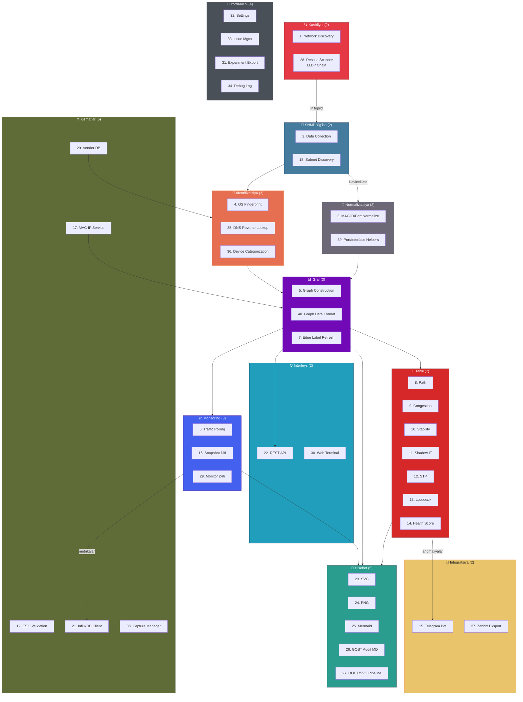
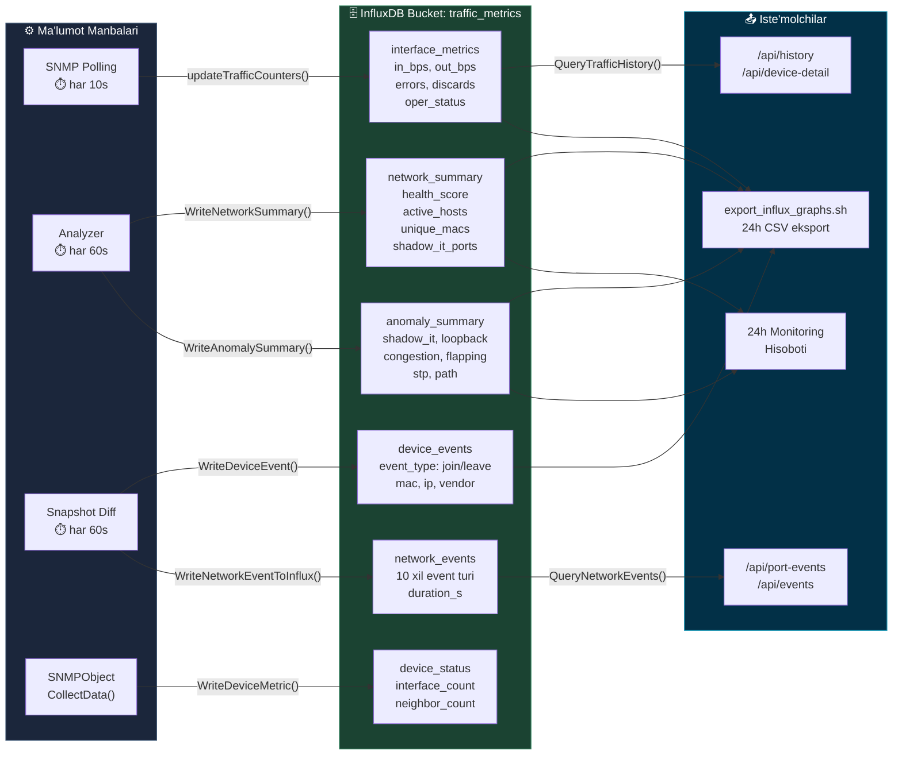
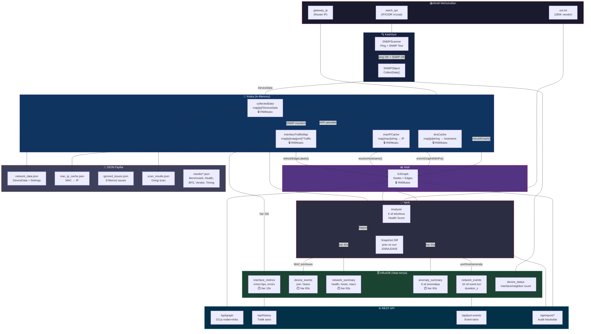

# LLDP Tarmoq Skaneri — Funksional Modullar Xaritasi

> Ushbu hujjat tizimni fayl bo'yicha emas, balki **mantiqiy funksional modullar** bo'yicha tavsiflaydi.
> Har bir modul — aniq bir vazifani bajaradigan funksiyalar to'plami.
> Jami: **40 ta modul**, 18 ta Go fayl, 12,356 qator kod, 249 ta funksiya.
> **Chuqur kod tahlili:** [knowledge.md](knowledge.md) — funksiya-darajasida batafsil hujjat

---

## Modullar Guruhi (Umumiy Ko'rinish)

| Guruh | Modullar soni | Misollar |
|-------|:---:|----------|
| **Kashfiyot** | 2 | Network Discovery, Dinamik Kashfiyot (Rescue Scanner, LLDP Chain) |
| **SNMP yig'ish** | 2 | Data Collection, Subnet Discovery |
| **Normalizatsiya** | 2 | MAC/ID/Port Normalize, Port/Interface Helpers |
| **Identifikatsiya** | 3 | OS Fingerprint (TTL, LLDP, OUI, BMC, VM, Random MAC), DNS Reverse Lookup, Qurilma Klassifikatsiya |
| **Graf** | 3 | Graph Construction, Graph Data Format (D3.js/Neo4j), Edge Label Refresh |
| **Tahlil** | 7 | Path, Congestion, Stability, Shadow IT, STP, Loopback, Health Score |
| **Monitoring** | 3 | Traffic Polling, Snapshot Diff, Continuous Monitor (24h) |
| **Hisobot** | 5 | SVG, PNG, Mermaid, GOST Audit MD, DOCX/SVG Pipeline |
| **Xizmatlar** | 5 | MAC-IP Service, ESXi Validation, Vendor DB (280K OUI), InfluxDB, Capture Manager |
| **Integratsiya** | 2 | Telegram Bot, Zabbix Eksport |
| **Interfeys** | 2 | REST API (30+ endpoint), Web Terminal (SSH/Telnet) |
| **Yordamchi** | 4 | Settings/Persistence, Issue Management, Experiment Exports, Debug Logging |
| | **Jami: 40** | |

### Guruhlar diagrammasi



---

## Modul 1: Tarmoq Kashfiyoti (Network Discovery)

**Fayl:** `snmp_scanner.go`
**Vazifa:** Tarmoqdan tirik xostlarni topish va ularning SNMP qo'llab-quvvatlashini tekshirish.

| Funksiya | Qatorlar | Tavsif |
|----------|----------|--------|
| `NewSNMPScanner()` | 54-66 | Scanner yaratish (default: 50 worker, 2s timeout, ping=true) |
| `ReadIPsFromFile()` | 69-92 | `swich_ips` fayldan IP/CIDR ro'yxat o'qish |
| `ExpandNetworks()` | 95-113 | CIDR notation → individual IP'lar (masalan `172.20.0.0/24` → 254 IP) |
| `expandCIDR()` | 116-132 | Bitta CIDR ni IP massivga yoyish, network/broadcast olib tashlash |
| `Scan()` | 291-320 | Worker Pool: `MaxWorkers` ta goroutine `workerChan` dan IP o'qib parallel skanerlash |
| `ScanFromFile()` | 323-340 | Fayldan o'qib → expand → scan zanjiri |
| `scanIP()` | 261-288 | 1 ta IP ni skanerlash: ping → SNMP test → callback |
| `isHostAlive()` | 145-158 | Xost tirikmi? (ping yoki UDP port check) |
| `pingHost()` | 161-182 | **Zero-goroutine ICMP:** `cmd.Start()` + `time.AfterFunc(kill)` + `go cmd.Wait()` |
| `testSNMP()` | 203-251 | GoSNMP orqali sysDescr/sysName/sysUpTime GET |
| `Connect()` | 185-200 | GoSNMP sessiya ochish (SNMPv2c, 161 port) |

---

## Modul 2: SNMP Ma'lumot Yig'ish (Data Collection)

**Fayl:** `snmp_object.go`
**Vazifa:** Topilgan qurilmalardan batafsil ma'lumot olish: interfeyslar, LLDP qo'shnilar, MAC jadval, ARP, STP, VLAN.

| Funksiya | Tavsif |
|----------|--------|
| `NewSNMPObject()` | OnSuccess/OnFailure callback'lar bilan SNMP ob'ekt yaratish |
| `CollectData(ip, sysName)` | To'liq yig'ish zanjiri: `snmpbulkwalk → parse → DeviceData` |
| `collectLocalChassisID()` | LLDP-MIB `1.0.8802.1.1.2.1.3` dan ChassisID olish; "No Such Instance" yoki bo'sh javobda ustun (`…3.2`) yana bir marta o'qiladi (PiXiETECH 172.20.230.40/.44), "No Such Object" — yakuniy |
| `collectInterfaces()` | IF-MIB: ifDescr, ifSpeed, ifOperStatus, ifHCInOctets, ifAlias, ifInErrors |
| `collectLLDPNeighbors()` | LLDP RemTable: RemChassisId, RemPortId, RemSysName, RemSysDesc, RemMgmtAddr. Indeks: standart 3 qism (TimeMark.LocalPort.RemIndex) yoki PiXiETECH 2 qism (RemIndex.LocalPort; agent bergan lldpRemLocalPortNum/lldpRemIndex ustunlari ustun), ManAddr ham shu 2 qismli shaklda (manzil 2-ustunda) |
| `collectMACTable()` | BRIDGE-MIB: dot1dTpFdbAddress → MAC + port mapping (dot1dBasePort→ifIndex). Walk `-Cc` bilan (tartibsiz): PiXiETECH FDB'ni hash tartibida beradi, oddiy walk "OID not increasing" bilan 1 kod qaytarib, jadval bo'sh qolardi; OID takrorlansa walk to'xtatiladi |
| `collectARPTable()` | IP-ARP: ipNetToMediaPhysAddress → MAC↔IP mapping |
| `collectSTP()` | dot1dStpDesignatedRoot → Root Bridge ID, STP enabled holati |
| `collectVLAN()` | Q-BRIDGE: dot1qPvid → Port VLAN ID'lar, trunk aniqlash |
| `parseSNMPLine()` | `snmpbulkwalk` chiqishini OID + value ga parse qilish |
| `normalizeChassisID()` | Raw bytes / hex string → canonical MAC format |

**Tuzilmalar (Structures):**
- `DeviceData` — 1 ta qurilmaning to'liq ma'lumotlari konteyneri
- `InterfaceData` — 1 ta interfeys: index, descr, speed, status, octets, errors
- `LLDPNeighbor` — 1 ta LLDP qo'shni: chassis, port, sysname, mgmt IP
- `MACEntry` — MAC + port number
- `ARPEntry` — MAC + IP
- `PortVLAN` — port index, PVID, IsTrunk, VLAN ro'yxat
- `STPData` — enabled, root bridge ID

---

## Modul 3: ID/MAC/Port Normalizatsiya (Normalization)

**Fayllar:** `example_usage.go`, `oui_lookup.go`
**Vazifa:** Barcha identifikatorlarni yagona canonical formatga keltirish.

| Funksiya | Joyi | Tavsif |
|----------|------|--------|
| `normalizeID(id, subtype)` | example_usage:608-673 | ChassisID ni subtype (4=MAC, 5=IP, 7=Local) bo'yicha parse |
| `normalizeMAC(mac)` | oui_lookup:139 | Ixtiyoriy MAC format → `aa:bb:cc:dd:ee:ff` |
| `normalizePortName(name)` | example_usage:1131-1179 | Port nomini qisqartirish: `GigabitEthernet1/0/26` → `GE1/0/26`. Pre-compiled regex (`rePortMACPrefix`). 15 ta abbreviation qoidasi. |
| `normalizePortForHypervisor()` | example_usage:1185-1187 | Port nomi lowercase canonical kalit: `GE1/0/26` → `ge1/0/26` |
| `cleanSNMPValue()` | example_usage:593-600 | SNMP prefixlarni olib tashlash: `STRING: "..."` → `...` |
| `formatAsHex()` | example_usage:578-590 | Raw bytes → colon-separated hex |
| `hexStringToMAC()` | example_usage:603-605 | Ixtiyoriy hex string → canonical MAC |
| `isPrintableString()` | example_usage:1191-1202 | ASCII printable tekshiruv (LLDP identifikator uchun) |
| `sanitizeMermaidID()` | report_topology:994-1009 | Node ID → Mermaid-safe alfanumerik kalit |

---

## Modul 4: OS Fingerprinting (Operatsion Tizim Aniqlash)

**Fayl:** `example_usage.go`
**Vazifa:** MAC, LLDP hostname va ICMP TTL birlashtirib qurilma turini aniqlash.

| Funksiya | Qatorlar | Tavsif |
|----------|----------|--------|
| `detectOSFromMAC()` | 1636-1678 | 3 bosqichli gibrid: (1) LLDP hostname, (2) TTL ping, (3) MAC OUI fallback |
| `detectOSByTTL()` | 1680-1720 | `ping -c 1 -W 1` → TTL≤64=Linux, 65-128=Windows. Zero-goroutine: `cmd.Start()` + `time.AfterFunc(3s, Kill)` |
| `isHypervisorMAC()` | 1568-1576 | MAC prefixlar: VMware(3), KVM(2), Hyper-V(1), Xen(1), VBox(1) |
| `isHypervisorPort()` | 1579-1591 | Port MAC'laridan 50%+ VM bo'lsa → true |
| `isServerNIC()` | 1596-1633 | Server vendor NIC: Dell(13), HPE(12), SuperMicro(6), Lenovo(5), Cisco UCS(3), Fujitsu(2), IBM(2) = 43 ta OUI prefix |
| `isBMC()` | 1769-1874 | BMC aniqlash — **2 bosqich:** (1) 30 ta BMC OUI prefix (iDRAC, iLO, XCC, IPMI, CIMC, iRMC, ASMB, iBMC), (2) 16 ta LLDP keyword match |
| `isRandomMAC()` | 1758-1767 | 1-oktet 2-hex = {2,6,a,e} → locally administered (Wi-Fi random) |
| `isSpecialMAC()` | 1722-1752 | Null, broadcast, multicast MAC filtri (1-oktet LSB=1) |
| `isInvalidID()` | 1922-1972 | Garbage ID filtri: null, broadcast, zero, short(<5), multicast |

---

## Modul 5: Graf Shakllantirish (Graph Construction)

**Fayllar:** `example_usage.go`, `dj_graph.go`
**Vazifa:** SNMP ma'lumotlardan D3.js topologiya grafi qurish.

| Funksiya | Joyi | Tavsif |
|----------|------|--------|
| `buildGraphEdges()` | example_usage:677-1043 | 1 ta qurilma uchun: LLDP→edge, MAC→endpoint/hub/VM node yaratish |
| `addMACCrossRefEdges()` | example_usage:2518-2596 | LLDP bo'lmagan switchlarni MAC jadval orqali aniqlash (1 port=1 switch MAC → direct link); LLDP qo'shnisi so'ralgan switch bo'lgan portdan MAC-REF chizilmaydi |
| `rebuildGraph()` | example_usage:2598-2652 | To'liq graf qayta qurish: snapshot → nodes → edges → MAC-ref → hypervisor → enrich → atomic swap |
| `buildSwitchChassisMACs()` | example_usage:2501-2516 | Switch MAC → nodeID mapping (switch MAC'larni endpoint'dan ajratish uchun) |
| `detectHypervisors()` | example_usage:2654-2806 | **Faza 1:** VM MAC'larni port bo'yicha guruhlash → `hyp-` node qo'yish. **Faza 2:** Server NIC OUI → `[HYPERVISOR]` tag |
| `DJGraph.AddNode()` | dj_graph | Node qo'shish (unique) |
| `DJGraph.AddEdge()` | dj_graph | Edge qo'shish (duplicate tekshiruv: A→B yoki B→A) |
| `DJGraph.GetGraphData()` | dj_graph | Nodes/Links → D3.js format (12 xil group: switch, router, hub, endpoint, vm, hypervisor, bmc, camera, phone, iot, wifi_random, server) |
| `DJGraph.OptimizeCoords()` | dj_graph | Tugunlarni tartiblash (coordinate optimallashtirish) |
| `DJGraph.GetLongPaths()` | dj_graph | BFS: coreID dan 3+ hop uzoqdagi node'larni topish |
| `DJGraph.ExportHostsToZabbix()` | dj_graph | `zabbix_hosts.json` eksport |
| `DJGraph.ExportToMap()` | dj_graph | `zabbix_map.json` eksport |

---

## Modul 6: Trafik Monitoring (Traffic Speed Measurement)

**Fayl:** `example_usage.go`
**Vazifa:** Har 10 soniyada SNMP counter'lardan real-time trafik tezligini hisoblash.

| Funksiya | Qatorlar | Tavsif |
|----------|----------|--------|
| `startTrafficPolling()` | 2155-2193 | 10s ticker. `pollingInProgress sync.Map` bilan takroriy poll oldini oladi. Har qurilmaga parallel `collectInterfaces()` |
| `updateTrafficCounters()` | 2052-2139 | Delta hisoblash: `(current - previous) * 8 / timeDelta` = bps. Counter reset = delta 0. Sanity: speed > linkSpeed*1.1 → 0 |
| `getPortTraffic()` | 2142-2152 | Port bo'yicha inSpeed/outSpeed olish |
| `formatSpeed()` | 1086-1108 | bps → `100M`, `1G`, `10G` formati |
| `getPortSpeed()` | 1111-1118 | Port ifSpeed → formatlanadi |

**Tuzilma:** `InterfaceTraffic` — LastInOctets, LastOutOctets, LastPollTime, InSpeed, OutSpeed

---

## Modul 7: Trafik Label Yangilash (Edge Label Refresh)

**Fayl:** `example_usage.go`
**Vazifa:** Graf edge'lariga `↓5M ↑3M` ko'rinishida trafik ma'lumot qo'shish (struktura buzmasdan).

| Funksiya | Qatorlar | Tavsif |
|----------|----------|--------|
| `refreshGraphEdgeLabels()` | 2195-2286 | **Deadlock-free:** collectedData.RLock → nodeToIP snapshot → release → globalGraph.Lock → **deep clone** edges → trafikni klonga qo'shish → `graph.Edges = newEdges` (atomic swap) |
| `startPeriodicLabelRefresh()` | 2308-2315 | Har 30 soniyada `refreshGraphEdgeLabels()` chaqiradi |
| `findPortIndexByName()` | 2289-2305 | Port nomi → IfIndex topish (label'dan portni aniqlash uchun) |

---

## Modul 8: Tarmoq Tahlili — Path (Yo'l Optimallashtirish)

**Fayl:** `analyzer.go`
**Vazifa:** Core gateway'dan uzoq (3+ hop) tugunlarni aniqlash.

| Funksiya | Tavsif |
|----------|--------|
| `analyzePaths()` | BFS chuqurlik 3 dan ortiq → "Device is too far from Core" ogohlantirish |

---

## Modul 9: Tarmoq Tahlili — Congestion (Tiqilinch)

**Fayl:** `analyzer.go`
**Vazifa:** Interfeys yuklanishi, packet loss va fizik xatoliklarni aniqlash.

| Funksiya | Tavsif |
|----------|--------|
| `analyzeCongestion()` | Trafik > 800Mbps (80% of 1G) → critical. InDiscards → packet loss. InErrors → CRC/frame xato |

---

## Modul 10: Tarmoq Tahlili — Stability (Barqarorlik)

**Fayl:** `analyzer.go`
**Vazifa:** Interfeys flapping (tez-tez Up/Down) aniqlash.

| Funksiya | Tavsif |
|----------|--------|
| `analyzeStability()` | IfOperStatus 1→2 (Down) hodisalar soni → "Interface went DOWN N times" |

---

## Modul 11: Tarmoq Tahlili — Shadow IT

**Fayl:** `analyzer.go`
**Vazifa:** Boshqarilmaydigan switch/hub larni aniqlash (Port-MAC Ratio).

| Funksiya | Tavsif |
|----------|--------|
| `analyzeShadowIT()` | Port dagi MAC > 1, non-trunk, non-VM (`isHypervisorPort`), non-ESXi (`ConfirmedESXiMACs`), non-ignored, non-random → Shadow IT |

---

## Modul 12: Tarmoq Tahlili — STP

**Fayl:** `analyzer.go`
**Vazifa:** Spanning Tree root bridge konfiguratsiyasini tekshirish.

| Funksiya | Tavsif |
|----------|--------|
| `analyzeSTP()` | Root Bridge MAC core switch'da emasmi? PVST+ normal deb 1 ta summary ogohlantirish |

---

## Modul 13: Tarmoq Tahlili — Loopback

**Fayl:** `analyzer.go`
**Vazifa:** Tarmoq loop'larini aniqlash (kabel o'ziga qaytgan).

| Funksiya | Tavsif |
|----------|--------|
| `analyzeLoopback()` | (1) LLDP self-neighbor: RemChassisId == o'z ChassisID. (2) MAC self-ref: o'z MAC non-trunk portda ko'rinishi |

---

## Modul 14: Health Score (Tarmoq Sog'ligi Bahosi)

**Fayl:** `analyzer.go`
**Vazifa:** 0-100 balli tarmoq sog'ligi reytingi.

| Funksiya | Tavsif |
|----------|--------|
| `CalculateHealthScore()` | 100 dan boshlab jarimalar: shadow_it=-5(max 30), loopback=-20, stp=-10(max 10), congestion=-5/-2, physical=-2, path=-2, stability=-3 |
| `GetHealthLabel()` | 90+=Excellent, 70+=Good, 50+=Warning, <50=Critical |

---

## Modul 15: Telegram Bot Integratsiya

**Fayl:** `analyzer.go`
**Vazifa:** Kritik muammolarni Telegram kanalga yuborish (python bot orqali).

| Funksiya | Tavsif |
|----------|--------|
| `notifyTelegramIfCritical()` | `http://127.0.0.1:5005/notify` ga POST. Har issue uchun 1 soatlik cooldown |
| `canNotifyIssue()` | Cooldown tekshiruv: `notifiedIssues[issueID]` → oxirgi yuborilgan vaqt |
| `ResetIssueCooldown()` | "To'g'irlandi" tugmasi bosilganda cooldown tozalash |

---

## Modul 16: Snapshot Diff Engine (Holat Qiyoslash)

**Fayl:** `snapshot_diff.go`
**Vazifa:** Ikki vaqt nuqtasidagi tarmoq holatini solishtirish.

| Funksiya | Tavsif |
|----------|--------|
| `CreateSnapshot()` | `collectedData` + `graph` + `report` → `NetworkSnapshot` (ActiveMACs, ActiveHosts, Ports, Anomalies) |
| `CompareSnapshots()` | prev vs curr: JoinedMACs, LeftMACs, NewHosts, LostHosts, UnreachableHosts, RestoredHosts, PortStatusChanges, NewAnomalies, FixedAnomalies |
| `LogChanges()` | Console + `AddNetworkEvent()` ga diff natijalarini chiqarish |
| `AddNetworkEvent()` | Global event log'ga qo'shish (max 200 ta), InfluxDB ga persist |
| `persistEventToInflux()` | Duration tracking: port_down boshlanish vaqti → port_up da duration hisoblanadi |
| `GetNetworkEvents()` | Thread-safe event log nusxasini qaytarish |

**Tuzilmalar:** `NetworkSnapshot`, `MACDiffEntry`, `AnomalyDiff`, `PortStatusChange`, `SnapshotDiff`, `NetworkEvent`

---

## Modul 17: MAC-IP Xizmat (ARP Cache Service)

**Fayl:** `mac_ip_service.go`, `example_usage.go`
**Vazifa:** Orqa fonda ARP jadval yig'ish va MAC→IP mapping boyitish.

| Funksiya | Joyi | Tavsif |
|----------|------|--------|
| `startMacIPService()` | mac_ip_service | Har 5 daqiqada `collectARPFromAllSwitches()` chaqiradi |
| `collectARPFromAllSwitches()` | mac_ip_service | Barcha switch'lardan parallel ARP yig'ish |
| `collectARPFromSwitch()` | mac_ip_service | 1 ta switch'dan SNMP ARP table |
| `collectGatewayARP()` | example_usage:2019-2042 | Gateway'dan ARP → `globalMACtoIP` map |
| `loadMacIPCache()` | mac_ip_service | `mac_ip_cache.json` fayldan yuklash |
| `saveMacIPCache()` | mac_ip_service | `mac_ip_cache.json` faylga saqlash |
| `enrichGraphWithIPs()` | mac_ip_service | Graf node'lariga IP qo'shish (MAC-IP keshdan) |
| `getGlobalIP()` | example_usage:2045-2049 | MAC → IP qidirish |
| `TriggerMacIPCollection()` | mac_ip_service | Tashqaridan ARP yig'ishni boshlash |

---

## Modul 18: Subnet Kashfiyoti (Gateway Subnet Discovery)

**Fayl:** `mac_ip_service.go`
**Vazifa:** Gateway router'dan SNMP orqali subnetlarni topish va yangi switch'larni qidirish.

| Funksiya | Tavsif |
|----------|--------|
| `discoverGatewaySubnets()` | `ipAdEntNetMask` → `SubnetInfo{Net, Prefix, IP}` ro'yxati (har gateway uchun) |
| `collectGatewaySVIIPs()` | Gateway SVI interfeyslarning IP'larini olish |
| `collectGatewayLLDP()` | Gateway'ning o'z lldpRemTable qo'shnilari (FortiGate 172.20.0.1: lldpLocalSystemData yo'q, RemTable bor) va port nomlari (ifName, bo'lmasa ifDescr); router tugundan qo'shnilarga link (`gatewayLLDPLinks`), switch o'z tomonidan ko'rsatgan link takrorlanmaydi |
| `planSubnetDiscovery()` | Xususiy subnetlardagi (/31, /32 emas) ARP-ma'lum IP'lardan MAC'i tarmoq uskunasi ishlab chiqaruvchisiniki bo'lganlari (`isNetworkMakerMAC`), har IP bir marta |
| `probeSubnetCandidates()` | 8 ta parallel: sysDescr (2 s, qayta urinishsiz), keyin `checkSwitch`; 5 daqiqalik vaqt chegarasi |
| `RunSubnetDiscovery()` | To'liq kashfiyot zanjiri, bitta xulosa qatori |
| `countBits()`, `parseIPv4()`, `switchIPPrefixes()` | Yordamchi funksiyalar |

---

## Modul 19: ESXi HTTP Validatsiya

**Fayl:** `mac_ip_service.go`
**Vazifa:** MAC→IP dan ESXi serverlarni HTTP orqali tasdiqlash (Shadow IT false positive kamaytirish).

| Funksiya | Tavsif |
|----------|--------|
| `queueESXiValidation()` | `esxiQueue` kanalga MAC+IP juftini jo'natish |
| `esxiCheckWorker()` | 100 ta parallel goroutine: `https://{ip}:443` → "VMware ESXi" izlash |
| `ConfirmedESXiMACs` | `sync.Map` — tasdiqlangan ESXi MAC'lar (analyzer va graph'da ishlatiladi) |

---

## Modul 20: Vendor Bazasi (OUI Lookup)

**Fayl:** `oui_lookup.go`
**Vazifa:** MAC adres bo'yicha ishlab chiqaruvchini aniqlash.

| Funksiya | Tavsif |
|----------|--------|
| `initOUIDatabase()` | IEEE `oui.txt` faylni parse qilish (280,000+ yozuv) |
| `lookupVendor()` | MAC prefix → vendor nomi (6-char, 9-char, 7-char prefix try) |
| `categorizeVendor()` | Vendor nomi → qurilma turi (camera, phone, iot, access_point, switch, router, server) |
| `getMACVendor()` | wrapper: lookupVendor → "Unknown" bo'lsa "" qaytaradi |

---

## Modul 21: InfluxDB Mijoz (Time Series Database)

**Fayl:** `influx_client.go`
**Vazifa:** InfluxDB v2 ga trafik va event ma'lumotlar yozish/o'qish.

| Funksiya | Measurement | Tavsif |
|----------|-------------|--------|
| `InitInfluxClient()` | — | InfluxDB ulanish (URL, token, org, bucket) |
| `CloseInfluxClient()` | — | Yopish |
| `WriteInterfaceMetric()` | `interface_metrics` | in/out bps, octets, errors, discards, oper_status |
| `WriteDeviceEvent()` | `device_events` | join/leave — mac, ip, switch_ip, vendor |
| `WriteNetworkSummary()` | `network_summary` | active_hosts, unique_macs, shadow_it, health_score, random_macs |
| `WriteAnomalySummary()` | `anomaly_summary` | 6 xil anomaliya soni |
| `WriteNetworkEventToInflux()` | `network_events` | event_type, switch_ip, port, mac, ip, duration_s |
| `QueryTrafficHistory()` | ← `interface_metrics` | Qurilma bo'yicha N soat trafik tarixi |
| `QueryNetworkEvents()` | ← `network_events` | Filter: IP, soat, event turi |
| `QueryRangeMetrics()` | ← | Ikki vaqt oralig'idagi metrikalar |
| `ClearInfluxData()` | — | Bucket tozalash |
| `DeleteNetworkEventsRange()` | — | Vaqt diapazoni bo'yicha eventlarni o'chirish |
| `IsInfluxEnabled()` | — | InfluxDB ulanganmi? |

---

## Modul 22: REST API Server

**Fayl:** `web_server.go`
**Vazifa:** 30+ HTTP endpoint: graf, hostlar, sozlamalar, tarix, eksperiment, eventlar.

| Endpoint | Handler | Vazifa |
|----------|---------|--------|
| `GET /api/graph` | `graphHandler` | D3.js graf + health score + anomaliyalar |
| `GET/DELETE /api/hosts` | `hostsHandler` | Qurilmalar ro'yxati / hammasini o'chirish |
| `GET/POST /api/settings` | `settingsHandler` | IP ranges, community, timeout, workers |
| `POST /api/rescan` | `rescanHandler` | Qayta skanerlash |
| `GET /api/status` | `statusHandler` | Hosts/nodes/edges soni |
| `GET /api/history` | `historyHandler` | InfluxDB trafik tarixi |
| `GET /api/device-detail` | `deviceDetailHandler` | Qurilma interfeyslari, VLAN, real-time trafik |
| `POST /api/bot/action` | `botActionHandler` | Telegram "Ignore"/"Verify" |
| `POST /api/capture/start` | `captureStartHandler` | Capture sessiya boshlash |
| `POST /api/capture/stop` | `captureStopHandler` | Capture to'xtatish |
| `GET /api/captures` | `capturesHandler` | Sessiyalar ro'yxati |
| `POST /api/report/generate` | `reportGenerateHandler` | JSON tahlil hisobot |
| `GET /api/report/download` | `reportDownloadHandler` | Word .doc yuklab olish |
| `POST /api/experiment/start` | `experimentStartHandler` | Eksperiment boshlash |
| `GET /api/experiment/status` | `experimentStatusHandler` | Eksperiment holati |
| `POST /api/experiment/stop` | `experimentStopHandler` | Eksperiment to'xtatish |
| `GET /api/experiment/results` | `experimentResultsHandler` | results/ JSON fayllar |
| `GET /api/events` | `eventsHandler` | So'nggi 200 ta event |
| `GET/DELETE /api/port-events` | `portEventsHandler` | InfluxDB event tarixi |
| `GET /api/port-events/stats` | `portEventsStatsHandler` | Event statistikasi |

---

## Modul 23: SVG Topologiya Generator

**Fayl:** `report_topology.go` (qator 44-147)
**Vazifa:** Switch/Router tugunlardan circular layout SVG yaratish.

| Funksiya | Tavsif |
|----------|--------|
| `GenerateTopologySVG()` | Node/Edge filtrlash → doiraviy joylashtirish → SVG string |
| `truncateLabel()` | Uzun label'ni qisqartirish |
| `SVGToBase64Img()` | SVG → Base64 `` tag |

---

## Modul 24: PNG Topologiya Generator

**Fayl:** `report_topology.go` (qator 157-325)
**Vazifa:** Go `image` paketi bilan pikselma-piksel rasm yaratish (Word uchun).

| Funksiya | Tavsif |
|----------|--------|
| `GenerateTopologyPNG()` | 900x700 RGBA → circular layout → PNG → Base64 `` |
| `drawLine()` | Bresenham's line algorithm (2px qalinlik) |
| `drawCircle()` | To'ldirilgan doira (r² formula) |
| `drawCircleOutline()` | Doira konturi |

---

## Modul 25: Mermaid Topologiya Generator

**Fayl:** `report_topology.go` (qator 574-737)
**Vazifa:** 12 xil qurilma turi uchun Mermaid `graph TD` kod generatsiyasi.

| Funksiya | Tavsif |
|----------|--------|
| `GenerateMermaidTopology()` | Node shape (doira, hexagon, flag), 12 rang kodlash, port label'lar |
| `GenerateTopologyLegend()` | Rang-tur Markdown jadvali: 🔵Switch, 🔴Router, 🟣VM ... |
| `GenerateShadowDiagrams()` | Har bir Hub uchun alohida `graph LR` — switch→hub→children |
| `GenerateHypervisorDiagrams()` | Har bir Hypervisor uchun alohida — switch→hyp→VM'lar |

---

## Modul 26: GOST Audit Hisobot Generator

**Fayl:** `report_topology.go` (qator 1032-1348)
**Vazifa:** 9 bo'limli to'liq GOST-standart audit hisoboti (Markdown formatda).

| Bo'lim | Kontent |
|--------|---------|
| 1. Umumiy Ma'lumot | Sana, qurilmalar soni, MAC soni |
| 2. Tarmoq Sog'ligi | Health Score, anomaliya jadvali |
| 3. Topologiya Sxemasi | Mermaid diagramma + rang legendasi |
| 4. Qurilmalar Ro'yxati | 4.1 Switchlar, 4.2-4.12 guruhlangan: endpoint, hypervisor, VM, hub, phone, camera, iot, bmc, server, router, wifi_random |
| 5. VLAN Ro'yxati | VLAN ID, switchlar, access/trunk port soni |
| 6. Anomaliyalar | Turi, qurilma, tavsif jadvali |
| 7. Shadow IT | Har bir hub uchun Mermaid diagramma |
| 8. Hypervisor | Har bir hypervisor uchun Mermaid diagramma |
| 9. Tavsiyalar | Anomaliyalarga asoslangan avtomatik tavsiyalar |

---

## Modul 27: DOCX/SVG Eksport Pipeline

**Fayl:** `report_topology.go` (qator 1350-1523)
**Vazifa:** Markdown hisobotni professional hujjat formatlariga aylantirish.

| Funksiya | Tavsif |
|----------|--------|
| `reportAuditDocxHandler()` | MD → temp fayl → `python3 md2docx_gost_linux.py input.md output.docx` → DOCX download. `PYTHONPATH` va `HOME` sozlash (sudo muhit uchun) |
| `reportFullHandler()` | HTML (Word-compatible) formatda 7 bo'limli hisobot: Title, Info, Health, Topology PNG, Devices jadval, Anomalies, Recommendations |
| `reportAuditSVGHandler()` | Mermaid → Python (`mermaid_to_graphviz()`) → `dot -Tsvg` → SVG download |

---

## Modul 28: Dinamik Kashfiyot (Dynamic Discovery)

**Fayl:** `example_usage.go`
**Vazifa:** Yangi switch'larni avtomatik topish va grafikaga qo'shish.

| Funksiya | Qatorlar | Tavsif |
|----------|----------|--------|
| `startRescueScanner()` | 2379-2391 | Har 7 daqiqada: `swich_ips` dagi `collectedData` da yo'q IP'larni topish → ping → CollectData → rebuildGraph |
| `runRescueScan()` | 2393-2450 | 30 ta parallel ping + SNMP collect |
| `discoverFromLLDP()` | 2452-2499 | Barcha LLDP RemMgmtIP'lardan yangi switch'larni topish → `appendToSwitchIPs()` → CollectData → rebuildGraph |
| `startPeriodicRescan()` | 2317-2373 | Har 5 daqiqada barcha ma'lum switch'larni qayta poll → rebuildGraph → discoverFromLLDP ("chain reaction") |

---

## Modul 29: Doimiy Monitoring (Continuous Monitoring)

**Fayl:** `example_usage.go`
**Vazifa:** 24 soatlik uzluksiz monitoring tsikli.

| Funksiya | Qatorlar | Tavsif |
|----------|----------|--------|
| `runMonitor24h()` | 1390-1523 | Har 60s (`monitorCycle`): Analyze → Snapshot → Diff → InfluxDB write. Birinchi tsikl startup grafini kutadi; bo'sh graf bo'yicha snapshot olinmaydi. Panic recovery har tsikl. Yakunida `monitor_summary.json` |
| `startPeriodicAnalysis()` | 1204-1279 | Har 60s: Analyze + Snapshot Diff + InfluxDB (summary, events). **Deadlock-free:** snapshot pattern |
| `runBenchmark()` | 1285-1373 | W=1,10,25,50,100 ketma-ket scan → `benchmark_results.json` |
| `handleRescanRequests()` | 2815-2924 | UI "Rescan" tugmasi → clear data → scan → rebuild → save |
| `generateExperimentReport()` | 2928-3098 | Eksperiment natijalarini hisoblash: Shadow IT (raw vs filtered), FP reduction, JSON eksport |

---

## Modul 30: Web Terminal (SSH/Telnet Proxy)

**Fayl:** `terminal_handler.go`
**Vazifa:** Brauzerdan qurilmalarga SSH/Telnet ulanish.

| Funksiya | Tavsif |
|----------|--------|
| `registerTerminalRoutes()` | `/api/terminal` (WS) + `/api/check-ports` (GET) |
| `terminalHandler()` | WebSocket upgrader → parametrlar parse → SSH yoki Telnet sessiya |
| `handleSSHSession()` | `golang.org/x/crypto/ssh` orqali PTY sessiya (cols×rows) |
| `handleTelnetSession()` | TCP ulanish + IAC filtrlash |
| `scanPorts()` | SSH (22, 2222, 830, 8022) + Telnet (23, 2323) portlarni parallel tekshirish |
| `checkPort()` | 1 ta port ochiqmi? (2s timeout TCP dial) |
| `filterTelnetIAC()` | Telnet IAC (0xFF) buyruqlarni tozalash |

---

## Modul 31: Eksperiment Eksportlari

**Fayl:** `experiment_exports.go`
**Vazifa:** Ilmiy maqola uchun natijalarni JSON formatda eksport.

| Funksiya | Fayl | Tavsif |
|----------|------|--------|
| `ExportBenchmarkResults()` | `results/benchmark_results.json` | W → Duration → Devices → SNMP OK/Fail |
| `ExportHealthScores()` | `results/health_scores.json` | Har qurilma: IP, SysName, anomaliyalar, per-device health |
| `ExportBFSDepths()` | `results/bfs_depths.json` | Core'dan har node'gacha BFS chuqurligi |
| `ExportVendorStats()` | `results/vendor_stats.json` | Vendor → qurilmalar soni statistikasi |
| `ExportTelegramTiming()` | `results/telegram_timing.json` | Issue aniqlash → Telegram yuborish vaqti (ms) |
| `AddTelegramTiming()` | — | Timing yozuvini qo'shish |

---

## Modul 32: Sozlamalar va Saqlash (Persistence)

**Fayl:** `settings.go`, `capture.go`
**Vazifa:** Konfiguratsiya va scan natijalarini faylga saqlash/yuklash.

| Funksiya | Fayl | Tavsif |
|----------|------|--------|
| `DefaultSettings()` | settings | Standart sozlamalar |
| `GetCurrentSettings()` / `SetCurrentSettings()` | settings | Joriy sozlamalarni o'qish/yozish |
| `LoadSavedData()` | settings | `network_data.json` dan yuklash |
| `SaveData()` | settings | `network_data.json` ga saqlash |
| `ClearSavedData()` | settings | Saqlangan ma'lumotlarni o'chirish |
| `HasSavedData()` | settings | Saqlangan ma'lumot bormi? |
| `readSwitchIPsFile()` | settings | `swich_ips` fayldan IP ro'yxat |
| `writeSwitchIPsFile()` | settings | `swich_ips` faylga yozish |
| `appendToSwitchIPs()` | settings | Yangi IP qo'shish (duplicate tekshiruv) |
| `loadGatewayIPs()` | gateways | `gateway_ip` fayldan o'qish (bir yoki bir nechta IP) |
| `InitCaptureManager()` | capture | Capture sessiya menejeri |

---

## Modul 33: Muammolarni Boshqarish (Issue Management)

**Fayl:** `ignored_issues.go`, `analyzer.go`
**Vazifa:** Telegram orqali "e'tiborsiz qoldirish" tugmasi bosilganda muammoni yashirish.

| Funksiya | Tavsif |
|----------|--------|
| `LoadIgnoredIssues()` | `ignored_issues.json` dan yuklash |
| `SaveIgnoredIssues()` | `ignored_issues.json` ga saqlash |
| `IgnoreIssue(issueID)` | Muammoni yashirish |
| `UnignoreIssue(issueID)` | Muammoni qaytarish |
| `IsIssueIgnored(issueID)` | Yashiringanmi? (Shadow IT va Loopback analizatorlarda ishlatiladi) |

---

---

## Modul 34: Debug Logging (Diagnostika Log)

**Fayl:** `example_usage.go` (qator 84-99)
**Vazifa:** `debug_edges_analysis.log` fayliga graf edge yaratish diagnostikalarini yozish.

| Funksiya | Tavsif |
|----------|--------|
| `initDebugLog()` | `debug_edges_analysis.log` faylni ochish, `debugLogFile` global o'zgaruvchiga saqlash |
| `logDebug(format, v...)` | Thread-safe log yozish (`debugLogMutex`). Agar fayl ochilmagan bo'lsa — silent skip |

---

## Modul 35: DNS Reverse Lookup (Xostnom Aniqlash)

**Fayl:** `example_usage.go` (qator 1877-1921)
**Vazifa:** IP adresdan hostname aniqlash (DNS PTR record) va natijani keshlash.

| Funksiya | Tavsif |
|----------|--------|
| `resolveHostname(ip)` | 2s timeout bilan DNS reverse lookup. Natija `dnsCache` map'ga keshlanadi (bo'sh natija ham keshlanadi — takroriy so'rov oldini oladi). FQDN dan domen qismi olib tashlanadi: `PC-JAMIL.tuit.local.` → `PC-JAMIL` |

**Kesh tuzilmasi:** `dnsCache map[string]string` + `dnsCacheMutex sync.RWMutex`

---

## Modul 36: Qurilma Klassifikatsiya (Device Group Categorization)

**Fayl:** `dj_graph.go` (qator 391-463)
**Vazifa:** Node ma'lumotlari asosida qurilma turini aniqlash (D3.js vizualizatsiya uchun).

| Funksiya | Tavsif |
|----------|--------|
| `determineDeviceGroup(node, info)` | 12 xil turga klassifikatsiya: wifi_random → endpoint (OUI orqali camera/phone/iot) → hub → bmc → hypervisor → vm → server → switch → router → unknown. Prioritet tartibi muhim — birinchi match qaytariladi |

**Aniqlash usullari:**
- `[WiFi]`, `[ENDPOINT]`, `[HUB]`, `[BMC]`, `[HYPERVISOR]`, `[VM]` tag'lar → tegishli tur
- MAC OUI vendor lookup → `categorizeVendor()` → camera, phone, iot, access_point
- String match: "linux"/"windows" → server, "hpe"/"cisco"/"snr" → switch

---

## Modul 37: Zabbix Eksport (Monitoring Integratsiya)

**Fayl:** `dj_graph.go` (qator 466-640)
**Vazifa:** Topilgan qurilmalarni Zabbix monitoring tizimiga eksport qilish.

| Funksiya | Tavsif |
|----------|--------|
| `GenerateZabbixTemplate(node)` | Node info asosida SNR yoki generic SNMP template tanlash (6 ta SNR template) |
| `ExportHostsToZabbix(filePath)` | `zabbix_hosts.json` yaratish: har host uchun SNMP interfeys, template, group |
| `ExportToMap(filePath)` | `zabbix_map.json` yaratish: Zabbix Map format, Server_(96) ikonka, koordinatalar |

---

## Modul 38: Capture Sessiya Menejeri

**Fayl:** `capture.go` (197 qator)
**Vazifa:** Trafik va topologiya ma'lumotlarini vaqt oraliqlarida yig'ish sessiyalari.

| Funksiya | Tavsif |
|----------|--------|
| `InitCaptureManager(baseDir)` | `captures/` papka yaratish, CaptureManager init |
| `StartCapture(name, graph)` | Yangi sessiya boshlash: UUID ID, timestamp, graph snapshot |
| `StopCapture()` | Aktiv sessiyani to'xtatish: InfluxDB dan metrikalar olish, `{id}_full_data.json` ga saqlash |
| `ListCaptures()` | `captures/` papkadagi sessiya fayllarni ro'yxatlash |
| `ActiveSession()` | Hozirgi aktiv sessiya bormi? |
| `fetchSessionData(start, end)` | InfluxDB dan vaqt oralig'idagi trafik va status eventlarni olish |

**Tuzilmalar:** `CaptureManager`, `CaptureSession`, `FullCaptureData`, `TrafficMetrics`, `StatusEvent`

---

## Modul 39: Port/Interface Yordamchi Funksiyalar

**Fayl:** `example_usage.go`
**Vazifa:** Port va interfeys bilan ishlash uchun yordamchi funksiyalar.

| Funksiya | Qatorlar | Tavsif |
|----------|----------|--------|
| `getLocalPortName(data, portNum)` | 1047-1057 | Port raqami → interfeys nomi (IfDescr) |
| `isNullInterface(name)` | 1060-1067 | NULL0 / InLoopBack / Vlanif virtual interfeyslarni filtrlash |
| `getPortVLANLabel(portVLANs, portIndex)` | 1069-1083 | Port VLAN ma'lumotini label formatiga: `[V100]`, `[T]` (trunk) |
| `getPortSpeed(interfaces, portIndex)` | 1111-1118 | Port ifSpeed → formatlangan string |
| `saveResults(data)` | 1994-2016 | `scan_results.json` ga DeviceData ro'yxatni saqlash |
| `countEdges(graph)` | 1985-1991 | Grafdagi edge'lar sonini hisoblash |
| `min(a, b)` | 2808-2813 | Ikki int dan kichigini qaytarish |
| `parseDurationFlag(s)` | 1380-1388 | `"24h"`, `"30m"` string → `time.Duration` |

---

## Modul 40: Graph Data Format (D3.js Ma'lumot Formati)

**Fayl:** `dj_graph.go` (qator 177-388)
**Vazifa:** Ichki graf tuzilmasini D3.js va Neo4j formatlariga aylantirish.

| Funksiya | Tavsif |
|----------|--------|
| `ExportDataJSON()` | Neo4j mos format: `{results: [{data: [{graph: {nodes, relationships}}]}]}` |
| `GetGraphData()` | D3.js format: `GraphData{Nodes, Links}`. Har node uchun: label, group, hostname, anomalies, unreachable. Har edge uchun: sourceLabel, targetLabel, unreachable. Edge label parse: `"GE1/0/5 [V100]\|GE1/0/1"` → sourceLabel + targetLabel |
| `CalculateDepths(rootID)` | BFS: root dan har node'gacha hop soni |
| `GetLongPaths(rootID, threshold)` | BFS chuqurligi > threshold bo'lgan node'lar ro'yxati |

**Tuzilmalar:** `GraphNode` (14 maydon), `GraphLink` (8 maydon), `GraphData` (4 maydon)

---

## Ma'lumotlar Saqlash Arxitekturasi (Data Storage)

Tizim ikki xil saqlash mexanizmidan foydalanadi:
1. **InfluxDB v2** — vaqt-seriya ma'lumotlar (trafik, eventlar, anomaliyalar)
2. **JSON fayllar** — konfiguratsiya, kesh, eksperiment natijalari

### InfluxDB Konfiguratsiya

```
URL:    http://localhost:8086
Token:  lldp-network-monitor-token
Org:    net_monitor
Bucket: traffic_metrics
Batch:  100 ta point, 5s flush interval
```

---

### InfluxDB Measurements (Jadvallar)

#### 1. `interface_metrics` — Port Trafik Ma'lumotlari

Har 10 soniyada har bir port uchun yoziladi. Asosiy vaqt-seriya jadvali.

| Maydon turi | Nomi | Tavsif |
|-------------|------|--------|
| **Tag** | `device_ip` | Switch IP adresi (indekslangan) |
| **Tag** | `if_name` | Interfeys nomi (masalan `GE1/0/5`) |
| **Tag** | `if_descr` | Interfeys tavsifi |
| **Field** | `in_bps` | Kiruvchi trafik tezligi (bit/s) |
| **Field** | `out_bps` | Chiquvchi trafik tezligi (bit/s) |
| **Field** | `in_octets` | Kiruvchi baytlar (64-bit HC counter) |
| **Field** | `out_octets` | Chiquvchi baytlar (64-bit HC counter) |
| **Field** | `in_errors` | Kiruvchi xatolar (CRC, frame) |
| **Field** | `out_errors` | Chiquvchi xatolar |
| **Field** | `in_discards` | Kiruvchi tashlab yuborilganlar (buffer to'lib ketishi) |
| **Field** | `out_discards` | Chiquvchi tashlab yuborilganlar |
| **Field** | `oper_status` | Port holati: 1=UP, 2=DOWN |

**Yozuvchi:** `WriteInterfaceMetric()` ← `updateTrafficCounters()` ← `startTrafficPolling()` (har 10s)
**O'quvchi:** `QueryTrafficHistory()`, `QueryRangeMetrics()` ← `/api/history`, `/api/device-detail`

---

#### 2. `device_events` — Qurilma JOIN/LEAVE Hodisalari

MAC/Host tarmoqqa kirganda yoki chiqqanda yoziladi.

| Maydon turi | Nomi | Tavsif |
|-------------|------|--------|
| **Tag** | `event_type` | `"join"` yoki `"leave"` |
| **Tag** | `vendor` | OUI vendor nomi |
| **Field** | `mac` | MAC adres |
| **Field** | `ip` | IP adres |
| **Field** | `switch_ip` | Qaysi switch'ga ulangan |

**Yozuvchi:** `WriteDeviceEvent()` ← `startPeriodicAnalysis()` (Snapshot Diff natijasi)
**O'quvchi:** InfluxDB export skripti (`export_influx_graphs.sh`)

---

#### 3. `network_summary` — Tarmoq Umumiy Holati

Har 60 soniyada 1 ta yozuv — tarmoq "pulsi".

| Maydon turi | Nomi | Tavsif |
|-------------|------|--------|
| **Field** | `active_hosts` | SNMP-reachable xostlar soni |
| **Field** | `unique_macs` | Noyob MAC adreslar soni |
| **Field** | `shadow_it_ports` | Shadow IT aniqlangan portlar |
| **Field** | `health_score` | Tarmoq sog'ligi bali (0-100) |
| **Field** | `random_macs` | Wi-Fi random MAC soni |

**Yozuvchi:** `WriteNetworkSummary()` ← `startPeriodicAnalysis()` (har 60s)
**O'quvchi:** InfluxDB export skripti, 24h monitoring hisoboti

---

#### 4. `anomaly_summary` — Anomaliya Statistikasi

Har 60 soniyada anomaliya turlari soni.

| Maydon turi | Nomi | Tavsif |
|-------------|------|--------|
| **Field** | `shadow_it_count` | Shadow IT soni |
| **Field** | `loopback_count` | Loop soni |
| **Field** | `congestion_count` | Tiqilinch soni |
| **Field** | `flapping_count` | Barqarorsizlik soni |
| **Field** | `stp_count` | STP muammolar soni |
| **Field** | `path_count` | Yo'l muammolar soni |

**Yozuvchi:** `WriteAnomalySummary()` ← `startPeriodicAnalysis()`
**O'quvchi:** InfluxDB export skripti

---

#### 5. `network_events` — Batafsil Tarmoq Hodisalari (Phase 14)

Port down/up, host join/leave, anomaliya va boshqa 10 xil event turi.

| Maydon turi | Nomi | Tavsif |
|-------------|------|--------|
| **Tag** | `event_type` | 10 tur: `port_down`, `port_up`, `host_down`, `host_up`, `mac_join`, `mac_leave`, `host_join`, `host_leave`, `anomaly_new`, `anomaly_fixed` |
| **Tag** | `switch_ip` | Switch IP |
| **Tag** | `port` | Port raqami (agar mavjud) |
| **Tag** | `mac` | MAC adres (agar mavjud) |
| **Field** | `message` | Odam o'qiy oladigan xabar |
| **Field** | `ip` | IP adres |
| **Field** | `vendor` | Vendor nomi |
| **Field** | `duration_s` | Davomiylik (soniya) — faqat *_up eventlarda |

**Yozuvchi:** `WriteNetworkEventToInflux()` ← `persistEventToInflux()` ← `AddNetworkEvent()`
**O'quvchi:** `QueryNetworkEvents()` ← `/api/port-events`, `/api/port-events/stats`

**Duration tracking:**
```
port_down → openEventTimes[key] = time.Now()
port_up   → duration = time.Since(openEventTimes[key])
            → WriteNetworkEventToInflux(evt, duration_seconds)
            → delete(openEventTimes, key)
```

---

#### 6. `device_status` — Qurilma Holati

Qurilma darajasida umumiy ma'lumot.

| Maydon turi | Nomi | Tavsif |
|-------------|------|--------|
| **Tag** | `device_ip` | Switch IP |
| **Tag** | `sys_name` | SNMP sysName |
| **Field** | `interface_count` | Interfeyslar soni |
| **Field** | `neighbor_count` | LLDP qo'shnilar soni |

**Yozuvchi:** `WriteDeviceMetric()`

---

### InfluxDB Ma'lumot Oqimi Diagrammasi



---

### JSON Fayl Saqlash (Local Persistence)

| # | Fayl nomi | Yozuvchi funksiya | O'quvchi | Mazmuni |
|---|-----------|-------------------|----------|---------|
| 1 | `network_data.json` | `SaveData()` | `LoadSavedData()` | Barcha DeviceData + ScanSettings (dastur qayta ishga tushganda restore) |
| 2 | `swich_ips` | `writeSwitchIPsFile()`, `appendToSwitchIPs()` | `readSwitchIPsFile()` | Skanerlash kerak bo'lgan IP/CIDR ro'yxati (1 qator = 1 IP) |
| 3 | `gateway_ip` | Qo'lda yaratiladi | `loadGatewayIPs()` | Gateway router IP'lari: bitta yoki bir nechta (har qatorda bittadan yoki bo'sh joy / vergul bilan, `#` — izoh); birinchisi analyzer core, har biri SNMP javob bersa router tugun |
| 4 | `mac_ip_cache.json` | `saveMacIPCache()` | `loadMacIPCache()` | `{mac: ip}` mapping (280K+ yozuv mumkin) |
| 5 | `ignored_issues.json` | `SaveIgnoredIssues()` | `LoadIgnoredIssues()` | E'tiborsiz qoldirilgan muammolar ro'yxati |
| 6 | `oui.txt` | IEEE (tashqi) | `initOUIDatabase()` | OUI vendor bazasi (280K+ yozuv, IEEE formatda) |
| 7 | `scan_results.json` | `saveResults()` | — | Oxirgi scan natijalari (DeviceData massivi) |
| 8 | `debug_edges_analysis.log` | `logDebug()` | — | Graf edge diagnostika logi |
| 9 | `graphs_data.txt` | `graphHandler()` | — | HTTP orqali yuborilgan graf debug nusxasi |
| 10 | `captures/{id}_full_data.json` | `StopCapture()` | `ListCaptures()` | Capture sessiya to'liq ma'lumotlari |

---

### Eksperiment Natijalari JSON Fayllari (`results/` papka)

| # | Fayl nomi | Yozuvchi | Mazmuni |
|---|-----------|----------|---------|
| 1 | `benchmark_results.json` | `ExportBenchmarkResults()` | W=1..100 scan vaqtlari, qurilmalar soni |
| 2 | `health_scores.json` | `ExportHealthScores()` | Har qurilma: IP, SysName, anomaliyalar, heath ball |
| 3 | `bfs_depths.json` | `ExportBFSDepths()` | Core'dan har node'gacha hop soni |
| 4 | `vendor_stats.json` | `ExportVendorStats()` | Vendor → qurilmalar soni |
| 5 | `telegram_timing.json` | `ExportTelegramTiming()` | Aniqlash → xabar yuborish vaqti (ms) |
| 6 | `experiment_metrics.json` | `generateExperimentReport()` | Shadow IT raw/filtered, FP reduction |
| 7 | `{prefix}_summary.json` | `runMonitor24h()` | 24h monitoring yakuniy xulosasi |
| 8 | `zabbix_hosts.json` | `ExportHostsToZabbix()` | Zabbix import uchun host ro'yxat |
| 9 | `zabbix_map.json` | `ExportToMap()` | Zabbix Map import uchun topologiya |

---

### Ma'lumotlar Bog'lanishi (Data Relationships)



---

## Xulosa

```
Jami: 40 ta funksional modul
Go fayllari: 18 ta
Kod qatorlari: 12,356 ta
Funksiyalar: 249 ta (aniq sanalgan)
Strukturalar: 45+ ta
HTTP endpointlar: 30+ ta
SNMP MIB jadvallar: 8 ta
OUI vendor yozuvlar: 280,000+ ta
Qurilma turlari: 12 xil (switch, router, hub, endpoint, vm, hypervisor, bmc, camera, phone, iot, wifi_random, server)
InfluxDB measurements: 6 ta
JSON saqlash fayllari: 19 ta
```

