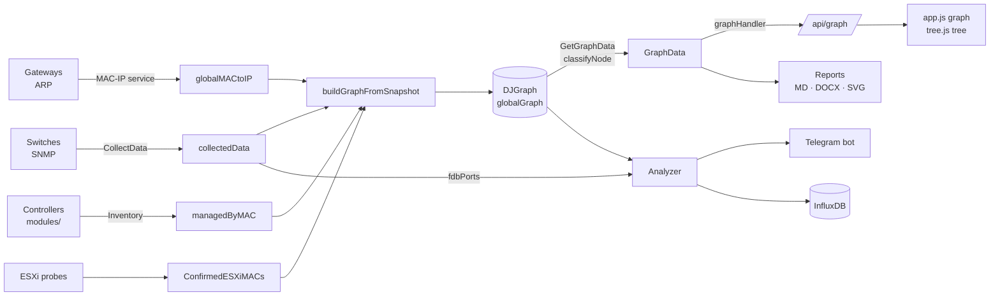

# Code structure

This document maps the program: what runs, how data moves from the switches
to the web UI, where each rule lives, and every function with the functions
that call it. Read sections 1–8 to find your way; use section 10 (the
function index) to look a name up.

Section 10 is generated from the code: `go test -run TestStructureIndex`
fails when it is stale, and `go test -run TestStructureIndex -update`
rewrites it. Sections 1–9 are written by hand; keep them true when you move
a responsibility.

## 1. What the program does

`lldp_scanner` polls the network's switches over SNMP (LLDP neighbors, the
FDB, ARP, interfaces, VLANs, STP), builds one topology graph from what they
report, tells what each node is (switch, router, hub, access point, phone,
camera, hypervisor, VM, ...), and serves it to a web UI (an interactive
graph, a Tree tab, per-port traffic history). An analyzer turns the graph
into findings (Shadow IT behind unmanaged switches, deep paths, loops), which
go to Telegram, to InfluxDB and to the UI; reports (Markdown, DOCX, SVG/PNG)
are made from the same graph. Device modules read controllers and hosts
(UniFi, VMware vCenter/ESXi, Kerio Operator, Grandstream/Yealink phones) and
add what they know.

Everything is one Go binary (package `main` in the repository root, device
modules under `modules/`), a static web UI (`static/`), a Telegram bot
(`bot/analyserbot.py`) and DOCX converters (`instrumens/`).

## 2. What runs

`main` (`example_usage.go`) parses the flags, loads the saved state
(`loadStartupData`: saved hosts, MAC-IP cache, ESXi confirmations,
controller inventories, gateway ARP — all before the first graph), starts
the web server (`StartWebServer`, port 8088) and builds the first graph
(`startStartupGraph`). Then, depending on `--mode` (`normal`, `experiment`,
`benchmark`, `monitor24h`), these loops run:

| Loop | Function | Interval | What it does |
|---|---|---|---|
| Periodic rescan | `startPeriodicRescan` | 5 min | polls every known switch, stores each poll (`storeCollectedDevice`), then `rebuildGraph` |
| Rescue scanner | `startRescueScanner` | 7 min | looks for switches of the `swich_ips` ranges that do not answer yet |
| Traffic polling | `startTrafficPolling` | 10 s | interface counters → link labels, InfluxDB |
| Label refresh | `startPeriodicLabelRefresh` | 30 s | rewrites the published graph's link traffic labels |
| Analysis | `startPeriodicAnalysis` / `runMonitor24h` | 60 s / per cycle | `Analyze` → health score, anomalies, Telegram, InfluxDB |
| MAC-IP service | `runMacIPCollector` | 5 min | ARP of gateways and switches → `globalMACtoIP`, queues ESXi checks |
| ESXi checks | `esxiCheckWorker` ×100 | on demand | `probeESXiHost`: vSphere API type, else the host client page |
| Inventories | `startModuleInventory` | 5 min | each controller module's `Inventory` → `managedByMAC` / `managedByIP` |

A graph is rebuilt (`rebuildGraph`) after a rescan, when Classification
settings change, when an ESXi confirmation changes (`esxiRebuildSoon`, 10 s
later) and when an inventory changes what the build reads (`inventoryAPs`).
Each build is published whole (`SetGlobalGraph`); readers never see a
half-built graph.

## 3. Data flow

The graph build (`buildGraphFromSnapshot`, `example_usage.go`), in order:

0. `buildSwitchOwnMACs` — every polled switch's own MACs (chassis, ARP aliases).
   `graphResolveHostnames` — reverse DNS for the labels, waited for at most 5 s.
1. `graphAddSwitchNode` — a node per polled device.
2. `buildGraphEdges` — per switch: LLDP neighbors (`graphAddLLDPEndpoint`),
   then each FDB port by the one per-port rule `fdbPorts` (direct endpoints,
   hubs, mini hubs, AP hubs, VM ports, ESXi ports; LLDP hub plans from
   `lldpPortPlans`).
3. `addMACCrossRefEdges` — links between switches that LLDP does not show.
   `addGatewayNodes` — a router node per configured gateway (`gateways.go`).
   `addManagedAPNodes` — access points a controller manages that no switch
   showed (`module_inventory.go`).
4. `detectHypervisors` — VM ports become hyp- nodes, or hang below a
   confirmed or vCenter-listed host NIC; server NICs get a hypervisor tag.
5. `enrichGraphWithIPs` — IP lines from the MAC-IP cache, the ESXi tag.

A node's group is not stored by the build: `GetGraphData` asks
`classifyNode` for each node every time the graph data is made, with the
current Classification settings and the controllers' and Credentials' facts.
`graphHandler` then adds, for `/api/graph` only: the topology core, HA
roles, VoIP profiles, the managed devices and their clients, gateway Wi-Fi
counts, VM names and the analyzer's anomalies.

## 4. One place for each rule

Each of these questions has one answer in the code. Change the rule there,
and the listed readers follow. The tests in the last column fail when a
second copy appears or a copy drifts.

| Question | Single place | Readers | Kept by |
|---|---|---|---|
| What group is a node? | `classifyNode` (`classify.go`), evidence from `nodeEvidence` | graph data, reports, analyzer, Telegram, UI | `TestClassifyNode`, `TestControllerKinds`, `TestPolledGroup` |
| How does a group look (name, icon, colour, report section, infrastructure)? | `deviceGroups` (`groups.go`) | Go reports; `app.js`, `tree.js`, `index.html`, `history.html`, `md2docx*.py` carry generated copies | `TestGroupTables` (`-update` rewrites the copies) |
| What does the build say a node is? | `nodeTag` (`tags.go`), written where a label line is written | `classifyNode`, analyzer, UI (`node.tags`) | `TestGraphTagsMatchLabels`, `TestNoTagParsing` |
| Did the build make this node (hub, hyp-)? | `syntheticNode`, `hubNodeID`, `hypNodeID` (`tags.go`) | hypervisor detection, reports, UI (`node.synthetic`) | `TestSyntheticNodeIDs` |
| What is behind a switch port? | `fdbPorts` + `lldpPortPlans` (`example_usage.go`), the LLDP neighbors per port from `lldpPortTargets` | graph, Shadow-IT alerts, report section 7, experiment metrics, UI modal | `TestShadowITOneRule`, `TestShadowITVCenterHost`, `TestPhonePCs` |
| Which alert is a Shadow-IT hub, is it ignored? | `shadowITIssueID` (`analyzer.go`), kept on the hub as `syntheticNode.Issue`; `IsIssueIgnored` (`ignored_issues.go`) | alerts, audit report (`reportHubIsShadowIT`), UI modal (`node.ignored`, `GraphNode.Ignored`) | `TestShadowITIgnored` |
| Which port links a device another switch's FDB learns (a switch, a router node, a managed access point)? | `fdbLinkPorts` (`example_usage.go`): the MACs per port; the port with the fewest wins | `addMACCrossRefEdges`, `gatewayPort`, `managedFDBPort` | `TestFDBLinkPorts` |
| Is a port a NULL0/loopback port? | `isNullInterface` (the name as it is and normalized) | every LLDP and FDB reader | `TestFDBLinkPorts` |
| Is a MAC an ESXi host's NIC? | `graphIsESXiHostNIC` | `fdbPorts`, `lldpPortPlans`, report, `GraphNode.ESXi` (UI) | `TestShadowITVCenterHost` |
| Who made this MAC, what kind is it? | `mac_identity.go` (`ouiRegistry`, `categorizeVendor`, `IdentifyMAC`) | classification, labels, subnet discovery | `TestOUI*`, `golden_predicates` |
| What does a sysName/sysDescr say? | `sysTextWords` (`systext.go`) | report vendor, switch-platform guard, Zabbix templates | `TestSysTextWords` |
| Is a phone a phone? | `modules/voip` (`Detect`, `Excluded`) | classification, LLDP hub plans | `modules/voip` tests |
| Is a polled device a switch? | `checkSwitch`, `switchMIBs.isSwitch` (`switch_qualify.go`) | every path that adds a device | `switch_qualify_test.go` |
| How is a health score named and coloured? | `healthTiers`, `healthTierOf`, `GetHealthLabel` (`analyzer.go`) | console, Telegram, analysis and audit reports; UI widget (`uiHealthTiers`, generated) | `TestHealthTiers`, `TestGroupTables` |
| Shared module helpers (HTTP client, MACs, plurals, LLDP bits, kinds, states) | `modules/kit`, `modules/module.go` | every module | `modules/kit` tests |

## 5. Classification

`classifyNode(ev, rules)` returns the first group its evidence gives, in this
order: a configured gateway's node (router); a controller's drawn access
point; a polled device (by its agent, `polledGroup`, or by its name); what
the owner or a controller tells (Credentials device type, controller kind);
a confirmed ESXi host; a random MAC; a VoIP phone; an LLDP/FDB endpoint by
its OUI category, then its LLDP capabilities; the hub tags; BMC; hypervisor;
VM; else its name. The doc comment of `classifyNode` is the exact list.

Every rule that changed an older behaviour is a choice in Settings →
Classification (`ClassifySettings`, `settings.go`); off gives the behaviour
before it:

| Setting | Default | What it turns on |
|---|---|---|
| `lldpCaps` | on | an unpolled LLDP bridge/router is `lldp_switch`, an AP bit an access point |
| `lldpHubs` | on | a port with several LLDP neighbors gets a hub, an AP hub or a phone's PC |
| `phonePCs` | on | the one device learned on a port whose only LLDP neighbor is an IP phone is drawn behind the phone |
| `apHubAlert` | off | an AP hub is a Shadow-IT alert too |
| `wifiClientsCountOnly` | on | an AP hub's clients are counted, not drawn |
| `mobileGroup` | on | smartphones (OUI category `mobile`) are not IP phones |
| `controllerKindWins` | on | a controller's kind and a Credentials device type beat the OUI and tags |
| `polledByMIB` | on | a polled device is grouped by its agent (bridge, sysDescr), not its name |
| `hubHysteresis` | on | a port turns hub ↔ mini hub only after two polls in a row agree |

## 6. Tags, labels and synthetic nodes

A node's label (`DJGraph.SwitchInfo`, the API's `sysName`) is display text:
tag lines (`[LLDP-EP] Ubiquiti`, `[VM] 🐧 Linux VMware`, `[HUB] Unmanaged`),
names, IPs and `[DNS] name`. The build records the same tags structurally
(`graphTags`, sent as `node.tags`); no reader parses a tag line back.
`nodeHasTag` reads label lines only for captures written before tags
existed. Nodes the build invents (hub-, hyp-) carry `syntheticNode`
(`node.synthetic`: kind, switch, port); their ids are made by `hubNodeID`
and `hypNodeID` only.

## 7. Device modules (`modules/`)

A module (`modules.Module`: `ID`, `Label`, `Type`, `Protocol`, `Actions`,
`Run`) registers itself in `init`. Optional interfaces:
`modules.Prober` (recognize a device without a login) and
`modules.Inventorier` (list the devices a controller manages, by MAC, with
their clients). Logins come from the Credentials window
(`credentials.go`, encrypted in `secrets/credentials.json`).

| Module | Talks to | Gives the scanner |
|---|---|---|
| `unificontroller` | UniFi Network (Integration API, older API) | access points, switches, gateways, Wi-Fi clients, uplinks |
| `vcenter` | vCenter (vSphere SOAP) | ESXi hosts per NIC MAC, their VMs, NIC uplinks from CDP/LLDP |
| `esxi` | one ESXi host (vSphere SOAP) | host details, enable SNMP |
| `keriooperator` | Kerio Operator PBX (JSON-RPC) | phones by MAC or registration IP |
| `voip` | Grandstream, Yealink phones (HTTP) | phone detection rules, phone status |
| `vsphere`, `kit` | — | shared SOAP client; shared helpers |

## 8. Web server and UI

Routes are registered in `StartWebServer` and its `register*Routes` helpers
(`web_server.go`, `report_topology.go`, `auth.go`, `credentials.go`,
`device_modules.go`, `terminal_handler.go`, `capture.go`). Every route but
the login page needs a session (`authMiddleware`).

| Area | Routes |
|---|---|
| Graph | `/api/graph`, `/api/status`, `/api/rescan`, `/api/hosts`, `/api/gateways`, `/api/settings` |
| Device | `/api/device-detail`, `/api/history`, `/api/port-events`, `/api/events`, `/api/check-ports`, `/api/terminal` |
| Modules | `/api/modules`, `/api/modules/run`, `/api/credentials` (+ `/lock`, `/unlock`) |
| Reports | `/api/report/summary`, `/full`, `/generate`, `/download`, `/audit-md`, `/audit-docx`, `/audit-svg`, `/topology-svg` |
| Captures, experiments | `/api/captures`, `/api/capture/start`, `/stop`, `/api/experiment/*` |
| Login, bot | `/api/login`, `/api/logout`, `/api/me`, `/api/bot/action` |

The UI is static: `index.html` + `app.js` (graph, info panel, filters,
Settings, reports, Shadow-IT modal) + `tree.js` (Tree tab; also the shared
helpers `treeEscapeHTML`, `treeIsIPv4`, `treeNodeIPs`, `treeNodeName`,
`treeTagText`, loaded after `app.js`), `history.html` (per-port history, its
own page), `modules.js`, `credentials.js`, `login.*`, `style.css`. Their
group tables are generated from `groups.go`, and `app.js`'s health tiers from
`analyzer.go` (`healthTiers`).

## 9. State on disk, tests, conventions

Runtime files in the working directory (all ignored by git; the config ones
may hold passwords and stay local):

| File | Written by | Holds |
|---|---|---|
| `network_data.json` | save on exit | the last polls (`SavedData`) and settings |
| `mac_ip_cache.json`, `mac_ip_cache_seen.json` | MAC-IP service | MAC → IP, last seen |
| `esxi_confirmed.json` | ESXi checks | confirmed ESXi MACs |
| `modules_inventory.json` | inventories (0600) | the controllers' last inventories |
| `secrets/` | `--user-add`, Credentials window | web users, vault key, device logins |
| `gateway_ip`, `swich_ips`, `ignored_issues.json` | the owner | gateways, switch ranges, ignored findings |
| `graphs_data.txt` | `graphHandler` | the last `/api/graph` answer (debug) |

Tests: `go test ./...` runs everything, isolated from the network as
`unshare -rn sh -c 'ip link set lo up && go test ./...'`. `harness_test.go`
replaces every network and file side effect with fakes and fails a test
that writes outside its temporary directories. Golden files
(`testdata/golden/`) pin outputs; `go test -run NAME -update` rewrites them
— review `git diff testdata/golden` before committing. Generated regions:
`BEGIN groups.go … END groups.go` (`TestGroupTables`: `deviceGroups` and
`healthTiers`) and section 10 of this file (`TestStructureIndex`).

How to add:

- **a device group** — a row in `deviceGroups` (`groups.go`), an SVG symbol
  `topo-icon-<key>` in `app.js`, the rule that gives it in `classifyNode`,
  then `go test -run TestGroupTables -update`;
- **a tag** — a constant and its writer in `tags.go`/the build, its reader in
  `classifyNode`; `TestGraphTagsMatchLabels` checks the writer;
- **a classification choice** — a field of `ClassifySettings` with its
  default, a checkbox `settingsClassify-<name>` in `index.html`, its name in
  `uiClassifyChoices` (`app.js`);
- **a vendor word of a sysName/sysDescr** — a row of `sysTextWords`;
  a MAC vendor — `ouiRegistry`;
- **a device module** — a package under `modules/` implementing
  `modules.Module` (and `Prober`/`Inventorier`), imported in `main`;
- then `go test -run TestStructureIndex -update`.

## 10. Function index

Every Go file of the program and its modules, and the UI's scripts: each
function's and type's first doc sentence, and (after ←) the functions that
use it. Generated — do not edit by hand.

<!-- BEGIN generated: go test -run TestStructureIndex -update -->

### Package `main`

#### `analyzer.go`

- **`NetworkAnalyzer`** type — NetworkAnalyzer handles analysis of network capture data ← NewAnalyzer
- **`analyzerIndex`** type — analyzerIndex is the analyzer input in a fixed order, with the topology nodes by id. ← NetworkAnalyzer.idx
- **`idx`** method (NetworkAnalyzer) — idx builds the index of na.Data on first use. ← NetworkAnalyzer.Analyze, NetworkAnalyzer.analyzeLoopback, NetworkAnalyzer.analyzePaths, NetworkAnalyzer.analyzeSTP, NetworkAnalyzer.analyzeShadowIT, NetworkAnalyzer.anomalyMap, NetworkAnalyzer.coreNode
- **`analyzerSwitchIDs`** func — analyzerSwitchIDs lists the node ids the graph can give the polled switch d: ← analyzerIndex.hubNode, analyzerIndex.switchNode, topologyCore
- **`analyzerUniqueMACs`** func — analyzerUniqueMACs returns the distinct station MACs (usableMAC) in the FDB tables of devices. ← NetworkAnalyzer.Analyze, generateExperimentReport
- **`switchNode`** method (analyzerIndex) — switchNode returns the topology node of the polled switch with this IP, or the IP itself when the topology has no node for it. ← NetworkAnalyzer.anomalyMap, analyzerIndex.hubNode
- **`hubNode`** method (analyzerIndex) — hubNode returns the hub node the graph draws for a port of switch d (hubNodeID), or the switch node when there is none. ← NetworkAnalyzer.analyzeShadowIT
- **`anomalyMap`** method (NetworkAnalyzer) — anomalyMap groups the suggestion types by the graph node /api/graph shows them on (F11): ← NetworkAnalyzer.Analyze
- **`NewAnalyzer`** func — NewAnalyzer creates a new analyzer instance ← ExportHealthScores, analyzeLiveGraph, main, monitorCycle, reportDownloadHandler, reportGenerateHandler, startPeriodicAnalysis
- **`OptimizationSuggestion`** type — OptimizationSuggestion represents a suggested improvement ← NetworkAnalyzer.BuildReport, NetworkAnalyzer.analyzeCongestion, NetworkAnalyzer.analyzeLoopback, NetworkAnalyzer.analyzePaths, NetworkAnalyzer.analyzeSTP, NetworkAnalyzer.analyzeShadowIT, NetworkAnalyzer.analyzeStability, analyzerReportAnomalies
- **`Report`** type — Report represents the final analysis report ← NetworkAnalyzer.BuildReport
- **`Analyze`** method (NetworkAnalyzer) — Analyze runs every check (BuildReport) and publishes the result as the live network state: ← analyzeLiveGraph, main, monitorCycle, startPeriodicAnalysis
- **`BuildReport`** method (NetworkAnalyzer) — BuildReport performs all analysis checks and computes the health score. ← ExportHealthScores, NetworkAnalyzer.Analyze, reportDownloadHandler, reportGenerateHandler
- **`botPacer`** type — botPacer runs queued sends on one goroutine, in the order they were queued, with gap after each one.
- **`enqueue`** method (botPacer) — enqueue queues one send and starts the sender when it is idle.
- **`run`** method (botPacer) ← botPacer.enqueue
- **`postToBot`** func — postToBot posts one JSON payload to the analyserbot /notify endpoint.
- **`ResetIssueCooldown`** func — ResetIssueCooldown removes cooldown for an issue (called when "Fixed" button is pressed) ← botActionHandler
- **`reserveIssueNotify`** func — reserveIssueNotify reports whether an alert for issueID may be queued now (none was sent or queued within notifyCooldown) and marks it queued, so a concurrent analysis does not queue it again. ← NetworkAnalyzer.notifyTelegramIfCritical
- **`reserveSummary`** func — reserveSummary reports whether the hourly health summary may go out now and marks it sent. ← NetworkAnalyzer.notifyTelegramIfCritical
- **`botPostAccepted`** func — botPostAccepted posts one payload and reports whether the bot accepted it (200: ← NetworkAnalyzer.notifyTelegramIfCritical
- **`notifyTelegramIfCritical`** method (NetworkAnalyzer) — notifyTelegramIfCritical sends separate messages per Shadow IT issue to the python bot. ← NetworkAnalyzer.Analyze
- **`analyzePaths`** method (NetworkAnalyzer) — analyzePaths checks for long paths: ← NetworkAnalyzer.BuildReport
- **`coreNode`** method (NetworkAnalyzer) — coreNode returns the core node of the analyzed topology (topologyCore). ← NetworkAnalyzer.analyzePaths
- **`topologyCore`** func — topologyCore is the core node of a topology, the root of both the analyzer's path check (analyzePaths) and bfs_depths.json (ExportBFSDepths), so both measure hops from the same node (AC-2, R6). ← ExportBFSDepths, NetworkAnalyzer.coreNode, graphHandler
- **`analyzerHopDepths`** func — analyzerHopDepths returns the hop count from root of every node the links reach. ← ExportBFSDepths, NetworkAnalyzer.analyzePaths
- **`analyzeCongestion`** method (NetworkAnalyzer) — analyzeCongestion checks for interface saturation and discards ← NetworkAnalyzer.BuildReport
- **`analyzeStability`** method (NetworkAnalyzer) — analyzeStability checks for status changes ← NetworkAnalyzer.BuildReport
- **`getDataLabel`** func — Helper to get formatted label ← NetworkAnalyzer.analyzePaths
- **`GenerateTextReport`** method (Report) — GenerateTextReport creates a human-readable report ← reportGenerateHandler
- **`GenerateHTMLReport`** method (Report) — GenerateHTMLReport creates an HTML report suitable for Word export ← reportDownloadHandler
- **`ShadowITDevice`** type — ShadowITDevice represents a suspected unmanaged switch
- **`shadowITIssueID`** func — shadowITIssueID is the issue id of the Shadow-IT hub on a switch's FDB port (fdbPorts' Port): ← NetworkAnalyzer.analyzeShadowIT, buildGraphEdges
- **`analyzeShadowIT`** method (NetworkAnalyzer) — analyzeShadowIT reports every port that the graph draws as an unmanaged hub (fdbPorts, the one per-port rule, Q14) as one shadow_<ip>_<port> issue (shadowITIssueID), in device and port order. ← NetworkAnalyzer.BuildReport
- **`analyzerShadowStats`** type — analyzerShadowStats are the experiment report's Shadow-IT numbers, counted with the same per-port rule as the graph and the alerts. ← analyzerShadowCounts
- **`analyzerShadowCounts`** func — analyzerShadowCounts applies the per-port rule (fdbPorts) to every device and counts its hub candidates. ← generateExperimentReport
- **`analyzeLoopback`** method (NetworkAnalyzer) — analyzeLoopback detects network loops (ports looped back to the same switch) ← NetworkAnalyzer.BuildReport
- **`analyzeSTP`** method (NetworkAnalyzer) — analyzeSTP checks Spanning Tree Protocol configuration: ← NetworkAnalyzer.BuildReport
- **`CalculateHealthScore`** method (NetworkAnalyzer) — CalculateHealthScore computes a 0-100 network health score ← NetworkAnalyzer.BuildReport
- **`healthTier`** type — healthTier is a band of the network health score:
- **`healthTierOf`** func — healthTierOf is the band of a health score (healthTiers). ← GetHealthLabel, NetworkAnalyzer.notifyTelegramIfCritical, Report.GenerateHTMLReport, reportFullHandler
- **`GetHealthLabel`** func — GetHealthLabel returns a human-readable label for health score ← NetworkAnalyzer.notifyTelegramIfCritical, Report.GenerateHTMLReport, analyzeLiveGraph, generateAuditMD

#### `auth.go`

- **`secretsWrite`** func — secretsWrite writes a file of the secrets directory atomically, readable by its owner only, and makes the directory (0700) when it is missing. ← authSaveUsers, credentialsCommandVaultPassword, credentialsSave, secretsKey
- **`secretsKey`** func — secretsKey returns the 32 random bytes of a key file of the secrets directory, made at first use. ← authSign, authVerify, credentialsCommandVaultPassword, credentialsGCM
- **`randomHex`** func — randomHex is n random bytes in hex. ← authEnsureBotToken, authLoginHandler, credentialsHandler
- **`authUser`** type — authUser is one login of secrets/users.json. ← authCommandUserAdd
- **`authUsersFile`** type ← authLoadUsers, authSaveUsers
- **`authLoadUsers`** func — authLoadUsers reads secrets/users.json; ← authCommandUserAdd, authCommandUserDel, authCommandUserList, authDeny, authLoginHandler, authUserHash, registerAuthRoutes
- **`authSaveUsers`** func ← authCommandUserAdd, authCommandUserDel
- **`authUserHash`** func — authUserHash returns the bcrypt hash of user, or "" when there is none. ← authLoginHandler, authVerify
- **`authCheckPassword`** func — authCheckPassword reports whether password is the one of hash (a bcrypt hash; ← authLoginHandler, credentialsUnlockHandler
- **`authSession`** type — authSession is the content of a session cookie, signed with secrets/session.key (HMAC-SHA256), so it outlives a restart. ← authLoginHandler, authMiddleware, authSessionOf, authVerify
- **`authSign`** func — authSign gives the cookie value of s: ← authLoginHandler
- **`authVerify`** func — authVerify returns the session of a cookie value: ← authMiddleware
- **`authRevoke`** func — authRevoke logs a session out until it would have expired. ← authLogoutHandler
- **`authCtxKey`** type — authCtxKey is the request context key of the session (authMiddleware). ← authMiddleware, authSessionOf
- **`authSessionOf`** func — authSessionOf returns the session authMiddleware found for the request. ← authLogoutHandler, authMeHandler, credentialsHandler, credentialsLockHandler, credentialsUnlockHandler, gatewaysHandler, moduleRunHandler
- **`authLimiter`** type — authLimiter counts failed password tries by client address: ← newAuthLimiter
- **`authFails`** type ← authLimiter.fail, newAuthLimiter
- **`newAuthLimiter`** func
- **`blocked`** method (authLimiter) ← authLoginHandler, credentialsUnlockHandler
- **`fail`** method (authLimiter) ← authLoginHandler, credentialsUnlockHandler
- **`succeed`** method (authLimiter) ← authLoginHandler, credentialsUnlockHandler
- **`authClientAddr`** func — authClientAddr is the address a request comes from (the scanner has no proxy in front of it). ← authLoginHandler, credentialsUnlockHandler
- **`authMiddleware`** func — authMiddleware lets a request through with a valid session cookie, the bot's token on /api/bot/action, or to a public path. ← StartWebServer
- **`authDeny`** func — authDeny answers a request without a valid login. ← authMiddleware
- **`authSameOrigin`** func — authSameOrigin reports whether a request may change something: ← authLoginHandler, authMiddleware
- **`authFromHere`** func — authFromHere reports whether the page that sent the request is of this server (Origin, else Referer); ← authSameOrigin
- **`authBotToken`** func — authBotToken reports whether the request carries the bot's token ("Authorization: ← authMiddleware
- **`authEnsureBotToken`** func — authEnsureBotToken makes bot/.api_token when it is missing: ← registerAuthRoutes
- **`authLoginHandler`** func — authLoginHandler: ← registerAuthRoutes
- **`authLogoutHandler`** func — authLogoutHandler (POST) logs the session out and clears its cookie. ← registerAuthRoutes
- **`authMeHandler`** func — authMeHandler tells the page who is logged in and the state of the Credentials section. ← registerAuthRoutes
- **`registerAuthRoutes`** func — registerAuthRoutes adds the login calls, and warns when no user exists. ← StartWebServer
- **`runAuthCommand`** func — runAuthCommand runs the login command of the command line, if one was given, and reports whether it did (the scanner does not start then). ← main
- **`authCommandUserAdd`** func — authCommandUserAdd adds a user, or sets a user's new password. ← runAuthCommand
- **`authCommandUserDel`** func — authCommandUserDel removes a user; ← runAuthCommand
- **`authCommandUserList`** func — authCommandUserList prints the users' names, one "user: ← runAuthCommand
- **`authAskPassword`** func — authAskPassword reads a new password: ← authCommandUserAdd, credentialsCommandVaultPassword
- **`authEcho`** func — authEcho turns the terminal's echo on or off (stty). ← authAskPassword

#### `capture.go`

- **`CaptureSession`** type — CaptureSession represents a network capture session ← CaptureManager.ListCaptures, CaptureManager.StartCapture, ExportHealthScores, analyzeLiveGraph, main, monitorCycle, startPeriodicAnalysis
- **`FullCaptureData`** type — FullCaptureData represents the complete data set for a session ← CaptureManager.LoadCapture, CaptureManager.StopCapture, ExportHealthScores, analyzeLiveGraph, analyzerLoadCapture, main, monitorCycle, startPeriodicAnalysis
- **`TrafficMetrics`** type — TrafficMetrics holds traffic data for a specific point in time ← QueryRangeMetrics
- **`StatusEvent`** type — StatusEvent represents a status change event ← QueryRangeMetrics
- **`CaptureManager`** type — CaptureManager manages capture sessions ← InitCaptureManager
- **`InitCaptureManager`** func — InitCaptureManager initializes the capture manager ← main
- **`StartCapture`** method (CaptureManager) — StartCapture starts a new capture session ← captureStartHandler
- **`StopCapture`** method (CaptureManager) — StopCapture stops the active session and saves data ← captureStopHandler
- **`ListCaptures`** method (CaptureManager) — ListCaptures returns a list of available captures ← capturesHandler
- **`LoadCapture`** method (CaptureManager) — LoadCapture reads the saved data of a capture session. ← analyzerLoadCapture
- **`ActiveSession`** method (CaptureManager) — ActiveSession returns the current running session (or nil) ← capturesHandler
- **`fetchSessionData`** method (CaptureManager) — fetchSessionData retrieves metrics from InfluxDB ← CaptureManager.StopCapture

#### `classify.go`

- **`nodeEvidence`** type — nodeEvidence is what a node's group is decided from: ← lldpTargetRole
- **`classifyFacts`** type — classifyFacts is what the controllers' inventories and the Credentials window tell of the nodes, read once for a GetGraphData. ← currentClassifyFacts
- **`currentClassifyFacts`** func — currentClassifyFacts reads the facts the rules use: ← DJGraph.GetGraphData
- **`nodeEvidence`** method (DJGraph) — nodeEvidence gathers the evidence of a node with label info, facts what the controllers and Credentials tell. ← DJGraph.GetGraphData
- **`idCategory`** func — idCategory is the OUI category (categorizeVendor) of a node id's vendor when the id is a MAC of a known vendor, else "". ← DJGraph.nodeEvidence, lldpTargetRole
- **`toldGroup`** func — toldGroup is the group the owner or a controller tells for a node: ← classifyOwn
- **`classifyNode`** func — classifyNode is a node's group (groups.go deviceGroups), the first that its evidence gives (a tag "[X]" below is a tag of the node, ev.Tags, not its label's text): ← DJGraph.GetGraphData, lldpTargetRole
- **`classifyOwn`** func — classifyOwn is classifyNode but the weaker fact of the node's IP. ← classifyNode
- **`polledGroup`** func — polledGroup is the group of a polled device by what its agent shows, not by its name ("Server-room switch" is a switch): ← classifyOwn
- **`graphNameGroup`** func — graphNameGroup is the group of an untagged node from its name and label: ← classifyOwn
- **`managedGroup`** func — managedGroup is the group of a node of group a controller's inventory tells the kind of (addManaged, at /api/graph time; ← addManaged, classifyNode

#### `credentials.go`

- **`credentialTarget`** type — credentialTarget is what a login is for:
- **`credentialEntry`** type — credentialEntry is one login of secrets/credentials.json. ← credentialsFor, credentialsHandler
- **`credentialsFile`** type ← credentialsLoad, credentialsSave
- **`credentialOption`** type — credentialOption is a protocol or device type the UI offers. ← credentialOptionKnown
- **`credentialOptionKnown`** func ← credentialsValidate
- **`credentialsLoad`** func ← credentialsDeclaredByIP, credentialsDeclaredTypes, credentialsFor, credentialsHandler, inventoryTargets
- **`credentialsSave`** func ← credentialsHandler
- **`credentialsGCM`** func ← credentialsOpen, credentialsSeal
- **`credentialsSeal`** func — credentialsSeal encrypts the password of entry id. ← credentialsHandler
- **`credentialsOpen`** func — credentialsOpen decrypts the password of entry id. ← credentialsFor
- **`credentialLogin`** type — credentialLogin is a decrypted login to try. ← credentialsFor, moduleRunHandler
- **`credentialsWorked`** func — credentialsWorked notes that entry id logged in to ip by protocol: ← inventoryRead, moduleRunHandler
- **`credentialsFor`** func — credentialsFor returns the logins to try on the device at ip by protocol, in order: ← inventoryRead, moduleRunHandler, modulesHandler
- **`credentialsDeclaredTypes`** func — credentialsDeclaredTypes returns the device types the Credentials window declares for the device at ip (credentialEntry.DeviceType): ← deviceTypesOf
- **`credentialsDeclaredByIP`** func — credentialsDeclaredByIP returns, by IP, the device types the logins for that IP itself declare (credentialEntry.DeviceType), in the file's order: ← currentClassifyFacts
- **`credentialsVaultHash`** func — credentialsVaultHash is the bcrypt hash of the Credentials password, "" when none was set. ← authMeHandler, credentialsUnlockHandler, registerCredentialRoutes
- **`credentialsCommandVaultPassword`** func — credentialsCommandVaultPassword sets the Credentials password. ← runAuthCommand
- **`credentialsUnlocked`** func — credentialsUnlocked reports whether the session opened the Credentials window less than credentialsUnlockTime ago (counted from its last call). ← authMeHandler, credentialsHandler
- **`credentialsUnlock`** func ← credentialsHandler, credentialsUnlockHandler
- **`credentialsLock`** func ← authLogoutHandler, credentialsLockHandler
- **`credentialView`** type — credentialView is an entry as the API shows it: ← credentialsHandler
- **`credentialRequest`** type — credentialRequest is the body of a create or an update: ← credentialsHandler
- **`credentialsValidate`** func — credentialsValidate checks a request and puts its target in canonical form (an IP as Go prints it, a range as its network). ← credentialsHandler
- **`credentialsReply`** func — credentialsReply writes a JSON answer. ← credentialsError, credentialsHandler, credentialsLockHandler, credentialsUnlockHandler, gatewaysHandler, moduleRunHandler, modulesHandler
- **`credentialsError`** func ← credentialsHandler, credentialsUnlockHandler, gatewaysHandler, moduleRunHandler, modulesHandler
- **`credentialsUnlockHandler`** func — credentialsUnlockHandler (POST {"password"}) opens the Credentials window for the session. ← registerCredentialRoutes
- **`credentialsLockHandler`** func — credentialsLockHandler (POST) closes the Credentials window. ← registerCredentialRoutes
- **`credentialsHandler`** func — credentialsHandler lists (GET), adds (POST), changes (PUT) and removes (DELETE ?id=) logins, and moves one up or down (PATCH {"id", "move": ← registerCredentialRoutes
- **`registerCredentialRoutes`** func — registerCredentialRoutes adds the Credentials API, and warns when its password is not set. ← StartWebServer

#### `device_modules.go`

- **`moduleProbeAnswer`** type ← deviceTypesOf
- **`esxiConfirmedIP`** func — esxiConfirmedIP reports whether the device at ip is an HTTP-confirmed ESXi host: ← deviceTypesOf
- **`deviceTypesOf`** func — deviceTypesOf returns the device types (Credentials types) of the device at ip, most specific first: ← inventoryRead, moduleRunHandler, modulesHandler
- **`moduleLastRun`** type — moduleLastRun is the last action of a module on a device. ← moduleRunHandler
- **`moduleView`** type — moduleView is a module as GET /api/modules shows it for one device. ← modulesHandler
- **`modulesHandler`** func — modulesHandler (GET ?ip=) lists the modules of the device at ip. ← registerModuleRoutes
- **`moduleRunRequest`** type — moduleRunRequest is the body of POST /api/modules/run. ← moduleRunHandler
- **`moduleRunHandler`** func — moduleRunHandler (POST) runs a module's action on a device of its type: ← registerModuleRoutes
- **`moduleCheckSNMP`** func — moduleCheckSNMP polls the device's sysName with the community, a few times (an agent just started may take seconds), and says what it got. ← moduleRunHandler
- **`moduleLogins`** func — moduleLogins gives a module login i of logins, and the others in their order. ← inventoryRead, moduleRunHandler
- **`registerModuleRoutes`** func — registerModuleRoutes adds the modules' API. ← StartWebServer

#### `dj_graph.go`

- **`Coordinate`** type — Coordinate represents x,y position ← DJGraph.OptimizeCoords, NewDJGraph
- **`DJGraph`** type — DJGraph manages network topology graph ← NewDJGraph
- **`NewDJGraph`** func — NewDJGraph creates a new graph instance ← buildGraphFromSnapshot, captureStartHandler, handleRescanRequests, hostsHandler, main
- **`AddNode`** method (DJGraph) — AddNode adds a node to the graph ← addGatewayNodes, addManagedAPNodes, buildGraphEdges, detectHypervisors, graphAddFDBEndpoint, graphAddLLDPEndpoint, graphAddSwitchNode
- **`GetNodeInfo`** method (DJGraph) — GetNodeInfo retrieves node info ← DJGraph.GetGraphData
- **`GetNodeCoords`** method (DJGraph) — GetNodeCoords retrieves node coordinates ← DJGraph.ExportToMap
- **`OptimizeCoords`** method (DJGraph) — OptimizeCoords shifts all coordinates to be non-negative ← main
- **`AddEdge`** method (DJGraph) — AddEdge adds an edge with optional label ← addGatewayNodes, addMACCrossRefEdges, addManagedAPNodes, buildGraphEdges, detectHypervisors, gatewayLLDPLinks, graphAddFDBEndpoint, graphMergeNode
- **`FillTargetPort`** method (DJGraph) — FillTargetPort names the target's port on the edge source -> target: ← addGatewayNodes, buildGraphEdges
- **`GetEdge`** method (DJGraph) — GetEdge checks if there is a connection between two nodes ← addGatewayNodes, addMACCrossRefEdges, gatewayLLDPLinks
- **`GraphNode`** type — GraphNode represents a node in D3.js format ← DJGraph.GetGraphData, ExportBFSDepths, GenerateHypervisorDiagrams, NetworkAnalyzer.idx, addGatewayWLAN, addManagedClients, generateAuditMD, graphHandler (+2 more)
- **`GraphLink`** type — GraphLink represents a link in D3.js format ← DJGraph.GetGraphData, addManagedClients, reportGraphData
- **`GraphData`** type — GraphData contains nodes and links for D3.js ← DJGraph.GetGraphData, ExportHealthScores, graphHandler
- **`GetGraphData`** method (DJGraph) — GetGraphData returns graph data formatted for D3.js ← CaptureManager.StartCapture, ExportBFSDepths, ExportHealthScores, analyzeLiveGraph, graphHandler, main, monitorCycle, reportGraphData (+2 more)
- **`GenerateZabbixTemplate`** method (DJGraph) — GenerateZabbixTemplate generates template list based on device info ← DJGraph.ExportHostsToZabbix
- **`ExportHostsToZabbix`** method (DJGraph) — ExportHostsToZabbix exports hosts to Zabbix JSON format: ← main
- **`reportZabbixHost`** type — reportZabbixHost is one Zabbix host: ← reportZabbixHosts
- **`reportZabbixHosts`** func — reportZabbixHosts lists the polled devices (collectedData) in IP order. ← DJGraph.ExportHostsToZabbix, DJGraph.ExportToMap
- **`ExportToMap`** method (DJGraph) — ExportToMap exports to Zabbix map format: ← main

#### `example_usage.go`

- **`InterfaceTraffic`** type — InterfaceTraffic tracks traffic counters for speed calculation ← handleRescanRequests, hostsHandler, updateTrafficCounters
- **`initDebugLog`** func ← main
- **`logDebug`** func ← SNMPObject.collectLLDPNeighbors, buildGraphEdges, fdbPorts, graphAddFDBEndpoint, graphAddLLDPEndpoint, main
- **`main`** func
- **`loadStartupData`** func — loadStartupData runs the startup steps before the web server starts: ← main
- **`startStartupGraph`** func — startStartupGraph builds the first graph (buildStartupGraph) in the background and returns a channel that is closed once it is published. ← main
- **`buildStartupGraph`** func — buildStartupGraph builds and publishes the first graph from the saved hosts that loadStartupData stored. ← startStartupGraph
- **`storeCollectedDevice`** func — storeCollectedDevice stores the data of a successful SNMP poll in collectedData and marks the switch reachable (the OnSuccess callbacks), and reports whether it stored it. ← handleReactiveDevice, storeCollected
- **`storeCollected`** func — storeCollected is storeCollectedDevice as an OnSuccess callback. ← handleRescanRequests, newRescanSNMPObject
- **`collectedReachable`** func — collectedReachable reports whether ip is in collectedData and answered its last poll. ← discoverFromLLDP, rescueScan
- **`keepPreviousChassisID`** func — keepPreviousChassisID keeps the switch identity stable across polls: ← storeCollectedDevice
- **`keepPreviousSysName`** func — keepPreviousSysName keeps a switch's name when this poll has none (the caller had none and the sysName read gave none, CollectData) and the stored data of the same IP has one. ← storeCollectedDevice
- **`markUnreachable`** func — markUnreachable flags a known switch as unreachable after a failed poll and keeps its last data (the OnFailure callbacks). ← handleRescanRequests, newReactiveSNMPObject, newRescanSNMPObject
- **`newRescanSNMPObject`** func — newRescanSNMPObject returns the SNMP object for traffic polling and rescans when saved data was loaded (normal and monitor24h mode): ← main
- **`newReactiveSNMPObject`** func — newReactiveSNMPObject returns the SNMP object of the first scan in normal mode without saved hosts: ← main
- **`analyzeLiveGraph`** func — analyzeLiveGraph runs Analyze() on collectedData and graph, which sets the health score and anomalies that /api/graph serves.
- **`handleReactiveDevice`** func — handleReactiveDevice is the OnSuccess work of the first scan: ← newReactiveSNMPObject
- **`formatAsHex`** func — Helper to format raw string as Hex with colons ← normalizeID
- **`cleanSNMPValue`** func — cleanSNMPValue cleans raw SNMP value and returns the actual data ← graphNormalizePortID, lldpPortIDName, lldpRemotePortName, normalizeID, voipEvidence
- **`normalizeID`** func — Helper to normalize Chassis IDs based on Subtype (RFC 2922) ← graphDeviceNodeID, graphNormalizePortID, lldpChassisID
- **`graphIsSNMPException`** func — graphIsSNMPException reports whether a value is net-snmp exception text ("No Such Object available on this agent at this OID", "No Such Instance …", "No more variables …"), raw or as normalizeMAC left it in saved … ← SNMPObject.collectLLDPLocPortMap, SNMPObject.collectPortNames, SNMPObject.collectSysText, SNMPObject.collectVRRPInfo, collectChassisAnswer, graphDeviceNodeID
- **`graphLocalChassisID`** func — graphLocalChassisID normalizes a switch's own lldpLocChassisId value (SNMP exception text must be rejected before): ← collectChassisAnswer
- **`graphChassisKey`** func — graphChassisKey is a switch's own-MAC key: ← NetworkAnalyzer.analyzeLoopback, NetworkAnalyzer.analyzeSTP, buildSwitchOwnMACs, fdbPorts, graphDeviceNodeID, graphKnownSwitch, keepPreviousChassisID, lldpPortPlans (+1 more)
- **`graphDeviceNodeID`** func — graphDeviceNodeID is the graph node id of a polled device: ← addGatewayNodes, addHARoles, addMACCrossRefEdges, addManagedAPNodes, analyzerSwitchIDs, buildGraphEdges, buildSwitchOwnMACs, collectSuggestionHosts (+11 more)
- **`graphNetworkAddress`** func — graphNetworkAddress decodes an LLDP network-address id (chassis subtype 5, port subtype 4): ← normalizeID
- **`graphNormalizePortID`** func — graphNormalizePortID normalizes an LLDP port id with the port subtype table (1 interfaceAlias, 2 portComponent, 3 macAddress, 4 networkAddress, 5 interfaceName, 6 agentCircuitId, 7 local), not the chassis one: ← lldpPortID
- **`graphUsableTargetID`** func — graphUsableTargetID reports whether an LLDP target may be a node id: ← graphLLDPNeighborTarget
- **`resolveLLDPTarget`** func — resolveLLDPTarget picks the graph node id and display name for one LLDP neighbor: ← graphLLDPNeighborTarget
- **`lldpChassisID`** func — lldpChassisID is the normalized chassis id resolveLLDPTarget works with. ← NetworkAnalyzer.analyzeLoopback, resolveLLDPTarget
- **`lldpPortID`** func — lldpPortID is the normalized port id resolveLLDPTarget checks for a port MAC, read with the port subtype table (graphNormalizePortID). ← resolveLLDPTarget
- **`lldpKnownMACs`** func — lldpKnownMACs returns the MACs that buildGraphEdges treats as known from LLDP: ← fdbPorts
- **`lldpPortPlan`** type — lldpPortPlan is what a port of a switch with several LLDP neighbors gets (lldpPortPlans). ← lldpPortPlans
- **`lldpPortTargets`** func — lldpPortTargets are a switch's accepted LLDP neighbors (graphLLDPNeighborTarget) by local port (ifIndex) and node id: ← fdbPorts, lldpPortPlans
- **`lldpPortPlans`** func — lldpPortPlans are the ports of a switch (by ifIndex, the LLDP local port) where several distinct LLDP neighbors are seen, with the Classification choice lldpHubs (none without it). ← buildGraphEdges, fdbPorts
- **`buildGraphEdges`** func — buildGraphEdges builds graph edges using ChassisID as the primary key switchMACs maps the own MACs of the polled switches to their node ids (buildSwitchOwnMACs), so switch MACs get no endpoint nodes ← buildGraphFromSnapshot
- **`graphLLDPNeighborTarget`** func — graphLLDPNeighborTarget resolves one LLDP neighbor of a switch to its node id and display name; ← buildGraphEdges, fdbLinkPorts, fdbPorts, gatewayLLDPLinks, gatewaySameDevice, graphHostnameIPs, lldpKnownMACs, lldpPortTargets
- **`graphAddLLDPEndpoint`** func — graphAddLLDPEndpoint adds the node of an LLDP neighbor that no polled device is (an "[LLDP-EP]" node, or "[BMC]" when its LLDP or DNS name or its MAC says so) with its label: ← buildGraphEdges, gatewayLLDPLinks
- **`lldpRemotePortName`** func — lldpRemotePortName is the far end's port in an LLDP link label (before normalizePortName): ← buildGraphEdges, gatewayLLDPLinks, lldpPortPlans, lldpReverseFarPort
- **`lldpPortIDName`** func — lldpPortIDName is the port id of an LLDP neighbor when it names a port, else "". ← lldpRemotePortName, lldpReverseFarPort
- **`lldpReverseFarPort`** func — lldpReverseFarPort is the port of this switch (data, node srcID) that names the far end of the link target drew from its own LLDP view before (the edge target -> srcID with the label "<target's port ...>\|", target's … ← buildGraphEdges
- **`lldpSamePort`** func — lldpSamePort reports whether a switch's own port name and the name a neighbor reported for it (both normalizePortName'd) are one port: ← lldpReverseFarPort
- **`fdbPortKind`** type — fdbPortKind is what the per-port FDB rule (fdbPorts) makes of the MACs a switch learned on one port.
- **`fdbPort`** type — fdbPort is one port of a switch's FDB under the per-port rule. ← fdbPorts
- **`fdbPorts`** func — fdbPorts is the one per-port Shadow-IT rule (Q14): ← NetworkAnalyzer.analyzeShadowIT, analyzerShadowCounts, buildGraphEdges, graphHostnameIPs, reportHubIsShadowIT
- **`lldpTargetRole`** func — lldpTargetRole is what an LLDP neighbor is to a port's hub plan (lldpPortPlans): ← fdbPorts, lldpPortPlans
- **`fdbBigVerdict`** type — fdbBigVerdict is the big-port verdict of one switch port (fdbBigPort): ← fdbBigPort
- **`fdbBigPort`** func — fdbBigPort reports whether a non-trunk port with n MACs is a big port (more than fdbHubMax: ← fdbPorts
- **`graphVCenterHostNIC`** func — graphVCenterHostNIC reports whether id is a NIC a vCenter lists as an ESXi host's (with ClassifySettings.ControllerKindWins): ← detectHypervisors, graphFDBEndpointLabel, graphIsESXiHostNIC
- **`graphIsConfirmedESXi`** func — graphIsConfirmedESXi reports whether id is the MAC of an ESXi host confirmed by the HTTP probe. ← DJGraph.nodeEvidence, detectHypervisors, enrichGraphWithIPs, graphIsESXiHostNIC
- **`graphIsESXiHostNIC`** func — graphIsESXiHostNIC reports whether id is the NIC of an ESXi host: ← DJGraph.GetGraphData, graphPortHasESXiHost, lldpPortPlans, reportHubIsShadowIT
- **`graphPortHasESXiHost`** func — graphPortHasESXiHost reports whether one of a port's MACs is an ESXi host's NIC (graphIsESXiHostNIC). ← fdbPorts
- **`graphIsBMC`** func — graphIsBMC runs the BMC check with each known name of a device (LLDP display name, DNS name) and finally with no name. ← graphAddLLDPEndpoint, graphFDBEndpointLabel
- **`graphFDBEndpointLabel`** func — graphFDBEndpointLabel is the label of a MAC learned from the FDB (direct port, VM port or hub member), and its tags: ← graphAddFDBEndpoint
- **`graphLabelIP`** func — graphLabelIP is the first label line that is an IP address, or "". ← DJGraph.nodeEvidence, enrichGraphWithIPs, nodeIP, voipKnownTypesForIP
- **`nodeIP`** func — nodeIP is a graph data node's IP: ← GenerateHypervisorDiagrams, addManaged, addVoIPProfiles, generateAuditMD, voipKnownTypesForIP
- **`graphAddFDBEndpoint`** func — graphAddFDBEndpoint creates the node of an FDB MAC unless an earlier port or switch created it (first creator wins) and links it from parent (the switch or a hub node) with label. ← buildGraphEdges
- **`getLocalPortName`** func — getLocalPortName resolves local port number to interface name ← buildGraphEdges, gatewayLLDPLinks, getFDBPortName, graphLLDPNeighborTarget, lldpReverseFarPort, macRefFarPort
- **`getFDBPortName`** func — getFDBPortName names an FDB port. ← addGatewayNodes, addMACCrossRefEdges, addManagedAPNodes, buildGraphEdges, fdbLinkPorts, fdbPorts, macRefFarPort, managedFDBPort
- **`isNullInterface`** func — isNullInterface returns true if the interface name is NULL0 or similar virtual discard interface that should be excluded from the topology graph. ← fdbLinkPorts, fdbPorts, graphLLDPNeighborTarget, macRefFarPort
- **`nullInterfaceName`** func — nullInterfaceName is isNullInterface for one form of the name. ← isNullInterface
- **`getPortVLANLabel`** func — getPortVLANLabel returns VLAN label for a port (e.g., "[V1616]" or "[TRUNK]") ← buildGraphEdges
- **`formatSpeed`** func — formatSpeed formats interface speed in human readable format ← buildGraphEdges, getPortSpeed, refreshGraphEdgeLabels
- **`getPortSpeed`** func — getPortSpeed returns formatted speed for a port ← buildGraphEdges
- **`normalizePortName`** func — normalizePortName is the SINGLE source of truth for port name normalization. ← DJGraph.GetGraphData, addGatewayNodes, addMACCrossRefEdges, addManagedAPNodes, buildGraphEdges, findPortIndexByName, gatewayLLDPLinks, historyHandler (+6 more)
- **`edgePortKey`** func — normalizePortForHypervisor returns a lowercase canonical port key for grouping. ← detectHypervisors, reportHypervisorHosts
- **`normalizePortForHypervisor`** func ← detectHypervisors, edgePortKey
- **`isPrintableString`** func — isPrintableString checks if a string contains only printable ASCII characters ← graphUsableTargetID, lldpPortIDName, normalizeID
- **`startPeriodicAnalysis`** func — startPeriodicAnalysis runs NetworkAnalyzer periodically to trigger alerts for new issues ← main
- **`recordSnapshotDiff`** func — recordSnapshotDiff compares two snapshots, logs the changes (UI event log) and writes the JOIN/LEAVE events and the network summary to InfluxDB. ← monitorCycle, startPeriodicAnalysis
- **`countRandomMACs`** func — countRandomMACs counts the snapshot MACs that isRandomMAC flags (the random_macs field of the InfluxDB network summary). ← recordSnapshotDiff
- **`runBenchmark`** func ← main
- **`parseDurationFlag`** func — parseDurationFlag parses duration strings like "24h", "1h", "30m", "5m" ← runMonitor24h
- **`waitStartupGraph`** func — waitStartupGraph returns once ready is closed, and says so when it has to wait. ← runMonitor24h
- **`monitorCycle`** func — monitorCycle is one cycle of runMonitor24h: ← runMonitor24h
- **`runMonitor24h`** func — runMonitor24h runs continuous monitoring for the --duration flag: ← main
- **`pingOnce`** func — pingOnce runs "ping -c 1 -W 1 ip" (killed after 3s) and returns its stdout.
- **`ttlOSEntry`** type — ttlOSEntry is one cached TTL answer ("" for no guess or no reply). ← detectOSByTTL
- **`detectOSByTTL`** func — detectOSByTTL pings an IP once and checks TTL to determine OS; ← detectOSFromMAC
- **`pingOSByTTL`** func — pingOSByTTL pings ip once and guesses the OS from the reply's TTL. ← detectOSByTTL
- **`dnsEntry`** type — dnsEntry is one cached reverse lookup: ← dnsStartLookup
- **`reverseLookup`** func — reverseLookup asks the system resolver for the PTR names of ip.
- **`cachedHostname`** func — cachedHostname returns the cached name of ip; ← graphAddLLDPEndpoint, graphFDBEndpointLabel, resolveHostnames, wlanDNSName
- **`resolveHostnames`** func — resolveHostnames looks up the names of the IPs the cache has no answer for, at most dnsLookupWorkers at a time, and waits until they are done or wait has passed. ← graphResolveHostnames, inventoryResolveNames
- **`dnsStartLookup`** func — dnsStartLookup starts the reverse lookup of ip unless one is running and returns a channel that is closed when it is done. ← resolveHostnames
- **`dnsLookupName`** func — dnsLookupName does one reverse lookup of ip and returns the short host name ("PC-JAMIL.tuit.local." → "PC-JAMIL"), or "" when there is none. ← dnsStartLookup
- **`graphHostnameIPs`** func — graphHostnameIPs lists the IPs whose reverse DNS names a build of snapshot uses: ← graphResolveHostnames
- **`graphResolveHostnames`** func — graphResolveHostnames looks up, before a build, the names the build of snapshot will use, waiting at most graphDNSWait: ← buildGraphFromSnapshot
- **`countEdges`** func — countEdges counts total edges in graph ← CreateSnapshot, generateExperimentReport, handleReactiveDevice, handleRescanRequests, main, startPeriodicRescan, statusHandler
- **`graphNodeCount`** func — graphNodeCount is the number of nodes of graph, 0 without a graph (a scan that collected no switch publishes none). ← generateExperimentReport
- **`saveResults`** func — saveResults saves collected data to JSON file ← main
- **`collectGatewayARP`** func — collectGatewayARP collects the ARP table of every gateway into the global MAC-IP lookup, with the policy of every ARP collector (F70: ← loadStartupData
- **`getGlobalIP`** func — getGlobalIP looks up IP address from global MAC-IP table (any MAC text form; ← gatewayLLDPLinks
- **`updateTrafficCounters`** func — updateTrafficCounters updates traffic data for a device ← loadStartupData, startTrafficPolling, storeCollectedDevice
- **`getPortTraffic`** func — getPortTraffic returns traffic speeds for a port ← buildGraphEdges, refreshGraphEdgeLabels
- **`startTrafficPolling`** func — startTrafficPolling starts periodic traffic counter polling ← main
- **`refreshGraphEdgeLabels`** func — refreshGraphEdgeLabels updates traffic info (↓X ↑Y) in existing edge labels without rebuilding the graph structure. ← startPeriodicLabelRefresh
- **`findPortIndexByName`** func — findPortIndexByName finds IfIndex by port name for a device ← refreshGraphEdgeLabels
- **`startPeriodicLabelRefresh`** func — startPeriodicLabelRefresh refreshes edge traffic labels every 30 seconds ← main
- **`startPeriodicRescan`** func — startPeriodicRescan re-polls all known switches via SNMP every 5 minutes to detect topology changes (new/removed devices, link changes) ← main
- **`startRescueScanner`** func — ─── Phase 15: ← main
- **`runRescueScan`** func — runRescueScan runs rescueScan over the lines of swich_ips, with ping as the alive check. ← startRescueScanner
- **`rescueScan`** func — rescueScan is one run of the rescue scan over ranges (swich_ips lines, CIDRs expanded). ← runRescueScan
- **`collectScannedSwitch`** func — collectScannedSwitch polls ip, a device the first scan or the UI rescan found answering SNMP, when it qualifies as a switch (checkSwitch); ← handleRescanRequests, main
- **`discoverFromLLDP`** func — discoverFromLLDP polls the management IPs that the LLDP neighbors of the polled devices advertise and adds each one that answers to swich_ips. ← startPeriodicRescan
- **`graphAddSwitchNode`** func — graphAddSwitchNode adds the node of a polled device, labelled "SysName\nIP" ("SysName" when the node id is the IP), marks it as a switch and returns its id. ← addMACCrossRefEdges, buildGraphEdges, buildGraphFromSnapshot
- **`polledFacts`** type — polledFacts is what a polled device's own agent shows of what it is (classifyNode, ClassifySettings.PolledByMIB). ← graphAddSwitchNode
- **`graphAddSysText`** func — graphAddSysText records sysName/sysDescr text for a node (each distinct text once, in build order). ← addGatewayNodes, buildGraphEdges, gatewayLLDPLinks, graphAddSwitchNode, graphMergeNode
- **`graphAddLLDPCaps`** func — graphAddLLDPCaps records the LLDP capabilities an LLDP row of a node enables. ← buildGraphEdges, gatewayLLDPLinks, graphMergeNode
- **`graphIsSwitchNode`** func — graphIsSwitchNode reports whether a node is a switch: ← DJGraph.nodeEvidence, detectHypervisors, enrichGraphWithIPs
- **`buildSwitchOwnMACs`** func — buildSwitchOwnMACs maps every own MAC of the polled switches to the node id of its switch (graphDeviceNodeID). ← NetworkAnalyzer.analyzeShadowIT, analyzerShadowCounts, buildGraphFromSnapshot, reportHubIsShadowIT
- **`switchARPAliases`** func — switchARPAliases gives the ARP aliases of the polled switches, each with the node id of its switch: ← buildSwitchOwnMACs
- **`fdbLinkPorts`** func — fdbLinkPorts is a polled switch's FDB as the link rules read it: ← addMACCrossRefEdges, gatewayPort, managedFDBPort
- **`addMACCrossRefEdges`** func — addMACCrossRefEdges links the switches that LLDP does not link (LLDP off, or no LLDP between them) through the FDBs: ← buildGraphFromSnapshot
- **`macRefFarPort`** func — macRefFarPort is the far port of the MAC cross-reference link srcID -> targetID: ← addMACCrossRefEdges
- **`rebuildGraph`** func — rebuildGraph rebuilds the graph from collectedData and publishes it. ← buildStartupGraph, discoverFromLLDP, handleReactiveDevice, handleRescanRequests, rescueScan, startPeriodicRescan
- **`snapshotCollectedData`** func — snapshotCollectedData copies collectedData under a short read lock. ← rebuildGraph
- **`sortedDeviceIPs`** func — sortedDeviceIPs returns the keys of devices in IP order. ← NetworkAnalyzer.idx, addMACCrossRefEdges, analyzerShadowCounts, buildGraphFromSnapshot, buildSwitchOwnMACs, computeHARoles, discoverFromLLDP, gatewayMAC (+10 more)
- **`compareIPs`** func — compareIPs orders IP strings numerically; ← CompareSnapshots, CreateSnapshot, ExportHealthScores, SNMPObject.collectVRRPInfo, analyzerReportAnomalies, arpSourceIPs, collectARPFromAllSwitches, generateAuditMD (+5 more)
- **`buildGraphFromSnapshot`** func — buildGraphFromSnapshot builds the complete graph from a device snapshot: ← rebuildGraph
- **`graphDominantHypervisorType`** func — graphDominantHypervisorType is the most common platform among the VM MACs of one port (hypervisorTypeOf, the MAC registry's type of each VM NIC); ← detectHypervisors
- **`graphEdgePort`** func — graphEdgePort is the port name at the start of an edge label: ← edgePortKey, graphHubUplinkPort
- **`graphHubUplinkPort`** func — graphHubUplinkPort is the switch port of a hub node (from its "port\|Hub" uplink edge), or "". ← detectHypervisors
- **`graphTagHypervisorHost`** func — graphTagHypervisorHost puts graphESXiTag and the VM count line of one of its ports ("13 VMs on ge1/0/26") at the top of a confirmed ESXi host's label, as a virtual hypervisor node's label starts; ← detectHypervisors
- **`detectHypervisors`** func — detectHypervisors scans the graph for switch ports where 2+ VM MACs are seen. ← buildGraphFromSnapshot
- **`min`** func ← GenerateHypervisorDiagrams, GenerateShadowDiagrams, detectHypervisors, probeSubnetCandidates, subnetDiscoveryRun.summary, switchSkips.detail
- **`handleRescanRequests`** func — handleRescanRequests handles rescan requests from UI ← main
- **`generateExperimentReport`** func — generateExperimentReport creates a detailed experiment metrics report ← main

#### `experiment_exports.go`

- **`DeviceHealthExport`** type — DeviceHealthExport holds per-device health information ← ExportHealthScores
- **`HealthScoreExport`** type — HealthScoreExport holds the complete health export data ← ExportHealthScores
- **`ExportHealthScores`** func — ExportHealthScores generates per-device health scores and saves to JSON ← generateExperimentReport
- **`BFSDepthExport`** type — BFSDepthExport holds BFS analysis results. ← ExportBFSDepths
- **`DeepDeviceInfo`** type — DeepDeviceInfo holds info about devices with depth > 3 ← ExportBFSDepths
- **`ExportBFSDepths`** func — ExportBFSDepths runs BFS from core and exports depth data. ← generateExperimentReport
- **`VendorStat`** type — VendorStat holds per-vendor statistics ← ExportVendorStats
- **`VendorStatsExport`** type — VendorStatsExport holds the complete vendor statistics ← ExportVendorStats
- **`ExportVendorStats`** func — ExportVendorStats generates vendor-level statistics from devices ← generateExperimentReport
- **`TelegramTimingEntry`** type — TelegramTimingEntry holds timing for one notification ← AddTelegramTiming, ExportTelegramTiming
- **`TelegramTimingExport`** type — TelegramTimingExport holds all timing entries ← ExportTelegramTiming
- **`AddTelegramTiming`** func — AddTelegramTiming records a telegram notification timing ← NetworkAnalyzer.notifyTelegramIfCritical
- **`ExportTelegramTiming`** func — ExportTelegramTiming saves all telegram timing data to JSON ← generateExperimentReport
- **`BenchmarkResult`** type — BenchmarkResult holds one benchmark run result ← runBenchmark
- **`BenchmarkExport`** type — BenchmarkExport holds all benchmark results ← ExportBenchmarkResults
- **`ExportBenchmarkResults`** func — ExportBenchmarkResults saves benchmark results to JSON ← runBenchmark

#### `gateways.go`

- **`setGatewayIPs`** func — setGatewayIPs sets the gateway list and gatewayIP, its first entry ("" for an empty list). ← gatewaysHandler, loadGatewayIPs
- **`gatewayList`** func — gatewayList returns the gateways in gateway_ip order. ← addHARoles, answeredGateways, collectARPFromAllSwitches, gatewayHostTables, gatewayListText, gatewaysHandler, isGatewayIP, loadStartupData (+4 more)
- **`gatewayCore`** func — gatewayCore returns the first gateway, the analyzer's core ("" for none). ← ExportBFSDepths, gatewaysHandler, topologyCore
- **`isGatewayIP`** func — isGatewayIP reports whether ip is one of the configured gateways. ← addARPSource, switchARPAliases
- **`gatewayListText`** func — gatewayListText names the gateways for log lines ("172.20.1.254, 172.20.0.1"). ← loadGatewayIPs, loadStartupData, subnetDiscovery
- **`parseGatewayIPs`** func — parseGatewayIPs reads the text of gateway_ip: ← gatewaysHandler, loadGatewayIPs
- **`loadGatewayIPs`** func — loadGatewayIPs reads the gateway list from the file at path (gateway_ip) and sets it (setGatewayIPs). ← init
- **`gatewayFileText`** func — gatewayFileText is the text of gatewayFile for a new list: ← gatewaysHandler
- **`gatewaysHandler`** func — gatewaysHandler shows (GET) and sets (POST {"gateways": ← StartWebServer
- **`gatewayPoll`** type — gatewayPoll is what the gateway walks of this run showed of one gateway.
- **`gatewayLLDP`** type — gatewayLLDP is a gateway's own LLDP view (collectGatewayLLDP): ← SNMPObject.collectGatewayLLDP, walkGatewaysARP
- **`device`** method (gatewayLLDP) — device is the gateway as a device for the LLDP rules of the switches (graphLLDPNeighborTarget, getLocalPortName): ← gatewayLLDPLinks
- **`recordGatewayPoll`** func — recordGatewayPoll notes one walk of gateway ip: ← walkGatewaysARP
- **`recordGatewayLLDP`** func — recordGatewayLLDP notes the LLDP read of gateway ip (collectGatewayLLDP): ← walkGatewaysARP
- **`recordGatewayHosts`** func — recordGatewayHosts notes the ARP rows and the subnets of an answering walk of gateway ip; ← walkGatewaysARP
- **`gatewayHostTable`** type — gatewayHostTable is a gateway's ARP rows and subnets (recordGatewayHosts). ← gatewayHostTables
- **`gatewayHostTables`** func — gatewayHostTables returns the ARP rows and subnets of the gateways that answered, in gateway_ip order. ← addGatewayWLAN, inventoryResolveNames
- **`recordGatewayMACPorts`** func — recordGatewayMACPorts notes the port read of gateway ip (collectGatewayMACPorts): ← walkGatewaysARP
- **`gatewayNode`** type — gatewayNode is a configured gateway that answered SNMP in this run, as the graph build draws it. ← addGatewayNodes, answeredGateways
- **`answeredGateways`** func — answeredGateways lists the configured gateways that answered SNMP in this run, in gateway_ip order. ← buildGraphFromSnapshot
- **`collectGatewayLLDP`** method (SNMPObject) — collectGatewayLLDP reads the gateway's own LLDP view for its router node: ← walkGatewaysARP
- **`collectPortNames`** method (SNMPObject) — collectPortNames reads the names of the agent's interfaces by ifIndex: ← SNMPObject.collectGatewayLLDP, SNMPObject.collectGatewayMACPorts
- **`collectGatewayMACPorts`** method (SNMPObject) — collectGatewayMACPorts reads the MACs of the gateway's interfaces (ifPhysAddress) and names the port of each MAC (gatewayMACPorts), with the port names LLDP read (names) or, when nil, a read of its own … ← walkGatewaysARP
- **`gatewayMACPorts`** func — gatewayMACPorts names the port of each interface MAC of a gateway (macs and names by ifIndex): ← SNMPObject.collectGatewayMACPorts
- **`gatewayARP`** type — gatewayARP is the result of one gateway's ARP walk in a run. ← walkGatewaysARP
- **`walkGatewaysARP`** func — walkGatewaysARP walks the ARP table of every configured gateway at the same time (gateways that do not answer cost one timeout together, not one each) and reads the sysName, the own LLDP view (collectGatewayLLDP) and … ← collectARPFromAllSwitches, collectGatewaysARP
- **`collectGatewaysARP`** func — collectGatewaysARP walks the ARP table of every gateway (walkGatewaysARP) and merges the tables into globalMACtoIP in gateway_ip order with the policy of every ARP collector (collectMergeARPTables: ← collectGatewayARP
- **`gatewayNotice`** func — gatewayNotice prints a gateway line unless this run printed it before. ← addGatewayNodes, collectGatewaySVIIPs, recordSVIWalk
- **`graphKnownSwitch`** func — graphKnownSwitch reports whether a polled device shows switch data: ← addGatewayNodes, gatewaySameDevice, switchARPAliases
- **`gatewayMAC`** func — gatewayMAC finds the MAC of gateway ip in the ARP data, in canonical form, and names its source. ← addGatewayNodes
- **`gatewayLink`** type — gatewayLink is the switch port a router node is linked from. ← gatewayPort
- **`gatewayPort`** func — gatewayPort picks the port the router node with this MAC is linked from, with the rule addMACCrossRefEdges applies to a switch seen in another switch's FDB: ← addGatewayNodes, addManagedAPNodes
- **`gatewaySameDevice`** func — gatewaySameDevice lists the nodes other than the router node mac that are the gateway itself, so the router node takes their place (no second node for one gateway, and no node with the gateway's IP as id): ← addGatewayNodes
- **`graphMergeNode`** func — graphMergeNode moves the links of node from to node into, with their labels (a link into already has keeps its own), and removes from with its label, status, sysName text and switch mark. ← addGatewayNodes
- **`addGatewayNodes`** func — addGatewayNodes draws every configured gateway that answered SNMP (answeredGateways) as one router node: ← buildGraphFromSnapshot
- **`gatewayLLDPLinks`** func — gatewayLLDPLinks links router node mac to the LLDP neighbors of its gateways (gatewayNode.LLDP). ← addGatewayNodes
- **`gatewayName`** func — gatewayName is the sysName of a gateway for log lines. ← addGatewayNodes

#### `groups.go`

- **`groupDef`** type — groupDef is one device group, a node's Group: ← reportGroupSections
- **`longName`** method (groupDef) — longName is the group's name in the report legend and the export popup. ← GenerateTopologyLegend
- **`groupInfra`** func — groupInfra reports whether group is an infrastructure group (Infra: ← GenerateTopologyPNG, GenerateTopologySVG, NetworkAnalyzer.analyzePaths, addManaged, reportSummaryHandler, topologyCore
- **`reportGroupStyle`** func — reportGroupStyle is the Mermaid style of a node of group, its fill and stroke (reportGroupColors). ← GenerateHypervisorDiagrams, GenerateShadowDiagrams
- **`reportGroupRGBA`** func — reportGroupRGBA is a group's fill and stroke as image colours (the PNG). ← GenerateTopologyPNG
- **`hexRGBA`** func — hexRGBA is "#RRGGBB" as an opaque colour (black when it is no such text). ← reportGroupRGBA
- **`reportGroupDef`** type — reportGroupDef is a report section: ← generateAuditMD, reportGroupSections
- **`reportGroupSections`** func — reportGroupSections are the report's per-group tables, by section number. ← generateAuditMD

#### `ha_role.go`

- **`haNodeRole`** type — haNodeRole describes a device's High-Availability (VRRP/HSRP) role and its associated floating virtual IPs. ← computeHARoles
- **`isVirtualRouterMAC`** func — isVirtualRouterMAC reports whether mac (in any case/separator form) is a standard virtual router MAC address: ← computeHARoles
- **`l3VLANKey`** func — l3VLANKey canonicalizes an L3 SVI interface name ("Vlanif100", "Vlan100", "Vlan-interface100", "VLAN 100") to "vlan<N>". ← computeHARoles
- **`sortUniqueVIPs`** func ← computeHARoles
- **`computeHARoles`** func — computeHARoles classifies polled switches/routers in snapshot as "active" (VRRP/HSRP Master) or "passive" (pure VRRP/HSRP Backup/Standby), keyed by both graphDeviceNodeID(d) and d.IP. ← addHARoles
- **`addHARoles`** func — addHARoles annotates GraphData nodes with their HA role ("active" / "passive") and floating VIPs, and promotes data.Core to an active configured gateway when the first configured gateway has failed over to passive. ← graphHandler

#### `ignored_issues.go`

- **`LoadIgnoredIssues`** func — LoadIgnoredIssues loads the list of ignored issue IDs from file ← init
- **`SaveIgnoredIssues`** func — SaveIgnoredIssues saves the current ignore list to file ← IgnoreIssue, UnignoreIssue
- **`IgnoreIssue`** func — IgnoreIssue adds an issue ID to the ignore list ← botActionHandler
- **`UnignoreIssue`** func — UnignoreIssue removes an issue ID from the ignore list (e.g. ← botActionHandler
- **`IsIssueIgnored`** func — IsIssueIgnored checks if an issue ID is currently ignored ← DJGraph.GetGraphData, NetworkAnalyzer.analyzeLoopback, NetworkAnalyzer.analyzeShadowIT, reportHubIsShadowIT
- **`init`** func

#### `influx_client.go`

- **`influxWritable`** func — influxWritable reports whether the client is connected and has a write API.
- **`queueInfluxPoint`** func — queueInfluxPoint hands one point to the non-blocking write API.
- **`InitInfluxClient`** func — InitInfluxClient initializes the InfluxDB client ← main
- **`CloseInfluxClient`** func — CloseInfluxClient closes the InfluxDB client ← main
- **`WriteInterfaceMetric`** func — WriteInterfaceMetric writes interface traffic and diagnostic metrics to InfluxDB ← updateTrafficCounters
- **`ClearInfluxData`** func — ClearInfluxData deletes all data from the InfluxDB bucket ← hostsHandler
- **`TrafficHistoryPoint`** type — TrafficHistoryPoint represents a single traffic data point ← QueryTrafficHistory
- **`fluxString`** func — fluxString is s as a Flux string literal: ← QueryNetworkEvents, trafficHistoryQuery
- **`historyWindow`** func — historyWindow is the aggregation window of a traffic history over the last hours: ← historyHandler, trafficHistoryQuery
- **`trafficHistoryQuery`** func — trafficHistoryQuery is the Flux query of QueryTrafficHistory: ← QueryTrafficHistory
- **`QueryTrafficHistory`** func — QueryTrafficHistory queries InfluxDB for device traffic history: ← historyHandler
- **`QueryRangeMetrics`** func — QueryRangeMetrics queries InfluxDB for metrics within a specific time range ← CaptureManager.fetchSessionData
- **`WriteDeviceEvent`** func — WriteDeviceEvent writes a device join or leave event to InfluxDB ← recordSnapshotDiff
- **`WriteNetworkSummary`** func — WriteNetworkSummary writes overall network state to InfluxDB ← recordSnapshotDiff
- **`WriteAnomalySummary`** func — WriteAnomalySummary writes anomaly counts per type to InfluxDB ← NetworkAnalyzer.Analyze
- **`NetworkEventRecord`** type — NetworkEventRecord represents an event read from InfluxDB ← QueryNetworkEvents, portEventsHandler
- **`EventStats`** type — EventStats holds uptime/downtime statistics for a device ← portEventsStatsHandler
- **`PortEventSummary`** type — PortEventSummary holds per-port down count and total down time ← portEventsStatsHandler
- **`WriteNetworkEventToInflux`** func — WriteNetworkEventToInflux writes a single network event to InfluxDB ← persistEventToInflux
- **`QueryNetworkEvents`** func — QueryNetworkEvents queries InfluxDB for network events with filters ← portEventsHandler, portEventsStatsHandler
- **`DeleteNetworkEventsRange`** func — DeleteNetworkEventsRange deletes network events in a time range from InfluxDB ← DeleteAllNetworkEvents, portEventsHandler
- **`DeleteAllNetworkEvents`** func — DeleteAllNetworkEvents deletes all network events from InfluxDB ← portEventsHandler

#### `mac_identity.go`

- **`macAddr`** type — macAddr is a parsed 48-bit MAC address. ← SNMPObject.collectARPTable, SNMPObject.collectMACTable, macAddr.IsBroadcast, macAddr.IsNull, parseMAC, parseMACOctets
- **`parseMAC`** func — parseMAC reads every MAC text form the collectors and LLDP produce: ← IdentifyMAC, canonicalMAC, graphChassisKey, isInvalidID, isRandomMAC, lookupVendor, ouiKey, usableMAC
- **`macJoinGroups`** func — macJoinGroups joins six groups of minDigits to 2 characters into twelve, padding single digits with a zero; ← parseMAC
- **`parseMACOctets`** func — parseMACOctets reads a 6-byte OCTET STRING that net-snmp printed as text (STRING: ← collectPhysAddress, graphLocalChassisID, normalizeID
- **`macUnquote`** func — macUnquote removes the quotes net-snmp puts around a printable STRING and undoes its \" and \\ escapes; ← lldpCapabilities, parseMACOctets
- **`canonicalMAC`** func — canonicalMAC gives "aa:bb:cc:dd:ee:ff" for any text parseMAC reads, or "". ← DJGraph.nodeEvidence, NetworkAnalyzer.analyzeLoopback, addGatewayWLAN, addManagedAPNodes, addManagedClients, addManagedVMNames, collectPhysAddress, collectSuggestionHosts (+19 more)
- **`usableMAC`** func — usableMAC gives "aa:bb:cc:dd:ee:ff" for a station MAC, or "": ← SNMPObject.collectARPTable, SNMPObject.collectGatewayMACPorts, addGatewayWLAN, analyzerUniqueMACs, collectARPAddsNothing, collectESXiCandidate, collectMergeARPTables, collectMergeMACIP (+11 more)
- **`String`** method (macAddr) — String gives the canonical text "aa:bb:cc:dd:ee:ff". ← CaptureManager.StartCapture, GenerateHypervisorDiagrams, GenerateMermaidTopology, GenerateShadowDiagrams, GenerateTopologyLegend, GenerateTopologySVG, IdentifyMAC, Report.GenerateHTMLReport (+32 more)
- **`OUI`** method (macAddr) — OUI gives the first three octets as "aa:bb:cc", the key of ouiRegistry. ← IdentifyMAC, isRandomMAC, macVendorOf, ouiKey
- **`ouiKey`** func — ouiKey gives the OUI "aa:bb:cc" of a MAC in any form parseMAC reads, or "" for text that is no MAC. ← bmcTypeByOUI, hypervisorTypeOf, isHypervisorMAC, isServerNIC, vmOSFromOUI
- **`IsNull`** method (macAddr) — IsNull: ← IdentifyMAC, graphChassisKey, macAddr.IsSpecial
- **`IsBroadcast`** method (macAddr) — IsBroadcast: ← IdentifyMAC, graphChassisKey, macAddr.IsSpecial
- **`IsMulticast`** method (macAddr) — IsMulticast: ← IdentifyMAC, macAddr.IsRandom, macAddr.IsSpecial
- **`IsLocal`** method (macAddr) — IsLocal: ← IdentifyMAC, macAddr.IsRandom, ouiIEEEName
- **`IsRandom`** method (macAddr) — IsRandom: ← IdentifyMAC, isRandomMAC
- **`IsZeroOUI`** method (macAddr) — IsZeroOUI: ← IdentifyMAC, macAddr.IsSpecial
- **`IsSpecial`** method (macAddr) — IsSpecial: ← IdentifyMAC, isInvalidID, macVendorOf, usableMAC
- **`normalizeMAC`** func — ============================================================ normalizeMAC — canonical MAC address normalization Converts ANY MAC format to lowercase colon-separated: ← NetworkAnalyzer.analyzeSTP, buildGraphEdges, detectOSFromMAC, graphHostnameIPs, graphIsConfirmedESXi, graphLocalChassisID, hexStringToMAC, normalizeID
- **`hexStringToMAC`** func — hexStringToMAC converts any MAC format to canonical "4c:ae:a3:8e:42:11" ← normalizeID
- **`ouiRole`** type — ouiRole is everything one OUI stands for.
- **`initOUIDatabase`** func — initOUIDatabase tries to load the IEEE OUI database ← main
- **`loadOUIFile`** func — loadOUIFile reads the IEEE database from an oui.txt file. ← initOUIDatabase
- **`ouiDownload`** func — ouiDownload is the production ouiOpenHTTP:
- **`ouiFetch`** func — ouiFetch downloads oui.txt with client. ← ouiDownload
- **`ouiParse`** func — ouiParse reads an IEEE oui.txt in either layout: ← loadOUIFile, ouiFetch
- **`ouiIEEEName`** func — ouiIEEEName returns the IEEE organization of the MAC's OUI, or "" when no database is loaded or the record names no vendor: ← macVendorOf
- **`macVendorOf`** func — macVendorOf is the vendor of an address: ← IdentifyMAC, lookupVendor
- **`lookupVendor`** func — lookupVendor resolves MAC address to vendor name: ← addVoIPProfiles, getMACVendor, idCategory
- **`getMACVendor`** func — getMACVendor returns vendor name for a MAC address based on OUI, "" when unknown. ← CreateSnapshot, graphAddLLDPEndpoint, graphFDBEndpointLabel, reportDeviceVendor, voipEvidence
- **`categorizeVendor`** func — categorizeVendor maps a vendor name to a device category: ← IdentifyMAC, idCategory, isNetworkMakerVendor
- **`ouiHasWord`** func — ouiHasWord reports whether s contains w as a whole word: ← categorizeVendor, isNetworkMakerVendor
- **`ouiWordByte`** func ← ouiHasWord
- **`isNetworkMakerVendor`** func — isNetworkMakerVendor reports whether vendor, a curated or IEEE vendor name, is a maker of network equipment: ← isNetworkMakerMAC
- **`isNetworkMakerMAC`** func — isNetworkMakerMAC reports whether mac can be a switch by its maker: ← planSubnetDiscovery
- **`MACIdentity`** type — MACIdentity is everything the MAC layer knows about one address. ← IdentifyMAC
- **`IdentifyMAC`** func — IdentifyMAC parses s and returns its address bits, vendor, category and every OUI role. ← isNetworkMakerMAC
- **`isHypervisorMAC`** func — isHypervisorMAC checks if a MAC address belongs to a known hypervisor vendor (a virtual NIC: ← generateExperimentReport, graphFDBEndpointLabel, isHypervisorPort
- **`isHypervisorPort`** func — isHypervisorPort checks if the majority of MACs on a port are from hypervisors ← fdbPorts
- **`hypervisorTypeOf`** func — hypervisorTypeOf returns the hypervisor a VM NIC's OUI belongs to: ← detectHypervisors, graphDominantHypervisorType
- **`vmOSFromOUI`** func — vmOSFromOUI returns the VM OS text of a VM NIC's OUI ("💻 VMware VM"), or "". ← detectOSFromMAC
- **`detectOSFromMAC`** func — detectOSFromMAC guesses the OS of a VM: ← graphFDBEndpointLabel
- **`isServerNIC`** func — isServerNIC returns true if the MAC belongs to a known server vendor NIC (Dell PowerEdge, HPE ProLiant, SuperMicro, Tyan, Cisco UCS etc.). ← detectHypervisors
- **`bmcTypeByName`** func — bmcTypeByName returns the BMC kind an LLDP or DNS name names, or "". ← isBMC
- **`macBMCKeywordIn`** func ← bmcTypeByName
- **`macIsHPESerial`** func — macIsHPESerial reports whether the letters and digits s look like an HPE serial number: ← macBMCKeywordIn
- **`bmcTypeByOUI`** func — bmcTypeByOUI returns the BMC maker the MAC's OUI names, or "". ← isBMC
- **`isBMC`** func — isBMC detects server BMC/management interfaces (iDRAC, iLO, IPMI, XCC, iRMC, CIMC) by a keyword in the LLDP or DNS name (Q5). ← graphIsBMC
- **`isRandomMAC`** func — isRandomMAC checks if a MAC address uses locally administered address (random/private): ← buildGraphEdges, collectESXiCandidate, countRandomMACs, graphFDBEndpointLabel
- **`isInvalidID`** func — isInvalidID checks if an ID is garbage/invalid (should be filtered). ← NetworkAnalyzer.analyzeLoopback, buildSwitchOwnMACs, fdbPorts, switchARPAliases
- **`macIsBrokenMAC`** func — macIsBrokenMAC reports text made of 1-2 digit hex groups separated by colons or spaces that is not a whole MAC, such as "01:ac:10:01:0f" (a network-address chassis id read as hex) or "aa:bb:cc:dd:ee". ← isInvalidID

#### `mac_ip_service.go`

- **`esxiJob`** type ← collectMergeMACIP, collectRetryESXi, collectWarmupESXi, loadESXiConfirmed, queueESXiValidation
- **`init`** func
- **`esxiCheckWorker`** func ← init
- **`newESXiClient`** func — newESXiClient returns the HTTP client of an ESXi check worker, which sends its requests through transport and follows redirects on the probed host only (collectESXiSameHost). ← esxiCheckWorker
- **`runESXiWorker`** func — runESXiWorker checks the MAC and IP of every job it receives (collectCheckESXi): ← esxiCheckWorker
- **`collectESXiSameHost`** func — collectESXiSameHost stops at a redirect to another host: ← newESXiClient
- **`collectESXiReachable`** func — collectESXiReachable reports whether ip accepts TCP on port 443 (500ms is plenty for the local network). ← esxiCheckWorker
- **`probeESXiHost`** func — probeESXiHost reports whether ip is an ESXi host, by the one test of the esxi module too:
- **`isESXiResponse`** func — isESXiResponse is the ESXi fingerprint applied to the /ui/ response body: ← probeESXiHost
- **`collectESXiRetryJob`** type — collectESXiRetryJob is a check whose host did not answer on :443. ← collectCheckESXi
- **`collectESXiCandidate`** func — collectESXiCandidate reports whether mac can be an ESXi host NIC worth a probe: ← collectESXiWanted
- **`queueESXiValidation`** func — queueESXiValidation asks the workers whether ip, the MAC's current IP, is an ESXi host. ← collectMergeMACIP
- **`collectESXiWanted`** func — collectESXiWanted reports whether the canonical mac at ip needs an ESXi check (see queueESXiValidation). ← collectWarmupESXi, queueESXiValidation
- **`collectWarmupESXi`** func — collectWarmupESXi queues the ESXi check for cached MACs that no sweep observed, at most collectESXiWarmupBatch per call (in MAC order): ← collectARPFromAllSwitches
- **`enqueueESXiJob`** func — enqueueESXiJob sends a job to the validation workers without blocking.
- **`collectClaimESXi`** func — collectClaimESXi marks job as queued; ← enqueueESXiJob
- **`collectReleaseESXi`** func — collectReleaseESXi ends the queued mark of job. ← enqueueESXiJob, runESXiWorker
- **`collectCheckESXi`** func — collectCheckESXi checks one queued MAC/IP and records the verdict. ← runESXiWorker
- **`esxiRebuildSoon`** func — esxiRebuildSoon builds the graph again esxiRebuildDelay from now, once for all the changes until then.
- **`esxiConfirmedChanged`** func — esxiConfirmedChanged saves the confirmations and announces the change. ← collectCheckESXi
- **`saveESXiConfirmed`** func — saveESXiConfirmed writes ConfirmedESXiMACs to esxiConfirmedFile (writeJSONAtomic). ← esxiConfirmedChanged
- **`loadESXiConfirmed`** func — loadESXiConfirmed reads esxiConfirmedFile into ConfirmedESXiMACs, so a restart knows the ESXi hosts at once: ← startMacIPService
- **`collectESXiRetryDelay`** func — collectESXiRetryDelay is the wait before retry n of a host that did not answer: ← collectCheckESXi
- **`collectRetryESXi`** func — collectRetryESXi queues again the checks whose host did not answer, once their retry time has come, and forgets the ones whose MAC has another IP now (or none). ← collectARPFromAllSwitches
- **`macIPExpiryClock`** func — macIPExpiryClock is the time cache entries expire against (collectPruneMACIP): ← collectPruneMACIP
- **`collectSVIWanted`** func — collectSVIWanted reports whether the sweep at now walks the ARP table of gateway SVI svi: ← collectARPFromAllSwitches
- **`recordSVIWalk`** func — recordSVIWalk notes what the ARP walk of gateway gw's SVI svi at now showed: ← collectARPFromAllSwitches
- **`collectARPAddsNothing`** func — collectARPAddsNothing reports whether the ARP rows of table add nothing to the rows of base: ← collectARPFromAllSwitches
- **`collectMACIPRecord`** type — collectMACIPRecord is a cache entry in the {"ip", "seen"} form a development build wrote; ← loadMacIPCache
- **`macIPSeenFile`** func — macIPSeenFile is the sidecar of the cache file: ← loadMacIPSeen, saveMacIPCache
- **`recordGatewayARP`** func — recordGatewayARP notes an ARP walk of the gateway ip at time now: ← walkGatewaysARP
- **`collectMACIPCurrent`** func — collectMACIPCurrent reports whether globalMACtoIP maps mac to ip. ← collectCheckESXi, collectRetryESXi, loadESXiConfirmed
- **`collectMergeMACIP`** func — collectMergeMACIP records ARP observations in globalMACtoIP. ← collectMergeARPTables
- **`collectMergeARPTables`** func — collectMergeARPTables merges ARP tables into globalMACtoIP as if one after the other in order (collectMergeMACIP: ← collectARPFromAllSwitches, collectGatewaysARP
- **`collectPruneMACIP`** func — collectPruneMACIP drops the globalMACtoIP entries whose last sighting is more than the TTL before the expiry clock (macIPExpiryClock, the oldest last answer of the configured gateways): ← collectARPFromAllSwitches
- **`loadMacIPCache`** func — loadMacIPCache loads mac→ip mappings from JSON file into globalMACtoIP, with their last-seen times from the sidecar file; ← startMacIPService
- **`loadMacIPSeen`** func — loadMacIPSeen reads the sidecar file's last-seen times by canonical MAC; ← loadMacIPCache
- **`saveMacIPCache`** func — saveMacIPCache saves globalMACtoIP to JSON file atomically, as the plain "mac": ← collectARPFromAllSwitches
- **`writeJSONAtomic`** func — writeJSONAtomic writes v as indented JSON to path through a temporary file and a rename (writeFileReplacing); ← saveESXiConfirmed, saveMacIPCache
- **`writeFileReplacing`** func — writeFileReplacing writes data to path through path+".tmp" and rename, so a reader never sees a half-written file. ← writeJSONAtomic
- **`collectARPFromAllSwitches`** func — collectARPFromAllSwitches collects ARP from every gateway (and all their SVI IPs) + all discovered switches + the ARP sources (SNMP devices of the swich_ips ranges that are no switches, arpSourceIPs). ← runMacIPCollector
- **`collectGatewaySVIIPs`** func — collectGatewaySVIIPs returns all IP addresses configured on the gateway device. ← collectARPFromAllSwitches
- **`parseIPv4`** func — parseIPv4 validates and returns an IPv4 string, or empty string if invalid. ← DJGraph.nodeEvidence, SNMPObject.collectVRRPInfo, addManagedAPNodes, collectARPAddsNothing, collectGatewaySVIIPs, collectMergeARPTables, collectMergeMACIP, credentialsDeclaredByIP (+6 more)
- **`SubnetInfo`** type — SubnetInfo holds IP + prefix length from gateway ipAddr table ← discoverGatewaySubnets, subnetDiscovery, walkGatewaysARP
- **`discoverGatewaySubnets`** func — discoverGatewaySubnets reads the ipAddrTable masks of gateway gwIP and returns one subnet per address (loopback left out); ← subnetDiscovery, walkGatewaysARP
- **`countBits`** func — countBits counts set bits in an integer (for mask) ← discoverGatewaySubnets
- **`subnetDiscoveryLimits`** type — subnetDiscoveryLimits bounds one subnet discovery run.
- **`subnetCandidate`** type — subnetCandidate is an IP that subnet discovery probes. ← planSubnetDiscovery, probeSubnetCandidates
- **`subnetPlan`** type — subnetPlan is what one subnet discovery run searches and probes. ← planSubnetDiscovery
- **`prefix`** method (SubnetInfo) — prefix is the subnet as a netip.Prefix; ← subnetDiscoveryPrefixes
- **`switchIPPrefixes`** func — switchIPPrefixes parses lines of swich_ips, IPv4 addresses and CIDRs, as prefixes (an address as a /32); ← planSubnetDiscovery
- **`subnetPrivate`** func — subnetPrivate reports whether all of p lies in an RFC 1918 block. ← subnetDiscoveryPrefixes
- **`subnetDiscoveryPrefixes`** func — subnetDiscoveryPrefixes returns the distinct subnets of the gateways' ipAddrTable rows that subnet discovery searches, in row order, and the ones it leaves out with the reason: ← planSubnetDiscovery
- **`planSubnetDiscovery`** func — planSubnetDiscovery returns the subnets, counts and candidates of a discovery run over the gateways' ipAddrTable rows subnets (see the subnet discovery doc above); ← subnetDiscovery
- **`probeSubnetCandidates`** func — probeSubnetCandidates probes candidates in order, limits.Workers at a time, and starts no probe once limits.Budget is spent: ← subnetDiscovery
- **`subnetDiscoveryRun`** type — subnetDiscoveryRun is what one discovery run did, for its summary line. ← subnetDiscovery
- **`summary`** method (subnetDiscoveryRun) — summary is the one line of a discovery run: ← subnetDiscovery, switchSkips.print
- **`subnetDiscovery`** func — subnetDiscovery is one discovery run (see the subnet discovery doc above) over the subnets of every gateway, within limits: ← RunSubnetDiscovery
- **`RunSubnetDiscovery`** func — RunSubnetDiscovery discovers new switches in the subnets of every gateway and appends each one to swich_ips as soon as it is found, for the rescue scan to poll (subnetDiscovery, with subnetDiscoveryDefaults). ← runMacIPCollector
- **`enrichGraphWithIPs`** func — enrichGraphWithIPs adds IP labels to graph nodes whose MAC is in globalMACtoIP. ← buildGraphFromSnapshot
- **`startMacIPService`** func — startMacIPService starts a background goroutine that periodically collects ARP tables from gateway and all discovered switches. ← loadStartupData
- **`runMacIPCollector`** func — runMacIPCollector collects the ARP tables at once and then every 5 minutes, and starts the one-time gateway subnet discovery.

#### `module_inventory.go`

- **`inventoryRecord`** type — inventoryRecord is the last inventory read from one device. ← inventoryLoad, inventoryRead, inventorySave
- **`ManagedView`** type — ManagedView is the device a controller manages under a graph node's MAC, as /api/graph shows it. ← addManagedAPNodes, inventoryIndex
- **`ClientView`** type — ClientView is a client of a managed device, as /api/graph shows its node: ← addManagedClients, addManagedVMNames
- **`inventoryAPs`** func — inventoryAPs is what of managedByMAC the graph build reads (inventoryMu held): ← inventoryRead
- **`inventoryIndex`** func — inventoryIndex rebuilds managedByMAC and managedByIP from the records, the newest record of a MAC (an IP) winning (inventoryMu held). ← inventoryLoad, inventoryRead
- **`managedViewOf`** func — managedViewOf returns the managed device under a node id, or nil. ← addManaged, graphVCenterHostNIC, lldpPortPlans, lldpTargetRole
- **`managedViewByIP`** func — managedViewByIP returns the managed device known by ip only, or nil. ← addManaged
- **`addManaged`** func — addManaged gives the graph data's nodes their managed devices: ← graphHandler
- **`addManagedAPNodes`** func — addManagedAPNodes adds to the graph the access points the controllers manage that it has no node for, by MAC or IP (the build's step 3c): ← buildGraphFromSnapshot
- **`managedFDBPort`** func — managedFDBPort is the port of the polled switch with node id switchID whose FDB learns mac (fdbLinkPorts), the one with the fewest MACs (then the lower port), normalized; ← addManagedAPNodes
- **`inventoryNotice`** func — inventoryNotice prints a line once in a run. ← addManagedAPNodes
- **`addManagedClients`** func — addManagedClients adds the clients of the managed devices to the graph data, for the canvas: ← graphHandler
- **`addManagedVMNames`** func — addManagedVMNames gives the nodes of the virtual machines the vCenters list (clients of kind "vm" of their hosts) what vCenter tells of them (GraphNode.Client: ← graphHandler
- **`wlanDNSName`** func — wlanDNSName is the short DNS name of a client's IP from the scanner's cache ("Elliot" for Elliot.dhcp.tuit.uz), "" when there is none or it is only the IP spelt out (a provider's 172-15-182-169.lightspeed...): ← addManagedClients
- **`WLANView`** type — WLANView is what the scanner tells of a gateway's Wi-Fi clients, as /api/graph shows its router node (addGatewayWLAN). ← addGatewayWLAN
- **`addGatewayWLAN`** func — addGatewayWLAN joins the Wi-Fi clients of the managed access points in the graph with the gateways' ARP tables. ← graphHandler
- **`inventoryResolveNames`** func — inventoryResolveNames starts the reverse DNS lookups of the IPs of the controllers' clients, their own or, for those they tell none, the gateways' ARP tables' (addGatewayWLAN), so their nodes get names (wlanDNSName); ← inventoryRound
- **`inventoryLoad`** func — inventoryLoad reads inventoryFile (none is no record). ← loadStartupData
- **`inventorySave`** func — inventorySave writes the records (inventoryMu held), atomically and for the scanner only: ← inventoryRead
- **`inventoryTargets`** func — inventoryTargets lists the devices to read, by module: ← inventoryRound
- **`inventoryRead`** func — inventoryRead reads the inventory of one device with its logins, in order, and keeps it; ← inventoryRound
- **`inventoryRound`** func — inventoryRound reads every device of every module with an inventory. ← startModuleInventory
- **`startModuleInventory`** func — startModuleInventory reads the inventories again every inventoryInterval, the first time soon after the start (loadStartupData loads the kept ones, before the first graph). ← StartWebServer

#### `report_topology.go`

- **`TopologyNode`** type — TopologyNode represents a node in the summary topology ← GenerateTopologySVG
- **`TopologyEdge`** type — TopologyEdge represents an edge in the summary topology ← GenerateTopologySVG
- **`reportGraphData`** func — reportGraphData is GetGraphData with the nodes in id order and the links in source, target order, so a graph always gives the same report (Q16). ← GenerateHypervisorDiagrams, GenerateMermaidTopology, GenerateShadowDiagrams, GenerateTopologyPNG, GenerateTopologySVG, generateAuditMD
- **`GenerateTopologySVG`** func — GenerateTopologySVG creates an SVG of the switch/router-only topology ← reportTopologySVGHandler
- **`truncateLabel`** func — truncateLabel shortens a label to maxLen characters, ".." included. ← GenerateTopologySVG
- **`svgText`** func — svgText escapes device text (polled sysNames, LLDP names, port labels) for an SVG <text> element: ← GenerateTopologySVG
- **`GenerateTopologyPNG`** func — GenerateTopologyPNG creates a PNG image of switch/router topology and returns base64  tag ← reportFullHandler
- **`drawLine`** func — drawLine draws a line using Bresenham's algorithm ← GenerateTopologyPNG
- **`drawCircle`** func — drawCircle fills a circle ← GenerateTopologyPNG
- **`drawCircleOutline`** func — drawCircleOutline draws a circle outline ← GenerateTopologyPNG
- **`abs`** func ← drawLine
- **`ReportSummary`** type — ReportSummary holds the JSON summary for /api/report/summary ← reportSummaryHandler
- **`DeviceSummary`** type — DeviceSummary is a short device record for report ← reportSummaryHandler
- **`reportDeviceVendor`** func — reportDeviceVendor is the vendor of a polled device in every report and export: ← CreateSnapshot, ExportHealthScores, ExportVendorStats, generateAuditMD, reportFullHandler, reportSummaryHandler
- **`registerReportRoutes`** func ← StartWebServer
- **`reportSummaryHandler`** func ← registerReportRoutes
- **`reportTopologySVGHandler`** func ← registerReportRoutes
- **`reportFullHandler`** func — reportFullHandler generates a full 7-section DOCX audit report from live data ← registerReportRoutes
- **`GenerateMermaidTopology`** func — GenerateMermaidTopology creates Mermaid graph code for selected device groups ← generateAuditMD, reportAuditSVGHandler
- **`GenerateTopologyLegend`** func — GenerateTopologyLegend returns a markdown legend table for the topology colors ← generateAuditMD
- **`GenerateShadowDiagrams`** func — GenerateShadowDiagrams creates individual mermaid diagrams for each Shadow IT hub ← generateAuditMD
- **`reportHubIsShadowIT`** func — reportHubIsShadowIT reports whether the port behind a hub node is a Shadow-IT hub under the per-port rule the alerts use (fdbPorts), applied to the polled switch's FDB with the current ESXi hosts: ← GenerateShadowDiagrams
- **`reportDeviceNode`** func — reportDeviceNode returns the graph node a polled device is drawn as: ← reportHubIsShadowIT, reportZabbixHosts
- **`GenerateHypervisorDiagrams`** func — GenerateHypervisorDiagrams creates individual mermaid diagrams for each Hypervisor node ← generateAuditMD
- **`reportHypervisorHosts`** func — reportHypervisorHosts finds the hypervisor-group nodes that belong to another hypervisor's diagram: ← GenerateHypervisorDiagrams
- **`sanitizeMermaidID`** func — sanitizeMermaidID creates a safe mermaid node ID ← GenerateHypervisorDiagrams, GenerateMermaidTopology, GenerateShadowDiagrams
- **`parseGroups`** func — parseGroups extracts groups from query param, defaults to switch+hub ← reportAuditDocxHandler, reportAuditMDHandler, reportAuditSVGHandler
- **`reportAuditMDHandler`** func — reportAuditMDHandler generates a Markdown audit report with mermaid topology ← registerReportRoutes
- **`generateAuditMD`** func — generateAuditMD builds the full MD report content (reusable for both MD and DOCX endpoints) ← reportAuditDocxHandler, reportAuditMDHandler
- **`reportAuditDocxHandler`** func — reportAuditDocxHandler: ← registerReportRoutes
- **`reportAuditSVGHandler`** func — reportAuditSVGHandler: ← registerReportRoutes

#### `settings.go`

- **`ScanSettings`** type — ScanSettings holds scanner configuration ← DefaultSettings, LoadSavedData
- **`ClassifySettings`** type — ClassifySettings are the owner's choices of how nodes are classified (Settings → Classification, classify.go): ← DefaultClassifySettings
- **`DefaultClassifySettings`** func — DefaultClassifySettings are the recommended classification choices. ← DefaultSettings, LoadSavedData
- **`SavedData`** type — SavedData holds all persistent data ← LoadSavedData, SaveData
- **`DefaultSettings`** func — DefaultSettings returns default scan settings ← init
- **`GetCurrentSettings`** func — GetCurrentSettings returns current settings Falls back to reading swich_ips file if IPRanges is empty ← handleRescanRequests, main, moduleRunHandler, runBenchmark, settingsHandler, statusHandler
- **`currentClassify`** func — currentClassify is the classification choices of the current settings. ← DJGraph.GetGraphData, buildGraphEdges, fdbBigPort, fdbPorts, graphVCenterHostNIC, lldpPortPlans
- **`SetCurrentSettings`** func — SetCurrentSettings updates current settings and syncs swich_ips file ← settingsHandler
- **`readSwitchIPsFile`** func — readSwitchIPsFile reads IP ranges from swich_ips file ← GetCurrentSettings, RunSubnetDiscovery, appendToSwitchIPs, runRescueScan
- **`writeSwitchIPsFile`** func — writeSwitchIPsFile writes IP ranges to swich_ips file ← SetCurrentSettings
- **`appendToSwitchIPs`** func — appendToSwitchIPs adds a single IP to swich_ips file if not already present.
- **`LoadSavedData`** func — LoadSavedData loads saved hosts and settings from file ← hostsHandler, init, main
- **`SaveData`** func — SaveData saves hosts and settings to file ← handleRescanRequests, main, settingsHandler
- **`ClearSavedData`** func — ClearSavedData removes saved data file ← hostsHandler
- **`HasSavedData`** func — HasSavedData checks if saved data exists ← statusHandler
- **`init`** func

#### `snapshot_diff.go`

- **`MACInfo`** type — MACInfo holds metadata about a single MAC address seen on the network ← CreateSnapshot
- **`HostInfo`** type — HostInfo holds metadata about an SNMP-reachable host ← CreateSnapshot
- **`NetworkSnapshot`** type — NetworkSnapshot represents the state of the network at a given point in time ← CreateSnapshot, runMonitor24h
- **`MACDiffEntry`** type — MACDiffEntry holds details about a MAC that joined or left the network ← CompareSnapshots
- **`AnomalyDiff`** type — AnomalyDiff holds details about an anomaly that appeared or disappeared ← collectAnomalySet
- **`PortStatusChange`** type — PortStatusChange holds details about a port that went up or down ← CompareSnapshots
- **`SnapshotDiff`** type — SnapshotDiff represents the differences between two snapshots ← CompareSnapshots
- **`NetworkEvent`** type — NetworkEvent represents a single network event (device join/leave/anomaly) ← GetNetworkEvents, SnapshotDiff.LogChanges
- **`AddNetworkEvent`** func — AddNetworkEvent appends an event to the global log (thread-safe, capped at maxEventLogSize) Phase 14: ← SnapshotDiff.LogChanges
- **`persistEventToInflux`** func — persistEventToInflux writes the event to InfluxDB with duration calculation ← AddNetworkEvent
- **`collectOpenEventKey`** func — collectOpenEventKey pairs a closing event with the event that opened it: ← persistEventToInflux
- **`GetNetworkEvents`** func — GetNetworkEvents returns a copy of the event log (thread-safe) ← eventsHandler
- **`CreateSnapshot`** func — CreateSnapshot builds a NetworkSnapshot from current collected data, graph, and analysis report ← monitorCycle, startPeriodicAnalysis
- **`collectMACSighting`** type — collectMACSighting is where a snapshot MAC was learned: ← CreateSnapshot, collectSightMACs
- **`collectSightMACs`** func — collectSightMACs records the usable MACs of dev's FDB (Q11: ← CreateSnapshot
- **`collectBetterSighting`** func — collectBetterSighting reports whether a beats b as the place of a MAC: ← collectSightMACs
- **`collectSuggestionHosts`** func — collectSuggestionHosts returns, for each suggestion, the snapshot host it is about, or "" when it matches no polled switch (F55: ← CreateSnapshot
- **`collectAnomalySet`** func — collectAnomalySet keys a snapshot's anomalies "host\|type" for the diff. ← CompareSnapshots
- **`CompareSnapshots`** func — CompareSnapshots compares two snapshots and returns their differences ← recordSnapshotDiff
- **`LogChanges`** method (SnapshotDiff) — LogChanges prints a human-readable summary of the snapshot diff to the console and records events to the global network event log for UI consumption ← recordSnapshotDiff

#### `snmp_object.go`

- **`InterfaceData`** type — InterfaceData holds interface statistics from IF-MIB ← SNMPObject.collectInterfaces, gatewayLLDP.device, historyPort, lldpReverseFarPort, macRefFarPort
- **`LLDPNeighbor`** type — LLDPNeighbor holds LLDP remote neighbor information ← SNMPObject.collectGatewayLLDP, SNMPObject.collectLLDPNeighbors, lldpPortTargets
- **`MACEntry`** type — MACEntry holds MAC address table entry from BRIDGE-MIB ← SNMPObject.collectMACTable
- **`ARPEntry`** type — ARPEntry holds ARP table entry (IP to MAC mapping) ← SNMPObject.collectARPTable, collectARPFromAllSwitches, collectGatewaysARP, collectMergeARPTables, walkGatewaysARP
- **`PortVLAN`** type — PortVLAN holds VLAN information for a port ← SNMPObject.collectPortVLANs
- **`DeviceData`** type — DeviceData holds all collected data from a device ← CreateSnapshot, ExportHealthScores, NetworkAnalyzer.idx, SNMPObject.CollectData, analyzeLiveGraph, analyzerShadowCounts, gatewayLLDP.device, handleRescanRequests (+8 more)
- **`VRRPInstance`** type — VRRPInstance holds one VRRP virtual router instance from RFC 2787 VRRP-MIB. ← SNMPObject.collectVRRPInfo
- **`VRRPData`** type — VRRPData holds VRRP operational state collected from VRRP-MIB (.1.3.6.1.2.1.68). ← SNMPObject.collectVRRPInfo
- **`collectWalkFailed`** method (DeviceData) — collectWalkFailed reports whether the walk of part failed in the poll that produced d. ← storeCollectedDevice
- **`collectKeepPrevious`** func — collectKeepPrevious fills the tables of data whose walk failed (a partial success) from prev, the stored data of the same switch, so one timed-out walk does not empty a table until the next poll (F57: ← storeCollectedDevice
- **`collectFDBIfIndex`** func — collectFDBIfIndex returns the ifIndex of FDB bridge port bridgePort, for port names (getLocalPortName). ← CreateSnapshot, buildGraphEdges, deviceDetailHandler, fdbLinkPorts, fdbPorts, gatewaySameDevice, getFDBPortName, lldpPortPlans (+1 more)
- **`collectBridgePort`** func — collectBridgePort returns the dot1d bridge port that maps to ifIndex in data.BridgePortIfIndex (lowest bridge port if more than one), or ifIndex when no mapping is present (for bridge-port indexed tables such as … ← buildGraphEdges, fdbPorts
- **`collectBridgePortIfIndex`** method (SNMPObject) — collectBridgePortIfIndex walks dot1dBasePortIfIndex (bridge port → ifIndex). ← SNMPObject.CollectData
- **`STPData`** type — STPData holds Spanning Tree Protocol information ← SNMPObject.collectSTPInfo
- **`SNMPObject`** type — SNMPObject handles detailed SNMP data collection using system snmpwalk ← NewSNMPObject, RunSubnetDiscovery, collectARPFromAllSwitches, collectGatewayARP
- **`NewSNMPObject`** func — NewSNMPObject creates a new SNMPObject with the poll timing (pollTiming) ← handleRescanRequests, moduleCheckSNMP, newReactiveSNMPObject, newRescanSNMPObject
- **`walkTiming`** type — walkTiming is how long one snmpbulkwalk waits for the agent: ← SNMPObject.timing
- **`timing`** method (SNMPObject) — timing is the walk timing of s: ← SNMPObject.runSNMPWalk, SNMPObject.runSNMPWalkUnordered
- **`CollectData`** method (SNMPObject) — CollectData starts the data collection process ← collectScannedSwitch, discoverFromLLDP, rescueScan, startPeriodicRescan
- **`runSNMPWalk`** method (SNMPObject) — runSNMPWalk runs one snmpbulkwalk of oid on ip with the timing of s (killed after 30s) and returns its lines. ← SNMPObject.collectARPTable, SNMPObject.collectBaseNumPorts, SNMPObject.collectBridgePortIfIndex, SNMPObject.collectGatewayMACPorts, SNMPObject.collectInterfaces, SNMPObject.collectLLDPLocPortMap, SNMPObject.collectLLDPNeighbors, SNMPObject.collectLocalChassisColumn (+9 more)
- **`runSNMPWalkUnordered`** method (SNMPObject) — runSNMPWalkUnordered is runSNMPWalk for a table that some agents return out of OID order (walkTiming.Unordered). ← SNMPObject.collectMACTable
- **`snmpBulkWalkArgs`** func — snmpBulkWalkArgs are the snmpbulkwalk arguments of one walk: ← snmpBulkWalkWithin
- **`snmpBulkWalk`** func — snmpBulkWalk runs snmpbulkwalk with timing (snmpBulkWalkArgs;
- **`snmpBulkWalkWithin`** func — snmpBulkWalkWithin is snmpBulkWalk with the walk killed after limit. ← snmpBulkWalk
- **`walkCutError`** type — walkCutError is the error of a walk that failed after its agent had answered rows: ← snmpBulkWalkWithin, walkAnswered
- **`Error`** method (walkCutError) ← analyzerLoadCapture, authDeny, authLoginHandler, authMiddleware, botActionHandler, captureStartHandler, captureStopHandler, capturesHandler (+19 more)
- **`Unwrap`** method (walkCutError)
- **`walkAnswered`** func — walkAnswered reports whether err is the error of a walk whose agent had answered rows before the walk failed (walkCutError). ← collectNoteEgressWalk
- **`walkRows`** func — walkRows counts the rows of a walk's output: ← snmpBulkWalkWithin
- **`snmpWalkOutput`** func — snmpWalkOutput reads the lines of one snmpbulkwalk from r to its end. ← snmpBulkWalkWithin
- **`collectLocalChassisID`** method (SNMPObject) — collectLocalChassisID collects the local Chassis ID (lldpLocChassisId). ← SNMPObject.CollectData, SNMPObject.checkSwitch
- **`collectChassisAnswer`** func — collectChassisAnswer reads the answer of the lldpLocChassisId walk: ← SNMPObject.collectLocalChassisColumn, SNMPObject.collectLocalChassisID
- **`collectLocalChassisColumn`** method (SNMPObject) — collectLocalChassisColumn is the second lldpLocChassisId read: ← SNMPObject.collectLocalChassisID
- **`collectInterfaces`** method (SNMPObject) — collectInterfaces walks IF-MIB with parallel OID groups for speed ← SNMPObject.CollectData, startTrafficPolling
- **`collectLLDPNeighbors`** method (SNMPObject) — collectLLDPNeighbors walks LLDP Remote Table (lldpRemTable, then the management addresses of lldpRemManAddrTable), in the index layout of the LLDP-MIB or in the 2-part layout of the PiXiETECH switches … ← SNMPObject.CollectData, SNMPObject.collectGatewayLLDP
- **`collectLLDPRemIndex`** func — collectLLDPRemIndex decodes one lldpRemTable OID into its column, the neighbor key ("localPort.remIndex", the key collectLLDPManAddr gives), the local port and the remote index. ← SNMPObject.collectLLDPNeighbors
- **`lldpCapabilities`** func — lldpCapabilities reads an lldpRemSysCapEnabled value as net-snmp prints it: ← SNMPObject.collectLLDPNeighbors
- **`lldpDiscoverable`** func — lldpDiscoverable reports whether an LLDP neighbor with these enabled capabilities may be polled as a switch and added to swich_ips: ← classifyOwn, discoverFromLLDP, lldpTargetRole
- **`enrichWithManagementIPs`** method (SNMPObject) — enrichWithManagementIPs collects Management IP addresses from lldpRemManAddrTable ← SNMPObject.collectLLDPNeighbors
- **`collectLLDPManAddr`** func — collectLLDPManAddr decodes one lldpRemManAddrTable OID into the neighbor key ("localPort.remIndex", as in collectLLDPNeighbors) and its IPv4 management address. ← SNMPObject.enrichWithManagementIPs
- **`collectLLDPManAddrValue`** func — collectLLDPManAddrValue decodes one lldpRemManAddrTable row of the PiXiETECH switches, whose index is their 2-part lldpRemTable index (lldpRemIndex.lldpRemLocalPortNum, collectLLDPRemIndex) and whose address is a … ← SNMPObject.enrichWithManagementIPs
- **`collectSNMPValue`** func — collectSNMPValue splits one snmpbulkwalk -On line into the OID, the value type ("Hex-STRING", "STRING", "INTEGER"...; ← SNMPObject.collectARPTable, SNMPObject.collectBaseNumPorts, SNMPObject.collectGatewayMACPorts, SNMPObject.collectLLDPNeighbors, SNMPObject.collectLocalChassisColumn, SNMPObject.collectPortNames, SNMPObject.collectSysText, SNMPObject.enrichWithManagementIPs
- **`collectPhysAddress`** func — collectPhysAddress decodes an ipNetToMediaPhysAddress value into canonical MAC text. ← SNMPObject.collectARPTable, SNMPObject.collectGatewayMACPorts
- **`collectOIDIndex`** func — collectOIDIndex returns the index components after base in a numeric OID (snmpbulkwalk -On), or ok=false when the OID is not below base or one of the components is not a number. ← SNMPObject.collectARPTable, SNMPObject.collectBridgePortIfIndex, SNMPObject.collectGatewayMACPorts, SNMPObject.collectLLDPLocPortMap, SNMPObject.collectMACTable, SNMPObject.collectPortNames, SNMPObject.collectVRRPInfo, collectLLDPManAddr (+2 more)
- **`parseSNMPLine`** func — parseSNMPLine parses specific snmpwalk output line .1.0.8802.1.1.2.1.4.1.1.5.0.48.1 = Hex-STRING: ← SNMPObject.collectBridgePortIfIndex, SNMPObject.collectInterfaces, SNMPObject.collectLLDPLocPortMap, SNMPObject.collectLLDPNeighbors, SNMPObject.collectMACTable, SNMPObject.collectSTPInfo, SNMPObject.collectVRRPInfo, collectChassisAnswer (+2 more)
- **`collectMACTable`** method (SNMPObject) — collectMACTable collects MAC address table (FDB) from BRIDGE-MIB, falling back to Q-BRIDGE-MIB dot1qTpFdbPort when dot1dTpFdbPort has no rows (UniFi USW FASTPATH and H3C Comware 7 agents). ← SNMPObject.CollectData
- **`collectARPTable`** method (SNMPObject) — collectARPTable collects ARP table (IP to MAC mapping) from IP-MIB ← SNMPObject.CollectData, collectARPFromAllSwitches, walkGatewaysARP
- **`collectSTPInfo`** method (SNMPObject) — collectSTPInfo collects Spanning Tree Protocol details ← SNMPObject.CollectData
- **`collectVRRPInfo`** method (SNMPObject) — collectVRRPInfo walks RFC 2787 VRRP-MIB (vrrpOperState and vrrpAssoIpAddrRowStatus). ← SNMPObject.CollectData
- **`collectVLANLast`** func — collectVLANLast reports whether CollectData walks the VLAN table of ip after its other walks: ← SNMPObject.CollectData
- **`collectNoteEgressWalk`** func — collectNoteEgressWalk records the outcome of an egress walk of ip (collectVLANLast): ← SNMPObject.collectPortVLANs
- **`collectPortVLANs`** method (SNMPObject) — collectPortVLANs collects VLAN configuration for ports Uses Q-BRIDGE-MIB (dot1qPvid) for PVID and port mode detection ← SNMPObject.CollectData
- **`collectLLDPLocPortMap`** method (SNMPObject) — collectLLDPLocPortMap walks lldpLocPortId (.1.0.8802.1.1.2.1.3.7.1.3) and lldpLocPortDesc (.1.0.8802.1.1.2.1.3.7.1.4) to map lldpLocPortNum -> interface name. ← SNMPObject.CollectData

#### `snmp_scanner.go`

- **`ScanEvent`** type — ScanEvent represents different event types during scanning
- **`ScanResult`** type — ScanResult contains information about a scan result ← SNMPScanner.Scan, SNMPScanner.scanIP, SNMPScanner.testSNMP, handleRescanRequests, main, runBenchmark
- **`SNMPScanner`** type — SNMPScanner is the main scanner class ← NewSNMPScanner
- **`NewSNMPScanner`** func — NewSNMPScanner creates a new SNMP scanner with default settings ← handleRescanRequests, main, rescueScan, runBenchmark, runRescueScan
- **`ReadIPsFromFile`** method (SNMPScanner) — ReadIPsFromFile reads IP addresses and networks from a file ← SNMPScanner.ScanFromFile, runBenchmark
- **`ExpandNetworks`** method (SNMPScanner) — ExpandNetworks converts CIDR networks to individual IP addresses ← SNMPScanner.ScanFromFile, handleRescanRequests, main, rescueScan, runBenchmark
- **`expandCIDR`** method (SNMPScanner) — expandCIDR expands a CIDR notation into individual IP addresses ← SNMPScanner.ExpandNetworks
- **`inc`** func — inc increments an IP address ← SNMPScanner.expandCIDR
- **`isHostAlive`** method (SNMPScanner) — isHostAlive checks if a host is reachable ← SNMPScanner.scanIP, runRescueScan
- **`pingHost`** method (SNMPScanner) — pingHost performs an ICMP ping using system ping command (reliable) ← SNMPScanner.isHostAlive
- **`Connect`** method (SNMPScanner) — Connect creates a new GoSNMP session ← SNMPScanner.Connect, SNMPScanner.testSNMP, probeESXiHost
- **`testSNMP`** method (SNMPScanner) — testSNMP tests SNMP connectivity to a host ← SNMPScanner.scanIP
- **`sendCallback`** method (SNMPScanner) — sendCallback safely sends a callback to the user-defined function ← SNMPScanner.Scan, SNMPScanner.scanIP, SNMPScanner.testSNMP
- **`scanIP`** method (SNMPScanner) — scanIP scans a single IP address ← SNMPScanner.Scan
- **`Scan`** method (SNMPScanner) — Scan starts the scanning process ← SNMPScanner.ReadIPsFromFile, SNMPScanner.ScanFromFile, handleRescanRequests, main, ouiParse, runBenchmark, snmpWalkOutput
- **`ScanFromFile`** method (SNMPScanner) — ScanFromFile reads IPs from file and starts scanning ← handleRescanRequests, main

#### `switch_qualify.go`

- **`switchMIBs`** type — switchMIBs is what an agent shows of the two switch MIBs.
- **`isSwitch`** method (switchMIBs) — isSwitch is the qualification rule: ← SNMPObject.checkSwitch, addARPSource, collectScannedSwitch, discoverFromLLDP, probeSubnetCandidates, rescueScan, storeCollectedDevice
- **`String`** method (switchMIBs) — String names the switch MIBs found, for log lines. ← CaptureManager.StartCapture, GenerateHypervisorDiagrams, GenerateMermaidTopology, GenerateShadowDiagrams, GenerateTopologyLegend, GenerateTopologySVG, IdentifyMAC, Report.GenerateHTMLReport (+32 more)
- **`switchCheck`** type — switchCheck is the qualification of one device: ← SNMPObject.checkSwitch, probeSubnetCandidates, subnetDiscovery, switchSkipPick, switchSkips.detail
- **`checkSwitch`** method (SNMPObject) — checkSwitch is the qualification check of every automatic add path. ← collectScannedSwitch, discoverFromLLDP, probeSubnetCandidates, rescueScan
- **`collectBaseNumPorts`** method (SNMPObject) — collectBaseNumPorts reads BRIDGE-MIB dot1dBaseNumPorts, the number of ports of the agent's bridge: ← SNMPObject.CollectData, SNMPObject.checkSwitch
- **`collectSysText`** method (SNMPObject) — collectSysText reads sysName or sysDescr as plain text: ← SNMPObject.CollectData, SNMPObject.checkSwitch, moduleCheckSNMP, walkGatewaysARP
- **`addARPSource`** func — addARPSource keeps the device of c as an ARP source when it answered SNMP and is no switch. ← collectScannedSwitch, rescueScan
- **`keepARPSources`** func — keepARPSources drops the ARP sources that are not in listed, the IPs of the swich_ips lines (rescueScan): ← rescueScan
- **`arpSourceIPs`** func — arpSourceIPs returns the ARP sources in IP order. ← collectARPFromAllSwitches
- **`switchSkips`** type — switchSkips collects the devices that one run of an add path did not add because they are no switches, for one summary line per run instead of a line per device. ← discoverFromLLDP, handleRescanRequests, main, rescueScan, subnetDiscovery
- **`add`** method (switchSkips) — add records a device that failed checkSwitch. ← collectScannedSwitch, discoverFromLLDP, probeSubnetCandidates, rescueScan
- **`count`** method (switchSkips) — count is the number of devices recorded.
- **`summary`** method (switchSkips) — summary is the run's one log line about the devices not added ("" when there are none), tagged like the run's other lines: ← subnetDiscovery, switchSkips.print
- **`detail`** method (switchSkips) — detail is the body of the summary line ("" when there are none), for lines that hold more than the devices not added (subnet discovery's). ← subnetDiscoveryRun.summary, switchSkips.summary
- **`print`** method (switchSkips) — print writes the summary line of the run, if there is one. ← discoverFromLLDP, handleRescanRequests, main, rescueScan
- **`switchSkipPick`** func — switchSkipPick chooses the examples of a summary from checks (in IP order): ← switchSkips.detail
- **`describe`** method (switchCheck) — describe is a skipped device in a summary: ← switchSkips.detail
- **`switchSkipCount`** func — switchSkipCount is "1 device", "2 devices". ← addGatewayNodes, addManagedAPNodes, gatewayLLDPLinks, subnetDiscoveryRun.summary, switchSkips.detail
- **`switchSkipList`** func — switchSkipList joins the named items of a summary and says how many of the total are left out. ← subnetDiscoveryRun.summary, switchSkips.detail

#### `systext.go`

- **`sysTextWord`** type — sysTextWord is one word of sysTextWords. ← sysTextSwitchOS
- **`sysTextVendor`** func — sysTextVendor is the vendor the first of texts that names one names (sysTextWords), "" when none does. ← DJGraph.GenerateZabbixTemplate, reportDeviceVendor
- **`sysTextSwitchOS`** func — sysTextSwitchOS reports whether text names a switch platform. ← graphIsSwitchNode

#### `tags.go`

- **`nodeTag`** type — nodeTag is one tag of a node: ← buildGraphEdges, classifyOwn, detectHypervisors, graphAddLLDPEndpoint, graphFDBEndpointLabel, graphHasTag, graphPrependTag, graphSetTags (+2 more)
- **`line`** method (nodeTag) — line is the tag's label line: ← buildGraphEdges, collectARPFromAllSwitches, detectHypervisors, graphAddLLDPEndpoint, graphFDBEndpointLabel
- **`graphSetTags`** func — graphSetTags makes tags a node's tags, in its label's order (none clears them: ← addGatewayNodes, addManagedAPNodes, buildGraphEdges, detectHypervisors, graphAddFDBEndpoint, graphAddLLDPEndpoint, graphAddSwitchNode, graphPrependTag
- **`graphPrependTag`** func — graphPrependTag puts t first among a node's tags, as its label's first line (an ESXi host's, a server NIC's tag), once: ← detectHypervisors, enrichGraphWithIPs, graphTagHypervisorHost
- **`graphHasTag`** func — graphHasTag reports whether a node has a tag of kind tag. ← detectHypervisors, enrichGraphWithIPs
- **`nodeHasTag`** func — nodeHasTag reports whether a graph data node has a tag of kind tag: ← topologyCore
- **`syntheticNode`** type — syntheticNode is what the graph build tells of a node it makes for what no device shows: ← buildGraphEdges, detectHypervisors, graphSetSynthetic
- **`hubNodeID`** func — hubNodeID is the id of the hub node of a switch node's FDB port. ← analyzerIndex.hubNode, buildGraphEdges
- **`hypNodeID`** func — hypNodeID is the id of the hypervisor node of a port of a switch or hub node (port: ← detectHypervisors
- **`graphSetSynthetic`** func — graphSetSynthetic records what the build tells of a synthetic node. ← buildGraphEdges, detectHypervisors
- **`graphSyntheticKind`** func — graphSyntheticKind is the kind of a synthetic node, "" for a device's. ← GenerateShadowDiagrams, detectHypervisors
- **`nodeSyntheticKind`** func — nodeSyntheticKind is the kind of a graph data node that is synthetic, "" for a device's. ← reportHypervisorHosts

#### `terminal_handler.go`

- **`PortScanResult`** type — PortScanResult holds the result of scanning common management ports ← scanPorts
- **`checkPort`** func — checkPort tests if a TCP port is open with a 2-second timeout ← scanPorts
- **`scanPorts`** func — scanPorts probes SSH, Telnet, HTTP, HTTPS ports concurrently ← checkPortsHandler
- **`checkPortsHandler`** func — checkPortsHandler handles GET /api/check-ports?id=172.20.254.10 ← registerTerminalRoutes
- **`terminalHandler`** func — terminalHandler handles WebSocket /api/terminal Query params: ← registerTerminalRoutes
- **`handleSSHSession`** func ← terminalHandler
- **`handleTelnetSession`** func ← terminalHandler
- **`filterTelnetIAC`** func — filterTelnetIAC handles basic Telnet IAC negotiation Strips IAC sequences from data and auto-responds to DO/WILL/WONT/DONT ← handleTelnetSession
- **`registerTerminalRoutes`** func — registerTerminalRoutes registers terminal-related HTTP handlers ← StartWebServer

#### `voip_integration.go`

- **`graphRecordVoIPNeighbor`** func — graphRecordVoIPNeighbor runs the standalone VoIP detector (modules/voip) on an accepted LLDP neighbor and records its structured VoIP profile on the graph when matched. ← buildGraphEdges, gatewayLLDPLinks
- **`voipEvidence`** func — voipEvidence is what the VoIP detector reads of an LLDP neighbor with node id targetID and ARP address arpIP. ← graphRecordVoIPNeighbor, lldpTargetRole
- **`addVoIPProfiles`** func — addVoIPProfiles attaches VoIP metadata (Brand, Model, Firmware, PCBridge) to phone nodes in /api/graph responses (mirrors addHARoles / addManaged). ← graphHandler
- **`voipKnownTypesForIP`** func — voipKnownTypesForIP returns the Credentials device type ("voip-grandstream", "voip-yealink") when the current topology graph knows ip belongs to a Grandstream or Yealink IP phone, avoiding slow network probes. ← deviceTypesOf

#### `web_server.go`

- **`ExperimentStatus`** type — ExperimentStatus holds the state of a running experiment ← experimentStartHandler
- **`init`** func
- **`SetLastReport`** func — SetLastReport stores analysis results for UI enrichment and the reports (called from analyzer): ← NetworkAnalyzer.Analyze
- **`analyzerReportAnomalies`** func — analyzerReportAnomalies returns the suggestions of the last live analysis ordered by type, device (IP order), issue id, description and value (numbers in them by value: ← generateAuditMD, reportFullHandler, reportSummaryHandler
- **`compareNatural`** func — compareNatural compares two texts with each run of digits taken as a number ("Port 2" < "Port 11", "shadow_10_0_9_7_2" < "shadow_10_0_9_7_11"). ← analyzerReportAnomalies
- **`analyzerMDCell`** func — analyzerMDCell puts report text on one line for a Markdown table cell. ← generateAuditMD
- **`analyzerHTMLCell`** func — analyzerHTMLCell puts report text on one line for an HTML table cell. ← reportFullHandler
- **`SetGlobalGraph`** func — SetGlobalGraph sets the global graph instance ← handleRescanRequests, hostsHandler, main, rebuildGraph
- **`GetGlobalGraph`** func — GetGlobalGraph retrieves the global graph instance ← generateAuditMD, handleRescanRequests, main, monitorCycle, reportAuditSVGHandler, reportFullHandler, reportSummaryHandler, reportTopologySVGHandler (+2 more)
- **`TriggerRescan`** func — TriggerRescan signals that a rescan should be performed ← botActionHandler, rescanHandler
- **`GetRescanTrigger`** func — GetRescanTrigger returns the rescan trigger channel ← handleRescanRequests
- **`StartWebServer`** func — StartWebServer starts the HTTP server for web visualization ← main
- **`graphHandler`** func — graphHandler returns the current graph data in D3.js format ← StartWebServer
- **`hostsHandler`** func — hostsHandler handles host management (GET list, DELETE clear) ← StartWebServer
- **`settingsHandler`** func — settingsHandler handles settings (GET/POST) ← StartWebServer
- **`rescanHandler`** func — rescanHandler triggers a rescan ← StartWebServer
- **`statusHandler`** func — statusHandler returns current app status ← StartWebServer
- **`historyPort`** func — historyPort finds the interface of the polled device ip that port names: ← historyHandler
- **`historyHandler`** func — historyHandler returns traffic history for a device, or for one of its ports: ← StartWebServer
- **`deviceDetailHandler`** func — deviceDetailHandler returns full interface + VLAN + traffic detail for a device Usage: ← StartWebServer
- **`BotActionPayload`** type — botActionHandler handles button clicks from the Telegram bot ← botActionHandler
- **`botActionHandler`** func ← StartWebServer
- **`captureStartHandler`** func — captureStartHandler starts a new capture session POST /api/capture/start?name=MySession ← StartWebServer
- **`captureStopHandler`** func — captureStopHandler stops the active capture session POST /api/capture/stop ← StartWebServer
- **`capturesHandler`** func — capturesHandler lists all available captures GET /api/captures ← StartWebServer
- **`reportGenerateHandler`** func — reportGenerateHandler generates a report for a specific session POST /api/report/generate?id=SESSION_ID ← StartWebServer
- **`analyzerLoadCapture`** func — analyzerLoadCapture loads a saved capture for the report endpoints from the capture manager's directory, or writes the HTTP error. ← reportDownloadHandler, reportGenerateHandler
- **`reportDownloadHandler`** func — reportDownloadHandler downloads the report as a Word document (.doc) GET /api/report/download?id=SESSION_ID ← StartWebServer
- **`experimentStartHandler`** func — experimentStartHandler starts an experiment in background ← StartWebServer
- **`experimentStatusHandler`** func — experimentStatusHandler returns current experiment status ← StartWebServer
- **`experimentStopHandler`** func — experimentStopHandler stops the running experiment ← StartWebServer
- **`experimentResultsHandler`** func — experimentResultsHandler lists result files in the output directory ← StartWebServer
- **`portEventsHandler`** func — portEventsHandler handles GET (query events) and DELETE (clear events) ← StartWebServer
- **`portEventsStatsHandler`** func — portEventsStatsHandler returns aggregated port event statistics ← StartWebServer
- **`eventsHandler`** func — eventsHandler returns network events (MAC joins/leaves, host changes) ← StartWebServer

### Package `modules/esxi`

#### `modules/esxi/esxi.go`

Package esxi is the device module of VMware ESXi hosts:

- **`init`** func
- **`Module`** type — Module is the ESXi device module. ← init
- **`ID`** method (Module)
- **`Label`** method (Module)
- **`Type`** method (Module)
- **`Protocol`** method (Module)
- **`Actions`** method (Module)
- **`Run`** method (Module) — Run logs in to the host, runs the action and logs out.
- **`detect`** func ← Module.Run
- **`vmTable`** func — vmTable lists the host's virtual machines, and how many are on. ← detect

### Package `modules/keriooperator`

#### `modules/keriooperator/api.go`

- **`newHTTPClient`** func — newHTTPClient is an HTTP client for the PBX, with the cookie jar the session cookie needs. ← Module.Probe, login
- **`client`** type — client talks the administration API (JSON-RPC 2.0) of one PBX, in a session: ← login
- **`rpcError`** type — rpcError is an error the API answers: ← client.call, client.listFields, login, pbx.historyAddresses
- **`Error`** method (rpcError) ← client.call, read
- **`call`** method (client) — call runs one method with params and reads its result into out (nil: ← client.close, client.list, login, pbx.historyAddresses, read
- **`login`** func — login opens a session on the PBX at ip with l. ← Module.Inventory, Module.Run
- **`close`** method (client) — close ends the session. ← Module.Inventory, Module.Run
- **`row`** type — row is one item of a list, its fields as the API sends them: ← client.list, pbx.historyAddresses, pbx.phoneOf
- **`text`** method (row) — text is the first of keys the row has a value for, as text. ← detect, pbx.historyAddresses, pbx.phoneOf, read
- **`flag`** method (row) — flag reads a yes/no field: ← read
- **`secretKey`** func — secretKey reports whether a field may hold a password: ← rawText, read
- **`rawText`** func — rawText is a JSON value as text: ← pbx.phoneOf, row.flag, row.text
- **`list`** method (client) — list reads a list method page by page: ← client.listFields
- **`listFields`** method (client) — listFields reads a list asking for fields, as the web client does; ← read

#### `modules/keriooperator/keriooperator.go`

Package keriooperator is the device module of Kerio Operator, the IP PBX (GFI).

- **`init`** func
- **`Module`** type — Module is the Kerio Operator device module. ← init
- **`ID`** method (Module)
- **`Label`** method (Module)
- **`Type`** method (Module)
- **`Protocol`** method (Module)
- **`Actions`** method (Module)
- **`Run`** method (Module) — Run logs in with the request's login and runs the action.
- **`Probe`** method (Module) — Probe tells, with no login, whether the administration of a Kerio Operator answers at ip:
- **`line`** type — line is one SIP registration of an extension (an extension has one, or more with "Add Another Registration"). ← pbx.hasNum, pbx.linesOf, read
- **`who`** method (line) — who names the line's user: ← pbx.label
- **`phone`** type — phone is one phone the PBX provisions. ← pbx.phoneOf
- **`pbx`** type — pbx is what the scanner read of a PBX. ← read
- **`read`** func — read reads the extensions (the PBX is not read without them), the provisioned phones, the calls in progress, and, for the lines with no address in their status, the newest calls' addresses. ← Module.Inventory, Module.Run
- **`phoneOf`** method (pbx) — phoneOf reads one provisioned phone: ← read
- **`hasNum`** method (pbx) ← pbx.phoneOf
- **`numOf`** method (pbx) — numOf is the number of the extension with guid, "" when none. ← pbx.phoneOf
- **`linesOf`** method (pbx) — linesOf are the lines of the numbers, in their order. ← detect, pbx.devices, pbx.label
- **`historyAddresses`** method (pbx) — historyAddresses reads the newest calls (CallHistory.get) and gives each line that has no address the peer address of its newest call, and its User-Agent when it has none. ← read
- **`regState`** func — regState reads a SIP status as a device state: ← read
- **`stateOf`** func — stateOf is the state of a phone of lines: ← detect, pbx.devices
- **`firstIPv4`** func — firstIPv4 is the first usable IPv4 address in s ("sip:101@172.20.16.150:5060"), "" when none. ← pbx.historyAddresses, read
- **`label`** method (pbx) — label names a phone by its extensions and their user: ← pbx.devices
- **`Inventory`** method (Module) — Inventory reads the phones the PBX knows, for the scanner's graph and tree (modules.Inventorier): ← Module.Inventory
- **`devices`** method (pbx) — devices are the phones of the inventory, sorted by name. ← Module.Inventory
- **`detect`** func ← Module.Run
- **`numCompare`** func — numCompare orders extension numbers as numbers when both are, else as text ("9" before "10", "101" before "1A"). ← detect

### Package `modules/kit`

#### `modules/kit/kit.go`

Package kit is what the device modules share:

- **`HTTPOptions`** type — HTTPOptions is how a module's HTTP client talks to a device. ← keriooperator.newHTTPClient, unificontroller.classicLogin, unificontroller.newHTTPClient, voip.fetchRoot, voip.newPhoneHTTPClient, vsphere.NewClient
- **`NewHTTPClient`** func — NewHTTPClient is an HTTP client with options o. ← keriooperator.newHTTPClient, unificontroller.classicLogin, unificontroller.newHTTPClient, voip.fetchRoot, voip.newPhoneHTTPClient, vsphere.NewClient
- **`HTTPError`** type — HTTPError is an HTTP answer a module did not want (other than 200, or a refused login it tells as modules.ErrLoginRejected). ← keriooperator.client.call, unificontroller.apiClient.get, unificontroller.classicClient.get
- **`Error`** method (HTTPError)
- **`Plural`** func — Plural is "1 host", "2 hosts". ← keriooperator.detect, main.buildGraphEdges, unificontroller.detect, vcenter.detect, vcenter.enableSNMPAll
- **`FirstOf`** func — FirstOf is the first of values that is not blank, trimmed; ← unificontroller.classicDevice.uplink, unificontroller.detect, unificontroller.device.label, unificontroller.site.label, unificontroller.site.ref, unificontroller.siteDevices, vsphere.ParseVM
- **`HasWord`** func — HasWord reports whether s contains w as a whole word (case-insensitive): ← main.sysTextSwitchOS, main.sysTextVendor, voip.BrandForDedicatedVendor, voip.init, voip.matchGrandstream, voip.matchYealink
- **`isWordByte`** func ← HasWord
- **`NormMAC`** func — NormMAC is a MAC address in canonical form ("00:0b:82:12:34:56") from any of the usual spellings (colons, dashes, Cisco dots, spaces, none), "" when s is none. ← keriooperator.pbx.phoneOf, vsphere.NicLinks

### Package `modules/unificontroller`

#### `modules/unificontroller/api.go`

- **`newHTTPClient`** func — newHTTPClient is an HTTP client for the application. ← Module.Probe, classicOpen, connect
- **`apiClient`** type — apiClient talks the Network Integration API of one UniFi Network application, with an API key in the X-API-KEY header. ← connect
- **`get`** method (apiClient) — get reads one answer of the API into out. ← classicClient.devices, classicClient.stations, classicOpen, connect, deviceDetails, getAll
- **`appInfo`** type — appInfo is the answer of /info: ← connect
- **`connect`** func — connect finds the API of the application at ip: ← Module.Inventory, Module.Run
- **`getAll`** func — getAll reads every page of a list of the API ("/sites", ...), which answers {"offset":0,"limit":200,"count":200,"totalCount":1530,"data":[...]}, and returns its items, at most maxItems, with the total the API counts … ← Module.Inventory, detect
- **`isStatusPage`** func — isStatusPage tells whether u answers as the application's status page: ← Module.Probe
- **`infoRefusal`** type — infoRefusal is the answer of the API's /info at a base to a request with no key, read once for both of Probe's checks of that base (refusesWithoutKey, unifiOSConsole): ← probeInfo
- **`probeInfo`** func — probeInfo asks base's /info with no key. ← Module.Probe
- **`refused`** method (infoRefusal) — refused tells whether the answer is a 401 or a 403 with a JSON object. ← infoRefusal.refusesWithoutKey, unifiOSConsole
- **`refusesWithoutKey`** method (infoRefusal) — refusesWithoutKey tells whether the API's /info refuses a request with no key as the application does: ← Module.Probe
- **`unifiOSConsole`** func — unifiOSConsole tells whether base, whose /info answered info, is the application behind a UniFi OS console (UDM, Cloud Key, UniFi OS Server): ← Module.Probe
- **`probeTitle`** func — probeTitle is the title of the HTML page at u, "" when there is none. ← unifiOSConsole
- **`probeGet`** func — probeGet asks u with no key and reads its answer, a JSON object, into out: ← isStatusPage, probeInfo

#### `modules/unificontroller/classic.go`

- **`classicClient`** type — classicClient talks the older API of one application, with the API key or in a login's session. ← Module.Inventory, classicLogin, classicOpen
- **`refusedKey`** func ← noteRefused, refusedRecently
- **`refusedRecently`** func — refusedRecently tells whether the application at root refused login l less than loginRetry ago. ← classicOpen
- **`noteRefused`** func ← classicOpen
- **`classicOpen`** func — classicOpen finds the older API of the application whose Integration API ic talks: ← Module.Inventory, detect
- **`classicLogin`** func — classicLogin logs in as a local user at the application at root ("https://IP:443"): ← classicOpen
- **`close`** method (classicClient) — close logs a session out. ← Module.Inventory, classicOpen, detect
- **`get`** method (classicClient) — get reads the data of one answer of the older API, {"meta":{"rc":"ok"},"data":[...]}, into out. ← classicClient.devices, classicClient.stations, classicOpen, connect, deviceDetails, getAll
- **`number`** type — number is a JSON number the API may also send as a string ("5"), or leave out; ← number.UnmarshalJSON
- **`UnmarshalJSON`** method (number)
- **`station`** type — station is one connected client of stat/sta. ← Module.Inventory, classicClient.stations, classicSite
- **`apply`** method (station) — apply gives a client what the station tells of it: ← detect, siteDevices
- **`classicDevice`** type — classicDevice is one device of stat/device: ← Module.Inventory, classicClient.devices, classicSite
- **`uplink`** method (classicDevice) — uplink is the device's uplink: ← detect, siteDevices
- **`stations`** method (classicClient) — stations reads the connected clients of a site. ← classicSite, detect
- **`devices`** method (classicClient) — devices reads the devices of a site. ← classicSite, detect

#### `modules/unificontroller/unificontroller.go`

Package unificontroller is the device module of the UniFi Network application (the controller of the network's UniFi access points), on a UniFi OS console or self-hosted.

- **`init`** func
- **`Module`** type — Module is the UniFi Network controller device module. ← init
- **`ID`** method (Module) ← Module.Inventory, detect, device.label, deviceDetails, site.label, siteDevices
- **`Label`** method (Module)
- **`Type`** method (Module) ← classicDevice.uplink, detect, siteDevices
- **`Protocol`** method (Module)
- **`Actions`** method (Module)
- **`Run`** method (Module) — Run finds the application's API with the key (Login.Password) and runs the action.
- **`loginsOf`** func — loginsOf is the request's login, then its others. ← Module.Inventory, Module.Run
- **`Probe`** method (Module) — Probe tells, with no key, whether a UniFi Network application answers at ip:
- **`site`** type — site is one site of the application. ← Module.Inventory, classicClient.devices, classicClient.stations, classicOpen, detect
- **`label`** method (site) ← Module.Inventory, classicSite, detect, deviceDetails, siteDevices
- **`ref`** method (site) — ref is the site's name in the older API. ← Module.Inventory, classicSite, detect
- **`device`** type — device is one device the application manages (an access point, a switch, a gateway). ← Module.Inventory, detect, deviceDetails
- **`label`** method (device) ← Module.Inventory, classicSite, detect, deviceDetails, siteDevices
- **`mac`** method (device) ← detect, siteDevices
- **`kind`** method (device) — kind is "gateway" for a gateway's model, "access_point" for a device with the access point feature, "switch" for one that only switches, else "": ← deviceDetails, siteDevices
- **`managedState`** func — managedState is a device's state as the scanner reads it (modules.State*): ← siteDevices
- **`uplinkID`** method (device) ← detect, deviceDetails, siteDevices
- **`clientInfo`** type — clientInfo is one connected client. ← Module.Inventory, detect
- **`Inventory`** method (Module) — Inventory reads the devices the application manages, with the clients on each (modules.Inventorier): ← Module.Inventory
- **`classicSite`** func — classicSite reads the stations and the devices of a site from the older API, by MAC; ← Module.Inventory
- **`deviceDetails`** func — deviceDetails reads the Integration API's details of the devices whose list entry tells no uplink or kind, and takes those from them. ← Module.Inventory
- **`siteDevices`** func — siteDevices makes the managed devices of a site: ← Module.Inventory
- **`clientCount`** type — clientCount is how many clients are on one device, by kind. ← detect
- **`ssidCount`** type — ssidCount is how many Wi-Fi clients one SSID has, by band. ← detect
- **`detect`** func ← Module.Run
- **`stateCounts`** func — stateCounts is how many devices are in each state, most first: ← detect

### Package `modules/vcenter`

#### `modules/vcenter/vcenter.go`

Package vcenter is the device module of VMware vCenter Server:

- **`init`** func
- **`Module`** type — Module is the vCenter Server device module. ← init
- **`ID`** method (Module)
- **`Label`** method (Module)
- **`Type`** method (Module) ← readAll
- **`Protocol`** method (Module)
- **`Actions`** method (Module)
- **`connect`** func — connect finds the vCenter's API at ip: ← Module.Inventory, Module.Run
- **`Run`** method (Module) — Run logs in to the vCenter, runs the action and logs out.
- **`Probe`** method (Module) — Probe tells, with no login, whether a vCenter Server answers at ip:
- **`host`** type — host is one ESXi host of the vCenter. ← readAll
- **`connected`** method (host) — connected tells whether the vCenter talks to the host. ← Module.Inventory, detect, enableSNMPAll, host.managedState
- **`managedState`** method (host) — managedState is the host's state as the scanner reads it (modules.State*): ← Module.Inventory
- **`hostState`** func — hostState is a host's state from its connection, power and maintenance. ← readAll
- **`readAll`** func — readAll reads every host of the vCenter, with its cluster and its virtual machines (templates left out), hosts and VMs sorted by name. ← Module.Inventory, detect, enableSNMPAll
- **`detect`** func ← Module.Run
- **`enableSNMPAll`** func — enableSNMPAll enables SNMP on every connected host (vsphere.EnableSNMP), one after the other: ← Module.Run
- **`Inventory`** method (Module) — Inventory gives the scanner the vCenter's hosts (modules.Inventorier): ← Module.Inventory

### Package `modules/voip`

#### `modules/voip/grandstream.go`

- **`init`** func
- **`matchGrandstream`** func ← init

#### `modules/voip/http_module.go`

- **`init`** func
- **`GrandstreamModule`** type — GrandstreamModule probes and inspects Grandstream GXP/GRP IP phones over HTTP/HTTPS. ← init
- **`ID`** method (GrandstreamModule) ← Detect, RegisterRule, UnregisterRule
- **`Label`** method (GrandstreamModule)
- **`Type`** method (GrandstreamModule)
- **`Protocol`** method (GrandstreamModule)
- **`Actions`** method (GrandstreamModule)
- **`Probe`** method (GrandstreamModule) — Probe recognizes Grandstream's embedded web server without logging in (modules.Prober:
- **`Run`** method (GrandstreamModule)
- **`YealinkModule`** type — YealinkModule probes and inspects Yealink SIP-T/VP/W series IP phones over HTTP/HTTPS. ← init
- **`ID`** method (YealinkModule) ← Detect, RegisterRule, UnregisterRule
- **`Label`** method (YealinkModule)
- **`Type`** method (YealinkModule)
- **`Protocol`** method (YealinkModule)
- **`Actions`** method (YealinkModule)
- **`Probe`** method (YealinkModule) — Probe recognizes Yealink's web interface without logging in (modules.Prober).
- **`Run`** method (YealinkModule)
- **`phoneBase`** func — phoneBase is the web UI address of a phone at ip by scheme (an IPv6 address in brackets). ← fetchRoot, newPhoneHTTPClient
- **`newPhoneHTTPClient`** func — newPhoneHTTPClient is the client of one Run (its caller closes its idle connections) and the web UI address that answered. ← GrandstreamModule.Run, YealinkModule.Run
- **`fetchRoot`** func — fetchRoot reads the web UI's root page (http, then https), with no connection kept. ← GrandstreamModule.Probe, YealinkModule.Probe
- **`getBody`** func ← GrandstreamModule.Run
- **`postForm`** func ← GrandstreamModule.Run, YealinkModule.Run

#### `modules/voip/vendors.go`

- **`init`** func

#### `modules/voip/voip.go`

Package voip is a standalone, extensible IP phone (VoIP) detection and inspection module.

- **`Evidence`** type — Evidence holds passive telemetry observed for one network endpoint (from LLDP, FDB/OUI lookup, and ARP/management IP tables). ← init, main.voipEvidence
- **`Profile`** type — Profile describes a detected VoIP device and the structured attributes extracted from its telemetry. ← Detect, buildProfile, main.addVoIPProfiles, main.graphRecordVoIPNeighbor
- **`Rule`** type — Rule defines one pluggable vendor or protocol detector. ← Excluded, RegisterRule, UnregisterRule, init
- **`RegisterRule`** func — RegisterRule adds or replaces a VoIP detection rule (safe for init() and runtime extension). ← init
- **`UnregisterRule`** func — UnregisterRule removes a registered VoIP rule by ID (useful in tests or dynamic overrides).
- **`IsDedicatedVoIPVendor`** func — IsDedicatedVoIPVendor reports whether an OUI vendor string belongs to a dedicated VoIP manufacturer (safe for MAC/FDB-only categorization without LLDP). ← main.categorizeVendor
- **`BrandForDedicatedVendor`** func — BrandForDedicatedVendor returns the canonical VoIP brand for a dedicated VoIP OUI vendor name, or ("", false) for unknown or multi-category vendors. ← Detect, IsDedicatedVoIPVendor, main.addVoIPProfiles
- **`Detect`** func — Detect evaluates Evidence against all registered VoIP rules and IEEE 802.1AB telephone capability flags. ← main.graphRecordVoIPNeighbor, main.lldpTargetRole
- **`Excluded`** func — Excluded reports whether ev is a non-phone product of a VoIP vendor by a rule's Exclude (a Grandstream UCM PBX, GDS door system, GWN access point or switch; ← main.graphRecordVoIPNeighbor, main.lldpTargetRole
- **`buildProfile`** func ← Detect
- **`DecodeChassisIPv4`** func — DecodeChassisIPv4 extracts a valid host IPv4 address from an LLDP networkAddress chassis ID (subtype 5: ← buildProfile
- **`firstLine`** func ← Detect, init, matchGrandstream, matchYealink
- **`cleanPortDesc`** func ← buildProfile, init
- **`cleanVendorBrand`** func ← Detect

#### `modules/voip/yealink.go`

- **`init`** func
- **`matchYealink`** func ← init

### Package `modules/vsphere`

#### `modules/vsphere/host.go`

- **`hardwareSummary`** type ← ParseHost
- **`PhysicalNic`** type — PhysicalNic is one physical NIC of a host. ← ParseHost
- **`Speed`** method (PhysicalNic) — Speed is the NIC's link speed ("1G"), "down" with no link.
- **`VirtualNic`** type — VirtualNic is one VMkernel NIC of a host. ← ParseHost
- **`virtualSwitch`** type ← ParseHost
- **`Host`** type — Host is what ParseHost reads of a host. ← ParseHost
- **`ParseHost`** func — ParseHost reads the properties HostPaths of a host. ← esxi.detect, vcenter.readAll
- **`ManagementIP`** method (Host) — ManagementIP is the IP of the host's first VMkernel NIC with one, "".
- **`nicHint`** type ← NicLinks
- **`DecodeString`** func — DecodeString reads a string value; ← EnableSNMP, ParseHost, ParseVM, vcenter.readAll
- **`LicenseName`** func — LicenseName is the name of the licenses of the API's license manager ("" when they are not read). ← EnableSNMP, esxi.detect, vcenter.detect
- **`NicLink`** type — NicLink is what CDP or LLDP tells a host of the switch port of one of its physical NICs. ← NicLinks
- **`NicHints`** func — NicHints asks a host (its network system) what CDP or LLDP tells of the switch port of each physical NIC: ← esxi.detect, vcenter.detect
- **`NicLinks`** func — NicLinks is NicHints with the switch's MAC: ← NicHints, vcenter.Module.Inventory
- **`LinkSpeed`** func — LinkSpeed is a speed in Mbit/s as "100M", "1G", "10G". ← PhysicalNic.Speed
- **`snmpConfig`** type ← SNMPState
- **`firewallRuleset`** type ← SNMPState
- **`SNMPView`** type — SNMPView is the SNMP state of a host: ← SNMPState
- **`Short`** method (SNMPView) — Short is the state in a few words:
- **`SNMPState`** func — SNMPState reads the SNMP state of a host from its managers. ← EnableSNMP, esxi.detect, vcenter.detect
- **`EnableSNMP`** func — EnableSNMP turns the SNMP agent of a host on with the community (kept with the communities and trap targets it has), opens the 'snmp' firewall rule and starts snmpd, on with the host. ← esxi.Module.Run, vcenter.enableSNMPAll
- **`guestNic`** type ← ParseVM
- **`virtualDevice`** type ← ParseVM
- **`VMNic`** type — VMNic is one virtual NIC of a virtual machine. ← ParseVM
- **`VM`** type — VM is what ParseVM reads of a virtual machine. ← ParseVM, vcenter.readAll
- **`IPs`** method (VM) — IPs are the IPv4 addresses of all its NICs. ← ParseVM, VM.IPs
- **`MACs`** method (VM) — MACs are the MACs of its NICs.
- **`ParseVM`** func — ParseVM reads the properties VMPaths of a virtual machine: ← esxi.vmTable, vcenter.readAll

#### `modules/vsphere/vim.go`

Package vsphere talks the vSphere Web Services API (SOAP, urn:vim25) of an ESXi host or a vCenter Server, for the device modules of both (modules/esxi, modules/vcenter):

- **`Client`** type — Client talks the vSphere Web Services API (SOAP, urn:vim25) of one ESXi host or vCenter Server at https://IP/sdk. ← NewClientHTTP
- **`NewClient`** func — NewClient is a client of the API at ip, not yet connected. ← esxi.Module.Run, vcenter.Module.Probe, vcenter.connect
- **`NewClientHTTP`** func — NewClientHTTP is a client of the API at ip that sends its requests with hc (the scanner's ESXi check, with its short timeouts), not yet connected. ← NewClient, main.probeESXiHost
- **`Fault`** type — Fault is a SOAP fault of the API: ← Client.Call, FaultKind
- **`Error`** method (Fault)
- **`Kind`** method (Fault) — Kind is the fault's type: ← FaultKind
- **`FaultKind`** func — FaultKind is the fault type of err, "" when it is no API fault. ← Client.Login, EnableSNMP
- **`Text`** func — text escapes s for an XML element. ← Client.ContainerView, Client.DestroyView, Client.Login, Client.Logout, Client.Retrieve, EnableSNMP, NicLinks
- **`Call`** method (Client) — Call posts one request (its body element) and decodes the answer's body element into out (nil: ← Client.Connect, Client.ContainerView, Client.DestroyView, Client.Login, Client.Logout, Client.Retrieve, EnableSNMP, NicLinks
- **`ServiceContent`** type — ServiceContent is the API's entry point (RetrieveServiceContent). ← Client.Connect
- **`Connect`** method (Client) — Connect reads the service content, with no login, and speaks the API version of the device from then on.
- **`URL`** method (Client) — URL is the API's address.
- **`Login`** method (Client) — Login logs in;
- **`Logout`** method (Client) — Logout ends the session.
- **`MoRef`** type — MoRef is a managed object reference. ← Client.ContainerView, LicenseName, SNMPState, vcenter.enableSNMPAll
- **`RawValue`** type — RawValue is a property value as the API sent it. ← Client.RetrieveOne, ObjectContent.Props
- **`Decode`** method (RawValue) — Decode reads the value into out (a struct of the value's fields, or a string). ← DecodeString, LicenseName, ParseHost, ParseVM, SNMPState
- **`ObjectContent`** type — ObjectContent is one object's properties (RetrieveProperties). ← Client.Retrieve
- **`Props`** method (ObjectContent) — Props maps the object's properties by path. ← Client.RetrieveOne
- **`Retrieve`** method (Client) — Retrieve reads properties of objects: ← Client.RetrieveOne
- **`RetrieveOne`** method (Client) — RetrieveOne reads properties of one object. ← EnableSNMP, LicenseName, SNMPState
- **`ContainerView`** method (Client) — ContainerView makes a view of every object of type kind below the root folder (a vCenter's hosts, its virtual machines), for Retrieve with traverse "view";
- **`DestroyView`** method (Client) — DestroyView removes a view of ContainerView.

### Package `modules`

#### `modules/module.go`

Package modules holds the device modules:

- **`Login`** type — Login is one login of the Credentials window, decrypted. ← main.moduleLogins, unificontroller.loginsOf
- **`Action`** type — Action is something a module does on a device. ← ActionOf, esxi.Module.Actions, keriooperator.Module.Actions, unificontroller.Module.Actions, vcenter.Module.Actions, voip.GrandstreamModule.Actions, voip.YealinkModule.Actions
- **`Request`** type — Request is one action to run on the device at IP with Login. ← main.inventoryRead, main.moduleRunHandler
- **`Result`** type — Result is what an action found or changed, as the UI shows it. ← esxi.Module.Run, esxi.detect, keriooperator.Module.Run, keriooperator.detect, main.moduleRunHandler, unificontroller.Module.Run, unificontroller.detect, vcenter.Module.Run (+4 more)
- **`Fact`** type — Fact is one label and value of a result. ← Result.AddFact
- **`Table`** type — Table is a list of a result (network ports, virtual machines, ...). ← esxi.detect, esxi.vmTable, keriooperator.detect, unificontroller.detect, vcenter.detect, vcenter.enableSNMPAll
- **`AddFact`** method (Result) — AddFact adds a fact, unless its value is empty.
- **`Module`** type — Module is one kind of device. ← All
- **`Prober`** type — Prober is a module that recognizes its devices itself, with no login (a UniFi controller answers its status page): ← main.deviceTypesOf
- **`Inventory`** type — Inventory is what a device that manages others (a UniFi controller manages its access points and switches) tells of them, for the scanner's graph and tree: ← keriooperator.Module.Inventory, unificontroller.Module.Inventory, vcenter.Module.Inventory
- **`ManagedDevice`** type — ManagedDevice is one device of an Inventory. ← keriooperator.pbx.devices, unificontroller.siteDevices, vcenter.Module.Inventory
- **`ManagedUplink`** type — ManagedUplink is the link of a managed device to the device it is connected through. ← unificontroller.classicDevice.uplink, unificontroller.detect, unificontroller.siteDevices, vcenter.Module.Inventory
- **`ManagedClient`** type — ManagedClient is a client connected to a managed device: ← main.addGatewayWLAN, unificontroller.detect, unificontroller.siteDevices, vcenter.Module.Inventory
- **`Inventorier`** type — Inventorier is a module whose devices report the devices they manage; ← main.inventoryRound
- **`Register`** func — Register adds a module; ← esxi.init, keriooperator.init, unificontroller.init, vcenter.init, voip.init
- **`All`** func — All returns the registered modules in ID order. ← Find, main.deviceTypesOf, main.inventoryRound, main.modulesHandler, main.registerModuleRoutes
- **`Find`** func — Find returns the module with id, or nil. ← main.inventoryIndex, main.moduleRunHandler
- **`ActionOf`** func — ActionOf returns a module's action with id. ← main.moduleRunHandler

### Web UI scripts

#### `static/app.js`

- **`uiNotifyViews`** function ← applyFilters, cleanHosts, loadNetworkData
- **`loadNetworkData`** function — Fetch and render network data ← refreshData
- **`uiNodeText`** function — uiNodeText is the text drawn under a node. ← uiRenderNodeLabel, updateTopology
- **`uiRenderNodeLabel`** function — uiRenderNodeLabel (re)builds the tspans of one node label when its text changed, so later IP/DNS/ESXi enrichment shows up on the canvas. ← renderGraph
- **`updateTopology`** function — Incremental topology update (based on reference implementation) ← applyFilters, cleanHosts, highlightNodeFromPanel, loadNetworkData, resetView, showConnectedDevices, updateDeviceList
- **`updateFilterState`** function — Update filter state from UI ← getFilteredData, treeRender
- **`uiGroupShown`** function — uiGroupShown: ← getFilteredData, treeOnPanelClick, treeRender, updateDeviceList
- **`getFilteredData`** function ← showConnectedDevices, updateTopology
- **`applyFilters`** function ← index.html
- **`ensureTopologyIconDefs`** function — Mount shared SVG <symbol> sprite once so both #network and the filter bar can <use> icons ← initFilterBarIcons, renderGraph
- **`initFilterBarIcons`** function — Replace the plain .fc-dot circles in the top Filter Bar with matching SVG device icons
- **`uiNodeIconHref`** function ← renderGraph
- **`uiNodeCanvasColor`** function ← initFilterBarIcons, renderGraph
- **`uiNodeIconSize`** function ← renderGraph
- **`renderGraph`** function — Render the network (incremental) ← updateTopology
- **`dragstarted`** function — Drag functions ← renderGraph
- **`dragged`** function ← renderGraph
- **`dragended`** function ← renderGraph
- **`filterDeviceListItems`** function — Filter rendered .device-item rows by #deviceSearch (trimmed, case-insensitive) ← updateDeviceList
- **`updateDeviceList`** function — Update device list ← applyFilters, loadNetworkData
- **`panToDevice`** function — Pan to device ← focusShadowNode, treeFocusInGraph, updateDeviceList
- **`updateStats`** function — Update statistics ← applyFilters, cleanHosts, loadNetworkData, resetView, showConnectedDevices
- **`updateFilterCounts`** function — Update device type counters in filter bar ← updateStats
- **`updateHealthWidget`** function — E.1: ← updateStats
- **`updateStatusBar`** function — E.5: ← updateStats
- **`showError`** function — Show error message ← loadNetworkData
- **`hideLoading`** function — Hide loading indicator ← loadNetworkData, showError
- **`refreshData`** function — Refresh data ← index.html
- **`resetView`** function — Reset view to show all devices ← index.html
- **`toggleEvents`** function ← index.html
- **`loadEvents`** function
- **`showContextMenu`** function — Show context menu ← renderGraph
- **`hideContextMenu`** function — Hide context menu ← connectToDevice, index.html, showConnectedDevices, viewHistory
- **`showConnectedDevices`** function — Show connected devices for selected node ← index.html
- **`updateContextFilters`** function — Update filters while context menu is open ← index.html
- **`uiHistoryURL`** function — uiHistoryURL is the history page of a node, or '' when there is none to open. ← viewHistory
- **`viewHistory`** function — View history for selected device (uiHistoryURL) ← index.html
- **`connectToDevice`** function ← index.html
- **`closeConnectModal`** function ← doConnect, history.html, index.html
- **`scanDevicePorts`** function ← connectToDevice, openConnectModal
- **`onProtoChange`** function ← history.html, index.html, scanDevicePorts
- **`doConnect`** function ← history.html, index.html
- **`openTerminal`** function ← doConnect
- **`disconnectTerminal`** function ← history.html, index.html
- **`toggleTermMinimize`** function ← index.html
- **`toggleTermMaximize`** function ← index.html
- **`uiParseNodeInfo`** function — uiParseNodeInfo reads what the info panel shows of a node: ← showInfoPanel, uiHistoryURL, uiTypeText
- **`uiLinkPorts`** function — uiLinkPorts gives the clicked node's own port and the peer's port on one link. ← showInfoPanel, uiShadowITEntries
- **`uiPortKey`** function — uiPortKey drops the speed and traffic suffix so that links on one port group together: ← showInfoPanel, uiShadowITEntries
- **`uiComparePorts`** function — uiComparePorts sorts port names naturally: ← showInfoPanel, uiShadowITEntries
- **`uiTypeText`** function — uiTypeText is a node's type as the info panel and the history page show it: ← showInfoPanel, uiHistoryURL
- **`showInfoPanel`** function ← renderGraph, treeOnActivate
- **`highlightNodeFromPanel`** function — Highlight a node from info panel click ← treeFocusInGraph
- **`closeInfoPanel`** function — Close info panel ← handleBackdropClick, index.html, treeShowInGraph
- **`handleBackdropClick`** function — Handle clicks outside panel to close it ← closeInfoPanel, showInfoPanel
- **`uiOnNodeClick`** function — Rows built with innerHTML carry the node id in an escaped data-node-id attribute instead of an inline onclick;
- **`openSettings`** function — Open settings modal ← index.html
- **`closeSettings`** function — Close settings modal ← index.html, saveSettings
- **`saveSettings`** function — Save settings ← index.html
- **`rescanConnections`** function — Rescan connections ← index.html
- **`cleanHosts`** function — Clean all hosts ← index.html
- **`startCapture`** function — Start Capture ← checkActiveCapture, index.html, stopCapture
- **`stopCapture`** function — Stop Capture ← checkActiveCapture, index.html, startCapture
- **`generateReport`** function — Generate Report (Open Modal) ← index.html, stopCapture
- **`openReportsModal`** function ← generateReport
- **`closeReports`** function ← index.html
- **`downloadWordReport`** function ← index.html
- **`generateReportFromSelection`** function ← index.html
- **`checkActiveCapture`** function — Check for active capture on load
- **`openExperiments`** function ← index.html
- **`closeExperiments`** function ← index.html
- **`toggleDurationField`** function ← index.html
- **`startExperiment`** function ← index.html
- **`stopExperiment`** function ← index.html
- **`pollExperimentStatus`** function ← openExperiments, startExperiment
- **`loadExperimentResults`** function ← index.html
- **`uiShadowITEntries`** function — uiShadowITEntries lists the Shadow-IT modal entries. ← showShadowIT
- **`showShadowIT`** function ← index.html
- **`focusShadowNode`** function
- **`closeShadowIT`** function ← focusShadowNode, index.html
- **`exportMermaid`** function ← index.html
- **`closeMermaid`** function ← index.html
- **`copyMermaidCode`** function ← index.html
- **`toggleEvents`** function ← index.html
- **`fetchEvents`** function ← toggleEvents
- **`renderEvents`** function ← fetchEvents
- **`downloadAuditReport`** function ← index.html
- **`doDownload`** function ← downloadAuditReport

#### `static/tree.js`

- **`treeEscapeHTML`** function — treeEscapeHTML makes a value safe as HTML text or as a quoted attribute value (the same entities as app.js uiEscapeHTML). ← exportMermaid, loadEvents, loadExperimentResults, renderEvents, showInfoPanel, showShadowIT, treeClientRows, treePortHTML (+2 more)
- **`treeSafeId`** function ← treeClientId, treeOnActivate, treeProject, treeReveal, treeXrefId
- **`treeIsIPv4`** function ← treeNodeIPs, treeNodeName, uiParseNodeInfo
- **`treeIsMAC`** function ← treeNodeAddress
- **`treeLinkEnd`** function — A link end is a node id, or the node object once d3's link force has resolved it (app.js renderGraph does that to the links it draws). ← treeSpanning
- **`treeLinkSide`** function — treeLinkSide reads one side of a link: ← treeSpanning
- **`treeSideText`** function — treeSideText is a side's port with its markers ('GE1/0/22 [V1620]'). ← treeBetterSide, treeSearchText
- **`treeBetterSide`** function — treeBetterSide picks, of two readings of one device's side of a link (a pair linked from both sides), the one that names a port, the device's own switch's first, else the first in text order, so the tree does not depend … ← treeSpanning
- **`treeLinkKind`** function — treeLinkKind tells how the scanner found a link, from the two sides of its label (near the source side, far the target side), or '' when the label does not tell. ← treeSpanning
- **`treeNodeIPs`** function — treeNodeIPs: ← connectToDevice, showInfoPanel, treeSpanning, uiHistoryURL, uiNodeText, uiShadowITEntries
- **`treeTagText`** function — treeTagText is a tag's text (node.tags, tags.go), as its label line shows it after the tag: ← treeNodeName, uiParseNodeInfo
- **`treeNodeName`** function — treeNodeName is the name a row shows: ← treeSpanning, uiShadowITEntries
- **`treeNodeAddress`** function — treeNodeAddress is the IP a row shows next to the name, or the MAC (the node id) when the node has no IP or the name already is the IP. ← treeSpanning
- **`treeGroupRank`** function — Child order: ← treeSpanning
- **`treeSortKey`** function — Names sort naturally and the same way in every browser and Node version (no locale): ← treeSpanning
- **`treeCompareKeys`** function ← treeCompareInfo
- **`treeCompareIds`** function ← treeCompareInfo, treeSpanning
- **`treeCompareInfo`** function — treeCompareInfo is the child order of the tree: ← treeProject, treeSpanning
- **`treeSpanning`** function — treeSpanning builds the spanning tree of the graph data (/api/graph: ← treeRender, uiHistoryURL
- **`treeIsInfra`** function — treeIsInfra: ← treePortDevices, treeUpstreamPort, uiHistoryURL
- **`treeUpstreamPort`** function — treeUpstreamPort tells where a device hangs on the network, from the spanning tree (treeSpanning): ← treePortDevices, uiHistoryURL
- **`treePortDevices`** function — treePortDevices lists the devices that hang on one port of a switch or router (treeUpstreamPort), in node order: ← uiHistoryURL
- **`treeGroupFilter`** function — treeGroupFilter is the filter of the checkboxes as a node predicate, the rule of app.js uiGroupShown: ← treeProject
- **`treeTitle`** function — treeTitle is the tooltip of a row (plain text, escaped when the row is built): ← treeSpanning
- **`treeSearchText`** function — treeSearchText is what the device search matches in a row, lower case: ← treeSpanning
- **`treePortHTML`** function — treePortHTML is the port badge of a row: ← treeProject
- **`treeShortName`** function — treeShortName is a device's short name for the badges of its children: ← treeSpanning
- **`treeRowHTML`** function — treeRowHTML is the text of a jsTree node: ← treeProject
- **`treeXrefId`** function — treeXrefId is the jsTree id of the row of a link from device id to device other that the tree leaves out. ← treeProject
- **`treeXrefHTML`** function — treeXrefHTML is the text of such a row: ← treeProject
- **`treeClientId`** function — treeClientId is the jsTree id of the row of a client connected to device id. ← treeClientRows
- **`treeBytes`** function — treeBytes is a byte count for people: ← treeClientDetails
- **`treeDuration`** function — treeDuration is a number of seconds for people: ← treeClientDetails
- **`treeClientDetails`** function — treeClientDetails are the lines of what its controller tells of a client (node.managed.clients[i], node.client): ← showInfoPanel, treeClientRows, uiHistoryURL
- **`treeClientGroups`** function — treeClientGroups groups the clients a controller lists on a device (node.managed.clients): ← treeClientCount, treeClientRows
- **`treeClientCount`** function — treeClientCount is how many clients a device has: ← showInfoPanel, treeRowHTML, treeTitle
- **`treeClientRows`** function — treeClientRows are the rows of the clients its controller lists on a device (node.managed.clients: ← treeProject, treeRowHTML
- **`treeOwn`** function — treeOwn is table[key] when the table has that key itself (a group named 'constructor' or '__proto__' finds nothing). ← treeGroupRank, treeProject, treeRowHTML, treeXrefHTML
- **`treeCountHTML`** function ← treeProject, treeRowHTML
- **`treeProject`** function — treeProject turns the spanning tree into jsTree JSON (an array of top level nodes with nested children). ← treeRender
- **`selectViewTab`** function — selectViewTab shows the graph or the tree. ← index.html, treeShowInGraph
- **`treeOnGraphChange`** function — treeOnGraphChange runs after every /api/graph load and filter change (app.js uiNotifyViews).
- **`treeRender`** function — treeRender builds the tree when it is stale and shows it: ← selectViewTab, treeOnGraphChange
- **`treeShowStatus`** function — treeShowStatus writes the counts above the tree. ← treeRender
- **`treeShowSearchResult`** function — treeShowSearchResult writes the note next to the toolbar's buttons (the search's count, or why a device is not in the tree); ← treeApplySearch, treeOnPanelClick, treeRender
- **`treeRowCount`** function — treeRowCount is the number of devices in a JSON row (the folder and the '↔' rows of extra links are none). ← treeShowStatus
- **`treeSearchMatch`** function ← treeRender
- **`treeApplySearch`** function — treeApplySearch filters the tree by the device search box (Tree tab only), unless that search is already applied: ← selectViewTab, treeRender
- **`treeBySearch`** function — treeBySearch runs a jsTree search call: ← treeApplySearch, treeRender
- **`treeDropSearchRows`** function — treeDropSearchRows closes the rows the shown search opened, before it is replaced or cleared. ← treeApplySearch, treeRender
- **`treeForgetOpen`** function — treeForgetOpen: ← treeRender
- **`treeSearchKept`** function — treeSearchKept lists the rows that stay in sight when the search is cleared: ← treeApplySearch
- **`treeInSight`** function — treeInSight tells whether a row is drawn: ← treeSearchKept
- **`treeScrollTo`** function — treeScrollTo scrolls the tree to a row's own line, its anchor (the row's element holds the rows below it as well). ← treeApplySearch, treeReveal
- **`treeGraphNode`** function — treeGraphNode is the /api/graph node of a jsTree node, or null. ← treeOnActivate, treeShowInGraph, treeUpdateToolbar
- **`treeOnActivate`** function — A click on a row toggles it and selects it; ← treeRender
- **`treeShowInGraph`** function — treeShowInGraph switches to the graph and focuses the node there. ← treeRender, treeShowSelectedInGraph, treeUpdateToolbar
- **`treeShowSelectedInGraph`** function ← index.html
- **`treeFocusInGraph`** function — treeFocusInGraph pans the graph to a drawn node and flashes it; ← treeShowInGraph
- **`treeExpandAll`** function — treeExpandAll opens every row. ← index.html
- **`treeCollapseAll`** function ← index.html
- **`treeUpdateToolbar`** function — treeUpdateToolbar enables "Show in graph" while a device is selected. ← treeOnActivate, treeRender
- **`treeReveal`** function — treeReveal selects a device in the tree and scrolls to it (a click in the device list, or in the info panel's list, while the Tree tab is shown): ← treeOnActivate, treeOnPanelClick
- **`treeOnPanelClick`** function — treeOnPanelClick takes a click on a device in the info panel's "Connected Devices" list while the Tree tab is shown.

#### `static/modules.js`

- **`modNode`** function ← modCard, modResultNodes, modRun, modulesOpenFor
- **`modulesShowFor`** function — modulesShowFor lists the modules of the device at ip in the info panel (app.js showInfoPanel calls it); ← modRun, showInfoPanel
- **`modulesOpenFor`** function — modulesOpenFor shows the modules of the device at ip in the module window: ← credRender
- **`modCard`** function ← modulesOpenFor, modulesShowFor
- **`modRun`** function ← modCard
- **`modResultNodes`** function ← modRun
- **`modOpen`** function ← modRun, modulesOpenFor
- **`closeModuleResult`** function ← index.html

#### `static/credentials.js`

- **`logout`** function ← index.html
- **`credApi`** function ← credDelete, credLoad, credMove, credSubmit, credUnlock, lockCredentials, openCredentials
- **`credShow`** function — credShow shows one of the window's views: ← credLoad, credSubmit, credUnlock, lockCredentials, openCredentials
- **`openCredentials`** function ← index.html
- **`closeCredentials`** function ← index.html
- **`lockCredentials`** function ← index.html
- **`credUnlock`** function
- **`credLoad`** function ← credDelete, credMove, credSubmit, credUnlock, openCredentials
- **`credFillSelect`** function ← credLoad
- **`credTargetText`** function ← credDelete, credRender
- **`credButton`** function ← credRender
- **`credRender`** function ← credLoad, lockCredentials
- **`credTypeChanged`** function ← credLoad, credResetForm
- **`credKindChanged`** function — credKindChanged shows the device type list or the IP field. ← credEdit, credResetForm
- **`credFormError`** function ← credDelete, credEdit, credLoad, credMove, credResetForm, credSubmit
- **`credResetForm`** function ← closeCredentials, credDelete, credSubmit, lockCredentials
- **`credEdit`** function ← credRender
- **`credSubmit`** function
- **`credDelete`** function ← credRender
- **`credMove`** function ← credRender

#### `static/login.js`

(no top-level functions)

#### `static/history.html (inline script)`

- **`historyDeviceView`** function — historyDeviceView: ← updateChart, updateSummary
- **`uiEscapeHTML`** function ← createPortElement, loadPortEvents, renderContextBanner, renderCustomLegend, renderDevicePanel, updateStateTable
- **`uiIsIPv4`** function — uiIsIPv4 accepts a dotted quad with octets 0-255.
- **`loadDevices`** function — Load available devices
- **`initChart`** function — Initialize Chart.js
- **`loadHistory`** function — Load history data ← createPortElement, history.html, showWholeSwitch
- **`updateChart`** function ← createPortElement, loadHistory
- **`renderCustomLegend`** function ← toggleDataset, updateChart
- **`toggleDataset`** function ← history.html, renderCustomLegend
- **`updateSummary`** function ← loadHistory
- **`updatePortSelector`** function ← loadHistory
- **`renderContextBanner`** function — renderContextBanner says, on a switch's own history, which one port the page shows and offers the whole switch again, and the uplink of the switch (historyUp). ← loadHistory
- **`showWholeSwitch`** function — showWholeSwitch drops the port: ← history.html, renderContextBanner
- **`showDeviceView`** function — showDeviceView turns the page into the page of one device (historyFor):
- **`renderDevicePanel`** function — renderDevicePanel fills the card of the device the page is for: ← loadDeviceDetail, loadHistory, showDeviceView
- **`openUplink`** function — openUplink opens the history of the port the switch hangs on, at the switch above it, for this switch (its download is that port's out). ← history.html, renderContextBanner
- **`updateStateTable`** function ← loadHistory
- **`formatSpeed`** function ← formatPortSpeed, initChart, renderDevicePanel, showPortTooltip, updateSummary
- **`formatTime`** function ← updateStateTable
- **`showLoading`** function ← loadHistory
- **`showEmpty`** function ← loadHistory
- **`loadDeviceDetail`** function — loadDeviceDetail shows the switch's ports now: ← loadHistory
- **`renderSwitchPanel`** function ← createPortElement, loadDeviceDetail
- **`createPortElement`** function ← renderSwitchPanel
- **`getPortStatusClass`** function ← createPortElement
- **`extractPortNum`** function ← createPortElement, renderSwitchPanel
- **`normalizePortName`** function ← createPortElement, loadHistory, renderSwitchPanel
- **`showPortTooltip`** function ← createPortElement
- **`movePortTooltip`** function ← createPortElement, showPortTooltip
- **`hidePortTooltip`** function ← createPortElement
- **`formatPortSpeed`** function ← renderDevicePanel, showPortTooltip
- **`openConnectModal`** function ← history.html
- **`closeConnectModal`** function ← doConnect, history.html, index.html
- **`scanDevicePorts`** function ← connectToDevice, openConnectModal
- **`onProtoChange`** function ← history.html, index.html, scanDevicePorts
- **`doConnect`** function ← history.html, index.html
- **`openTerminal`** function ← doConnect
- **`disconnectTerminal`** function ← history.html, index.html
- **`toggleMinimize`** function ← history.html
- **`toggleMaximize`** function ← history.html
- **`switchTab`** function ← history.html
- **`loadPortEvents`** function ← clearAllEvents, history.html, switchTab
- **`eventsPortParam`** function — eventsPortParam: ← loadEventStats, loadPortEvents
- **`loadEventStats`** function ← loadPortEvents
- **`updateEventStats`** function ← loadEventStats, loadPortEvents
- **`clearAllEvents`** function ← history.html

<!-- END generated -->
